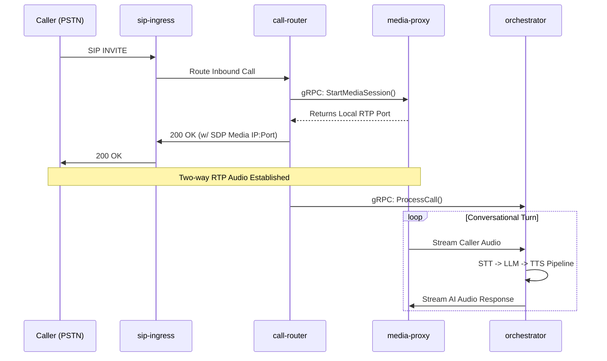
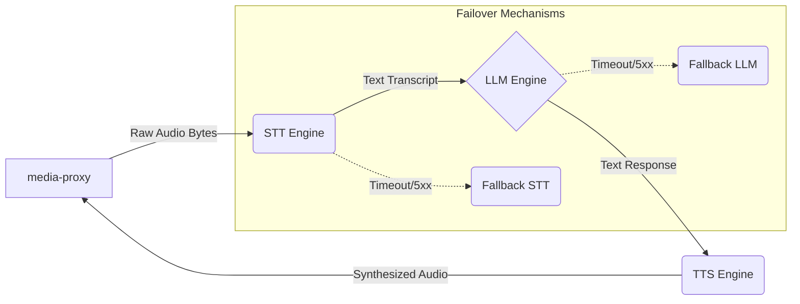

# AI Telephony Platform

Welcome to the **AI Telephony Platform**, a high-performance, event-driven voice and AI orchestration system built in Go. This platform seamlessly bridges traditional SIP telephony with modern AI components (Speech-to-Text, Large Language Models, Text-to-Speech) to facilitate real-time, ultra-low latency conversational AI voice agents.

## Table of Contents
1. [Platform Overview](#1-platform-overview)
2. [Project Structure](#2-project-structure)
3. [Architecture Deep Dive](#3-architecture-deep-dive)
4. [Deployment & Operations](#4-deployment--operations)
5. [Local Development](#5-local-development)

---

## 1. Platform Overview

The platform uses an entirely microservices-based approach. It separates SIP signaling from RTP media streams, ensuring maximum throughput and minimal CPU contention. It features built-in high-availability, fail-open mechanisms for AI providers, and robust observability integrations out-of-the-box.

**Key Technologies:**
- **Language**: Go 1.23+
- **Communication**: gRPC (Internal), REST/JSON (External API)
- **State Management**: Redis (Rate limiting, active calls, distributed locking)
- **Media & SIP**: Custom UDP/RTP handling, ffmpeg, SIP B2BUA logic
- **Infrastructure**: Docker, Kubernetes, Helm, Istio (mTLS & Mesh)

---

## 2. Project Structure

```text
ai-telephony-platform/
├── api/                  # gRPC Protobuf definitions (telephony.proto)
├── cmd/                  # Main entry points for all 7 microservices
├── config/               # Platform configuration files (platform.yaml)
├── deploy/               
│   ├── docker/           # Consolidated multi-stage Dockerfiles
│   ├── helm/             # Kubernetes Helm charts
│   └── scripts/          # PowerShell deployment scripts for local dev
├── docs/                 # OpenAPI/Swagger specifications
├── pkg/                  # Shared Go libraries (auth, router, media, llm, etc.)
└── tests/                # Load tests (k6) and integration tests
```

---

## 3. Architecture Deep Dive

The system consists of **7 distinct microservices**, decoupled to scale independently:

### 3.1 Edge & Ingress
- **`sip-ingress`**: The absolute edge of the telephony network. It binds to UDP/TCP 5060-5063 and terminates inbound SIP trunks from carriers (e.g., Twilio, Plivo, local PBX). It normalizes SIP headers and forwards signaling to the `call-router`.
- **`api-gateway`**: The RESTful entry point for web dashboards, CRM integrations, and administrators. It handles JWT authentication, Redis-backed rate limiting, and exposes WebSocket streams for real-time MOS (Mean Opinion Score) monitoring.

### 3.2 Core Telephony
- **`call-router`**: The brain of the telephony layer. It manages the lifecycle of a call (Ringing, Connected, Transferring) and orchestrates the setup of media sessions.
- **`media-proxy`**: A highly specialized, CPU-intensive service that binds to UDP ports 10000-20000. It negotiates SDP codecs, terminates raw RTP audio packets, and proxies the audio bytes directly into the `orchestrator` via gRPC streams.
- **`transfer-manager`**: Handles complex B2BUA logic and SIP `REFER` commands to smoothly execute Blind and Warm transfers to human agents, injecting AI transcript context into the SIP headers.

### 3.3 AI & Automation
- **`orchestrator`**: The AI conversational engine. It streams audio from the `media-proxy` into an STT (Speech-to-Text) provider, feeds the transcript into an LLM, and streams the LLM's text output into a TTS (Text-to-Speech) provider, sending the resulting audio back to the caller.
- **`campaign-manager`**: The outbound predictive dialer. Uses Erlang C algorithms and Answering Machine Detection (AMD) to aggressively dial contact lists and connect live humans to the `orchestrator`.

### 3.4 Data Flow Diagrams

#### Inbound Call Flow (SIP -> AI -> Audio)



#### AI Pipeline Flow (Inside the Orchestrator)



---

## 4. Deployment & Operations

The platform is designed to be deployed on **Kubernetes** using Helm.

### Deployment Scripts (`deploy/scripts/`)
We provide a suite of PowerShell scripts for rapid local deployment and testing:
- **`build-images.ps1`**: Builds the Docker images using the consolidated files in `deploy/docker/` and loads them into your local Minikube environment.
- **`install-all.ps1`**: A 1-click script to install dependencies (Redis) and apply the Helm charts for all 7 microservices.
- **`run-all.ps1`**: Bootstraps the entire environment from scratch.
- **`install-observability.ps1`**: Installs Prometheus and Grafana for monitoring.

### Containerization
A single, optimized, multi-stage `Dockerfile` is used for all services. Binaries are statically compiled (`CGO_ENABLED=0`), resulting in tiny (~20MB) footprint Alpine images.

---

## 5. Local Development

### Prerequisites
- Go 1.23+
- Docker Desktop
- Minikube
- Helm
- PowerShell

### Getting Started
1. Start your local cluster: `minikube start`
2. Build all Docker images:
   ```powershell
   .\deploy\scripts\build-images.ps1
   ```
3. Deploy the platform:
   ```powershell
   .\deploy\scripts\install-all.ps1
   ```
4. Expose the API Gateway:
   ```powershell
   kubectl port-forward svc/api-gateway 8080:8080
   ```
5. View API Documentation: Navigate to `http://localhost:8080/docs/` in your browser.
