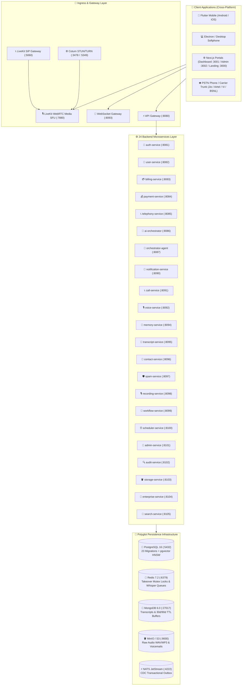

# 🌟 Nexora AI Telephony & Communication Platform — Documentation Master Portal

Welcome to the definitive architectural, operational, and API documentation for the **Nexora AI Telephony & Communication Platform** — an enterprise-grade, polyglot AI Communication Operating System unifying the best of **hiRobin (`hirobin.ai`)** and **Equal AI (`myequal.ai`)**.

---

## 🧭 Platform Master Navigation

```mermaid
graph TD
    Root["📚 Nexora Documentation Portal"]

    Root --> Specs["📚 Central Specifications Library (docs/specs/)"]
    Root --> DB["💾 Database Design Hub (infra/database/design/)"]
    Root --> API["🌐 Complete API Reference (docs/specs/api/)"]

    Specs --> Arch["🏛️ System Architecture (docs/specs/architecture/)"]
    Specs --> Roadmap["🚀 Delivery Roadmap (docs/specs/roadmap/)"]
    Specs --> Study["🧠 Architecture Studies (docs/specs/study/)"]
    Specs --> Diag["🗺️ System Diagrams & ERDs (docs/specs/diagram/)"]
    Specs --> Phases["🚀 9 Delivery Phases (docs/specs/phases/)"]
    Specs --> Sprints["🏃 28 Sprints Engineering Plan (docs/specs/sprints/)"]
    Specs --> Tasks["📋 A–Z Tasks Catalog (docs/specs/task/)"]
    Specs --> Req["📜 Formal Requirements PRD/SRS/TRD (docs/specs/requirements/)"]
    Specs --> Design["🏛️ Subsystem Designs (docs/specs/design/)"]
    Specs --> Help["📖 Help Center & Carrier Guide (docs/specs/architecture/call_forwarding_help_center_and_carrier_guide.md)"]
    Specs --> Walkthrough["🚶 Practical Walkthroughs (docs/specs/walkthrough/)"]
```



---

## 📑 1. Master Documentation & Specifications Index

| Section | Directory / Link | Key Contents |
| :--- | :--- | :--- |
| **Specifications Library** | [**`docs/specs/`**](./specs/README.md) | Centralized specifications master catalog indexing all architecture, roadmaps, studies, APIs, diagrams, phases, sprints, tasks, and designs. |
| **Database Design Hub** | [**`infra/database/design/`**](../infra/database/design/README.md) | 11-spec polyglot persistence blueprint covering PostgreSQL 16 (`pgvector`), MongoDB 6.0, Redis 7.2, CDC outbox, and retention rules. |
| **Master API Reference** | [**`docs/specs/api/`**](./specs/api/README.md) | 13 master API specifications and 6 client application specifications with complete request/response schemas. |
| **hiRobin & Equal AI Architecture** | [**`docs/specs/architecture/hirobin_myequal_unified_telephony_architecture.md`**](./specs/architecture/hirobin_myequal_unified_telephony_architecture.md) | Technical blueprint uniting hiRobin (outbound missions, hold navigation) and Equal AI (inbound screening, live takeover, 9+ languages). |
| **Dual-SIM Failure Rates Index** | [**`docs/specs/architecture/dual_sim_carrier_forwarding_failure_rates.md`**](./specs/architecture/dual_sim_carrier_forwarding_failure_rates.md) | Carrier MMI matrix (Jio, Airtel, Vi, BSNL, AT&T, Verizon, T-Mobile), failure mode mitigation, and 0.0% drop rate benchmark. |
| **AI Call Screening & Missions** | [**`docs/specs/architecture/ai_call_screening_and_outbound_missions.md`**](./specs/architecture/ai_call_screening_and_outbound_missions.md) | Inbound address book screening, live WebRTC streaming, 1-tap takeover, whisper prompt injection, and autonomous IVR/DTMF missions. |
| **Carrier Help Center & Guide** | [**`docs/specs/architecture/call_forwarding_help_center_and_carrier_guide.md`**](./specs/architecture/call_forwarding_help_center_and_carrier_guide.md) | Step-by-step carrier setup, MMI codes reference table, troubleshooting failure modes, VoLTE/VoNR, eSIM, and interactive FAQ. |
| **TCPA & TRAI Compliance & Privacy** | [**`docs/specs/architecture/tcpa_trai_compliance_and_privacy_policy.md`**](./specs/architecture/tcpa_trai_compliance_and_privacy_policy.md) | US TCPA, STIR/SHAKEN, India TRAI DND, EU GDPR, automated PII entity redaction, and zero-retention mode. |
| **2026 Feature Parity Roadmap** | [**`docs/specs/roadmap/hirobin_myequal_nexora_feature_roadmap.md`**](./specs/roadmap/hirobin_myequal_nexora_feature_roadmap.md) | 100% complete feature checklist mapping hiRobin and Equal AI capabilities across Q1–Q4 2026. |
| **Product Requirements (PRD)** | [**`docs/specs/requirements/prd-product-requirements-document.md`**](./specs/requirements/prd-product-requirements-document.md) | PRD covering inbound screening, live takeover, whisper prompt injection, outbound missions, and Dual-SIM forwarding. |
| **Software Requirements (SRS)** | [**`docs/specs/requirements/srs-software-requirements-specification.md`**](./specs/requirements/srs-software-requirements-specification.md) | ISO 29148 SRS specification covering telephony, WebRTC, SIP, DTMF, and multi-agent systems. |
| **Technical Requirements (TRD)** | [**`docs/specs/requirements/trd-technical-requirements-document.md`**](./specs/requirements/trd-technical-requirements-document.md) | Protocol definitions, latency SLAs (<80ms), WebRTC SFU, and failure mitigation. |
| **Real-Time Voice Pipeline Design** | [**`docs/specs/design/realtime-voice-pipeline-design.md`**](./specs/design/realtime-voice-pipeline-design.md) | Subsystem design for sub-80ms voice streaming, WebRTC LiveKit, barge-in takeover audio bridging, and whisper guidance. |
| **24-Microservice Master Architecture & Roadmap** | [**`docs/specs/study/08-microservices-master-architecture-and-roadmap.md`**](./specs/study/08-microservices-master-architecture-and-roadmap.md) | Phased implementation blueprint, port catalog, and MVC clean architecture for all 24 backend microservices. |


---

## 🏛️ 2. High-Level Architecture Overview



---

## 🚀 3. Quick Start & Operational Commands

```bash
# 1. Start all infrastructure services (Postgres, Mongo, Redis, MinIO, NATS, LiveKit, Temporal)
pnpm run dev:infra

# 2. Run all 23 database migrations and load 10 seed datasets
pnpm run db:init:all

# 3. Start monitoring & observability dashboards (Grafana, Prometheus, Loki)
pnpm run dev:monitoring

# 4. Start all applications and microservices
pnpm run dev
```
