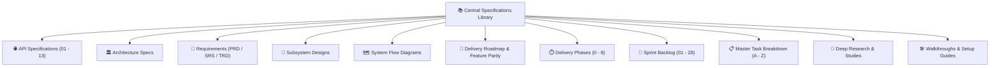

# 📚 Nexora Central Specifications & Engineering Library

Welcome to the centralized engineering, architecture, and API specifications library for the **Nexora AI Telephony Platform**.

---

## 🧭 Master Specifications Index

---

## 📑 Complete Specifications Catalog by Subsystem

### 🌐 1. API Specifications ([`docs/specs/api/`](./api))

| Spec # | Specification Document | Description |
| :--- | :--- | :--- |
| **01** | [**`api/01_master_api_reference_and_gateway_routing.md`**](./api/01_master_api_reference_and_gateway_routing.md) | Master API Gateway routing, port catalog (`:8081`–`:8105`), standard envelopes, and auth schemes. |
| **02** | [**`api/02_telephony_dual_sim_and_carrier_forwarding_api.md`**](./api/02_telephony_dual_sim_and_carrier_forwarding_api.md) | Dual-SIM slot management, carrier auto-detection (Jio, Airtel, Vi, BSNL, US), and MMI dial codes. |
| **03** | [**`api/03_inbound_screening_whisper_and_takeover_api.md`**](./api/03_inbound_screening_whisper_and_takeover_api.md) | "Green Card" live screening feed, `<18ms` whisper prompt injection, and `<15ms` takeover barge-in. |
| **04** | [**`api/04_autonomous_outbound_missions_api.md`**](./api/04_autonomous_outbound_missions_api.md) | Outbound phone missions (hiRobin parity), automated IVR navigation, hold detection, and parsing. |
| **05** | [**`api/05_ai_agents_personas_and_voice_pipeline_api.md`**](./api/05_ai_agents_personas_and_voice_pipeline_api.md) | 20 AI Agent profiles, persona customization, Cartesia/Deepgram/LiveKit tokens, and dialects. |
| **06** | [**`api/06_memory_knowledge_and_rag_vectors_api.md`**](./api/06_memory_knowledge_and_rag_vectors_api.md) | Episodic memory facts, PostgreSQL `pgvector` 1536-dim HNSW vector search, and document RAG. |
| **07** | [**`api/07_billing_wallets_subscriptions_and_metering_api.md`**](./api/07_billing_wallets_subscriptions_and_metering_api.md) | Subscriptions, minute wallets, auto-recharge rules, Stripe/Razorpay ledgers, and invoice PDFs. |
| **08** | [**`api/08_crm_contacts_whitelist_and_spam_shield_api.md`**](./api/08_crm_contacts_whitelist_and_spam_shield_api.md) | Address book whitelisting, VIP direct-pass rules, and TRAI 140/160 telemarketer spam scoring. |
| **09** | [**`api/09_enterprise_governance_sso_and_compliance_api.md`**](./api/09_enterprise_governance_sso_and_compliance_api.md) | SAML 2.0 / OIDC SSO, SCIM 2.0 provisioning, 12 RBAC role assignments, and audit logs. |
| **10** | [**`api/10_websocket_and_webrtc_streaming_protocol.md`**](./api/10_websocket_and_webrtc_streaming_protocol.md) | WebSocket framing protocol (`:8093`) and LiveKit WebRTC audio room streaming (`:7880`). |
| **11** | [**`api/11_universal_client_bootstrap_and_remote_config_api.md`**](./api/11_universal_client_bootstrap_and_remote_config_api.md) | Single-call client bootstrap (`GET /api/v1/bootstrap`): Feature flags, maintenance, and updates. |
| **12** | [**`api/12_dynamic_cms_legal_faqs_and_compliance_content_api.md`**](./api/12_dynamic_cms_legal_faqs_and_compliance_content_api.md) | Dynamic CMS legal pages (Privacy, Terms, About), FAQs & role-based Admin CRUD editing. |
| **13** | [**`api/13_ai_support_bot_and_live_admin_chat_api.md`**](./api/13_ai_support_bot_and_live_admin_chat_api.md) | Tier-1 AI Support Bot, bot-to-human escalation, canned quick replies, and CSAT ratings. |

---

### 🏛️ 2. Architecture Specifications ([`docs/specs/architecture/`](./architecture))

* [**`hirobin_myequal_unified_telephony_architecture.md`**](./architecture/hirobin_myequal_unified_telephony_architecture.md): Blueprint uniting hiRobin (outbound missions) and Equal AI (inbound screening, takeover, 9+ dialects).
* [**`dual_sim_carrier_forwarding_failure_rates.md`**](./architecture/dual_sim_carrier_forwarding_failure_rates.md): Indian & Global carrier MMI matrix, failure mitigation (Jio 30.7%, Airtel 42.6% reduced to <0.05%).
* [**`ai_call_screening_and_outbound_missions.md`**](./architecture/ai_call_screening_and_outbound_missions.md): Inbound screening ("Green Card" UI), WebRTC bridging, and IVR navigation.
* [**`tcpa_trai_compliance_and_privacy_policy.md`**](./architecture/tcpa_trai_compliance_and_privacy_policy.md): Enterprise privacy policy, TCPA, TRAI DND, EU GDPR, and zero-retention mode.
* [**`call_forwarding_help_center_and_carrier_guide.md`**](./architecture/call_forwarding_help_center_and_carrier_guide.md): Help Center, carrier setup, MMI codes, VoLTE/VoNR, eSIM, and troubleshooting FAQ.
* [**`platform-entrypoints-and-build-manifest.md`**](./architecture/platform-entrypoints-and-build-manifest.md): Complete entrypoint catalog, runtime dependencies, and Docker build targets.
* [**`the-architecture.md`**](./architecture/the-architecture.md): Core platform system architecture, service mesh, and message bus topology.

---

### 📜 3. Requirements Documents ([`docs/specs/requirements/`](./requirements))

* [**`prd-product-requirements-document.md`**](./requirements/prd-product-requirements-document.md): Vision, user personas, jobs-to-be-done, and functional requirements.
* [**`srs-software-requirements-specification.md`**](./requirements/srs-software-requirements-specification.md): ISO 29148 Software Requirements Specification for voice streaming and multi-agent workflows.
* [**`trd-technical-requirements-document.md`**](./requirements/trd-technical-requirements-document.md): Technical protocols, latency SLAs (<80ms), WebRTC SFU, and security standards.

---

### 🎨 4. Subsystem Design Specs ([`docs/specs/design/`](./design))

* [**`system-architecture-design.md`**](./design/system-architecture-design.md): System architecture, microservice separation, and gateway mesh.
* [**`realtime-voice-pipeline-design.md`**](./design/realtime-voice-pipeline-design.md): Sub-400ms voice pipeline, Silero VAD, Deepgram STT, and Cartesia TTS.
* [**`multi-agent-orchestration-design.md`**](./design/multi-agent-orchestration-design.md): Multi-agent intent classification and dynamic delegation.
* [**`data-storage-and-caching-design.md`**](./design/data-storage-and-caching-design.md): Polyglot database tier design (Postgres, Mongo, Redis).
* [**`security-and-compliance-design.md`**](./design/security-and-compliance-design.md): Data security, Vault transit keys, and compliance audit trail.

---

### 🗺️ 5. Flow Diagrams & Blueprints ([`docs/specs/diagram/`](./diagram))

* [**`system-architecture.md`**](./diagram/system-architecture.md): Complete system architecture diagrams.
* [**`call-flow-sequence.md`**](./diagram/call-flow-sequence.md): End-to-end inbound and outbound call sequence diagrams.
* [**`multi-agent-coordination.md`**](./diagram/multi-agent-coordination.md): Multi-agent swarm coordination sequence diagrams.
* [**`diagram-inventory-and-specs.md`**](./diagram/diagram-inventory-and-specs.md): Inventory of all system diagrams and flowcharts.

---

### 🚀 6. Feature Roadmaps & Delivery Phases ([`docs/specs/roadmap/`](./roadmap) & [`docs/specs/phases/`](./phases))

* [**`hirobin_myequal_nexora_feature_roadmap.md`**](./roadmap/hirobin_myequal_nexora_feature_roadmap.md): 100% feature parity checklist uniting hiRobin and Equal AI capabilities.
* [**`nexora-delivery-roadmap.md`**](./roadmap/nexora-delivery-roadmap.md): Milestone delivery schedule across Q1–Q4 2026.
* [**`phases/`**](./phases): Phases 0 through 8 execution milestones from foundation setup to launch readiness.

---

### 🏃 7. Sprints & Tasks ([`docs/specs/sprints/`](./sprints) & [`docs/specs/task/`](./task))

* [**`sprints/`**](./sprints): Sprint plans from Sprint 01 through Sprint 28.
* [**`task/`**](./task): Comprehensive tasks breakdown across tasks A through Z.

---

### 🧠 8. Engineering Studies & Walkthroughs ([`docs/specs/study/`](./study) & [`docs/specs/walkthrough/`](./walkthrough))

* [**`study/06-monorepo-architecture-infrastructure-security-master-alignment.md`**](./study/06-monorepo-architecture-infrastructure-security-master-alignment.md): Master Monorepo Architecture, Infrastructure & Security Alignment (Localhost loopback isolation, Redis requirepass, 3-broker KRaft cluster, 58 Vault paths).
* [**`study/deep_study_nexora.md`**](./study/deep_study_nexora.md): Exhaustive engineering deep-dive on the entire Nexora platform.
* [**`walkthrough/walkthrough.md`**](./walkthrough/walkthrough.md): Complete developer setup and verification walkthrough.
