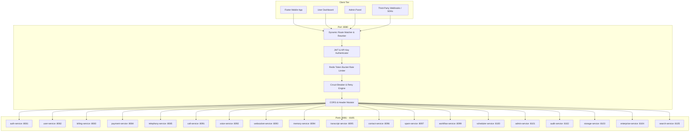

# 01. Master API Reference & Gateway Routing Specification

## 1. Global API Architecture & Gateway Topology

All client requests from the **Flutter Mobile App**, **Next.js User Dashboard**, **Admin Panel**, and **External Enterprise Integrations** pass through the **API Gateway** (`http://localhost:8080` in dev, `https://api.nexora.ai` in production).



---

## 2. Universal Protocol & Standard Headers

### 2.1 Request Headers
```http
Authorization: Bearer <JWT_ACCESS_TOKEN>
x-tenant-id: 11111111-1111-1111-1111-111111111111
x-api-key: nx_live_9a8b7c6d5e4f3a2b1c0987654321
x-correlation-id: req_98fbc182-42ab-41c8-a921-99c019284729
x-client-version: 1.4.0 (android/34)
Content-Type: application/json
```

### 2.2 Standard Success Response Envelope
```json
{
  "success": true,
  "data": {},
  "meta": {
    "requestId": "req_98fbc182-42ab-41c8-a921-99c019284729",
    "timestamp": "2026-08-25T20:00:00.000Z",
    "executionTimeMs": 14
  }
}
```

### 2.3 Standard Error Response Envelope
```json
{
  "success": false,
  "error": {
    "code": "INVALID_MMI_FORMAT",
    "message": "The provided MMI shortcode is not recognized by carrier Jio 5G",
    "details": [
      {
        "field": "activationMmi",
        "issue": "Must match pattern ^\\*004\\*\\+[0-9]{10,15}#$"
      }
    ]
  },
  "meta": {
    "requestId": "req_98fbc182-42ab-41c8-a921-99c019284729",
    "timestamp": "2026-08-25T20:00:00.000Z"
  }
}
```

---

## 3. Gateway Route Mapping & Service Port Catalog

```text
+------------------------------+------------+--------------------+-----------------------+---------------------------------------+
| Route Path Pattern           | Methods    | Target Service     | Target Port           | Auth & Permissions Required           |
+------------------------------+------------+--------------------+-----------------------+---------------------------------------+
| /api/v1/bootstrap             | GET         | api-gateway (cached)| :8080                 | Public / Bearer (Optional)             |
| /api/v1/content/*            | GET         | admin-service (cached)| :8101               | Public / Bearer (Optional)             |
| /api/v1/support/*            | ALL         | admin-service       | :8101                 | Bearer / Public (Chat Sessions)        |
| /api/v1/auth/*               | ALL        | auth-service       | :8081                 | Public / Bearer Token                 |
| /api/v1/users/*              | ALL        | user-service       | :8082                 | Bearer (user:read, user:write)        |
| /api/v1/billing/*            | ALL        | billing-service    | :8083                 | Bearer (billing:*)                    |
| /api/v1/payments/*           | ALL        | payment-service    | :8084                 | Bearer (payment:*)                    |
| /api/v1/telephony/*          | ALL        | telephony-service  | :8085                 | Bearer / API Key (carrier:*, sim:*)   |
| /api/v1/ai/*                 | ALL        | ai-orchestrator    | :8086                 | Bearer (agent:*)                      |
| /api/v1/notifications/*      | ALL        | notification-service| :8090                | Bearer (notification:*)               |
| /api/v1/calls/*              | ALL        | call-service       | :8091                 | Bearer / API Key (call:*)             |
| /api/v1/voice/*              | ALL        | voice-service      | :8092                 | Bearer / LiveKit Token                |
| /api/v1/websocket/*          | ALL        | websocket-service  | :8093                 | Bearer / Connection ID                |
| /api/v1/memory/*             | ALL        | memory-service     | :8094                 | Bearer (memory:*)                     |
| /api/v1/transcripts/*        | ALL        | transcript-service | :8095                 | Bearer (transcript:*)                 |
| /api/v1/contacts/*           | ALL        | contact-service    | :8096                 | Bearer (contact:*)                    |
| /api/v1/spam/*               | ALL        | spam-service       | :8097                 | Bearer (spam:*)                       |
| /api/v1/recordings/*         | ALL        | recording-service  | :8098                 | Bearer (recording:*)                  |
| /api/v1/workflows/*          | ALL        | workflow-service   | :8099                 | Bearer (workflow:*)                   |
| /api/v1/scheduler/*          | ALL        | scheduler-service  | :8100                 | Bearer (schedule:*)                   |
| /api/v1/admin/*              | ALL        | admin-service      | :8101                 | Bearer (superadmin, tenant_admin)     |
| /api/v1/audit/*              | ALL        | audit-service      | :8102                 | Bearer (compliance_officer)           |
| /api/v1/storage/*            | ALL        | storage-service    | :8103                 | Bearer (storage:*)                    |
| /api/v1/enterprise/*         | ALL        | enterprise-service | :8104                 | Bearer (tenant_admin, enterprise:*)   |
| /api/v1/search/*             | ALL        | search-service     | :8105                 | Bearer (search:*)                     |
+------------------------------+------------+--------------------+-----------------------+---------------------------------------+
```
