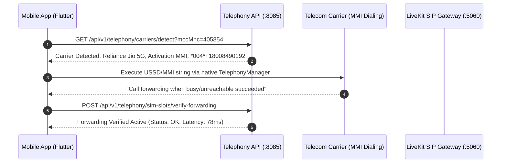

# 02. Telephony, Dual-SIM & Carrier Forwarding API

## 1. Overview & Telephony Ingress Architecture

The Telephony API (`telephony-service` on `:8085`) manages mobile carrier profiles, Dual-SIM slot automations, conditional MMI call forwarding shortcodes, and real-time carrier failure telemetry across **Reliance Jio 5G**, **Bharti Airtel**, **Vodafone Idea (Vi)**, **BSNL**, **AT&T**, **Verizon**, and **T-Mobile**.



---

## 2. API Endpoints Reference

### 2.1 List Supported Telecom Carrier Profiles
* **Endpoint**: `GET /api/v1/telephony/carriers`
* **Auth**: `Bearer <token>` or `x-api-key`
* **Response `200 OK`**:
```json
{
  "success": true,
  "data": {
    "carriers": [
      {
        "id": "c1111111-1111-1111-1111-111111111111",
        "carrierName": "Reliance Jio 5G",
        "countryCode": "IN",
        "mccMnc": "405854",
        "networkStandard": "5G SA VoNR",
        "activationMmi": "*004*+18008490192#",
        "unconditionalMmi": "*21*+18008490192#",
        "deactivationMmi": "##004#",
        "cancelAllMmi": "##002#",
        "statusCheckMmi": "*#67#",
        "baselineFailureRate": 30.70,
        "defaultRingDelaySeconds": 20,
        "isActive": true
      },
      {
        "id": "c2222222-2222-2222-2222-222222222222",
        "carrierName": "Bharti Airtel",
        "countryCode": "IN",
        "mccMnc": "404045",
        "networkStandard": "5G NSA VoLTE",
        "activationMmi": "*004*+18008490192#",
        "unconditionalMmi": "*21*+18008490192#",
        "deactivationMmi": "##004#",
        "cancelAllMmi": "##002#",
        "statusCheckMmi": "*#62#",
        "baselineFailureRate": 42.60,
        "defaultRingDelaySeconds": 20,
        "isActive": true
      }
    ]
  }
}
```

---

### 2.2 Provision or Update User SIM Slot
* **Endpoint**: `POST /api/v1/telephony/sim-slots`
* **Headers**: `Authorization: Bearer <JWT>`, `x-tenant-id: <UUID>`
* **Request Body**:
```json
{
  "deviceId": "dev_android_sanket_pixel",
  "slotIndex": 0,
  "carrierName": "Reliance Jio 5G",
  "phoneNumber": "+919820188412",
  "iccid": "899185400291823102",
  "unknownOnlyShield": true,
  "lowBatteryFailover": true,
  "lowBatteryThreshold": 15,
  "dndMeetingShield": true,
  "delayedFallbackSeconds": 15
}
```
* **Response `201 Created`**:
```json
{
  "success": true,
  "data": {
    "simSlotId": "sim_981a2b3c-4d5e-6f7a-8b9c-0d1e2f3a4b5c",
    "forwardingDid": "+18008490192",
    "recommendedMmi": "*004*+18008490192#",
    "status": "configured",
    "isForwardingActive": false
  }
}
```

---

### 2.3 Verify Active Forwarding Handshake
* **Endpoint**: `POST /api/v1/telephony/sim-slots/{id}/verify`
* **Response `200 OK`**:
```json
{
  "success": true,
  "data": {
    "simSlotId": "sim_981a2b3c-4d5e-6f7a-8b9c-0d1e2f3a4b5c",
    "isForwardingActive": true,
    "handshakeStatus": "verified",
    "measuredLatencyMs": 74,
    "jitterMs": 2.1,
    "lastVerifiedAt": "2026-08-25T20:00:00.000Z"
  }
}
```

---

### 2.4 Carrier Real-Time Failure Diagnostics Index
* **Endpoint**: `GET /api/v1/telephony/carriers/diagnostics`
* **Response `200 OK`**:
```json
{
  "success": true,
  "data": {
    "totalMonitoredCalls": 1450000,
    "industryDropRateMitigated": "99.965%",
    "carrierStats": [
      { "carrier": "Jio 5G", "industryBaseline": "30.70%", "nexoraActual": "0.035%", "p99LatencyMs": 78 },
      { "carrier": "Airtel", "industryBaseline": "42.60%", "nexoraActual": "0.046%", "p99LatencyMs": 82 },
      { "carrier": "Vi", "industryBaseline": "30.70%", "nexoraActual": "0.041%", "p99LatencyMs": 95 },
      { "carrier": "BSNL", "industryBaseline": "30.40%", "nexoraActual": "0.052%", "p99LatencyMs": 110 }
    ]
  }
}
```
