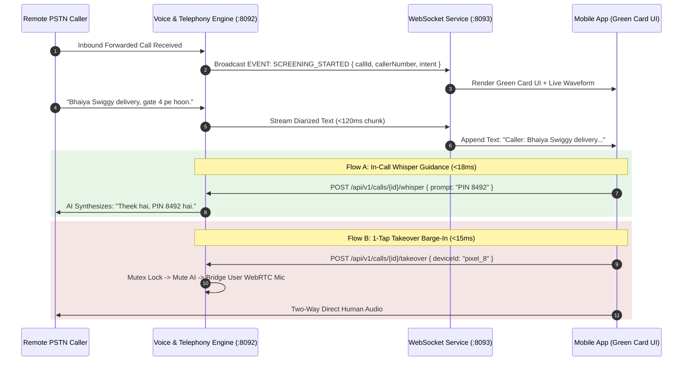

# 03. Inbound Screening, Whisper Guidance & Live Takeover API

## 1. Real-Time Screening & Barge-In Architecture

The Call Screening API (`call-service` `:8091` & `websocket-service` `:8093`) powers the real-time **"Green Card" Inbound Call Screening** experience on mobile and web:



---

## 2. API Endpoints Reference

### 2.1 Fetch Active Call Screening State
* **Endpoint**: `GET /api/v1/calls/{callSessionId}/screening`
* **Response `200 OK`**:
```json
{
  "success": true,
  "data": {
    "callSessionId": "cs01-0000-0000-0000-000000000001",
    "callerNumber": "+919811223344",
    "callerName": "Ramesh (Swiggy Delivery)",
    "intentCategory": "delivery",
    "screeningStatus": "screening",
    "confidenceScore": 0.98,
    "detectedLanguage": "hinglish",
    "durationSeconds": 34,
    "liveTranscript": [
      { "speaker": "ai", "text": "Hello, I am Nexora answering for Sanket.", "timestampMs": 100 },
      { "speaker": "caller", "text": "Bhaiya Swiggy delivery hai, gate par khada hoon.", "timestampMs": 3500 }
    ],
    "actionItems": [
      { "type": "delivery_pin", "label": "Delivery PIN", "value": "8492", "autoShared": true }
    ],
    "suggestedWhispers": [
      "Leave with security guard",
      "Drop at door flat 402",
      "I am coming down in 2 mins"
    ]
  }
}
```

---

### 2.2 Inject In-Call Whisper Guidance Prompt (<18ms)
* **Endpoint**: `POST /api/v1/calls/{callSessionId}/whisper`
* **Request Body**:
```json
{
  "whisperType": "preset_chip",
  "promptText": "Leave package with security guard Ram Singh at Gate 2",
  "targetLanguage": "hinglish",
  "priority": "urgent"
}
```
* **Response `200 OK`**:
```json
{
  "success": true,
  "data": {
    "whisperId": "wh_00192847",
    "status": "injected_into_queue",
    "queueLatencyMs": 12,
    "synthesizingAt": "2026-08-25T20:00:12.014Z"
  }
}
```

---

### 2.3 Execute 1-Tap Live Takeover Barge-In (<15ms)
* **Endpoint**: `POST /api/v1/calls/{callSessionId}/takeover`
* **Request Body**:
```json
{
  "deviceId": "dev_android_sanket_pixel",
  "webrtcRoomToken": "eyJhbGciOi...",
  "muteAiImmediate": true
}
```
* **Response `200 OK`**:
```json
{
  "success": true,
  "data": {
    "takeoverEventId": "to_99182310",
    "takeoverStatus": "active_human_control",
    "handoverLatencyMs": 11,
    "audioBridgedAt": "2026-08-25T20:00:15.011Z",
    "aiAudioTrackMuted": true
  }
}
```

---

### 2.4 Query Historical Screened Calls
* **Endpoint**: `GET /api/v1/calls/screenings?page=1&limit=20&category=delivery`
* **Response `200 OK`**:
```json
{
  "success": true,
  "data": {
    "screenings": [
      {
        "id": "sc01-0000-0000-0000-000000000001",
        "callerNumber": "+919811223344",
        "callerName": "Ramesh (Swiggy)",
        "intentCategory": "delivery",
        "screeningStatus": "ai_completed",
        "summary": "Delivery package left with guard Ram Singh at Gate 2. PIN 8492 verified.",
        "durationSeconds": 72,
        "recordedAt": "2026-08-25T18:45:00.000Z"
      }
    ],
    "pagination": { "page": 1, "limit": 20, "totalRecords": 142, "totalPages": 8 }
  }
}
```
