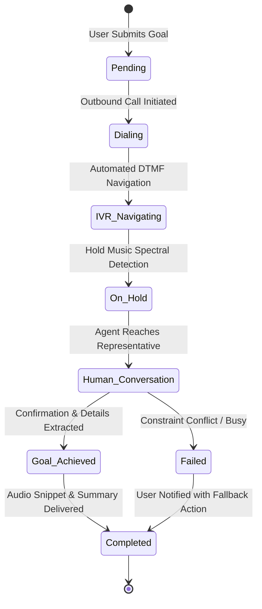

# 04. Autonomous Outbound Missions API (hiRobin Parity)

## 1. Mission Delegator Engine Architecture

The Autonomous Outbound Missions API (`workflow-service` `:8099` & `ai-orchestrator` `:8086`) empowers users to delegate complex real-world phone calling tasks (e.g. restaurant bookings, doctor appointments, airline refunds, customer service escalations) to autonomous AI agents.



---

## 2. API Endpoints Reference

### 2.1 Create Outbound Phone Mission
* **Endpoint**: `POST /api/v1/missions`
* **Headers**: `Authorization: Bearer <token>`, `x-tenant-id: <UUID>`
* **Request Body**:
```json
{
  "missionType": "restaurant_reservation",
  "targetPhoneNumber": "+918041234567",
  "targetBusinessName": "Olive Bistro & Bar",
  "goal": "Book a table for 4 people tonight at 8:00 PM (outdoor seating preferred)",
  "constraints": {
    "partySize": 4,
    "preferredTime": "2026-08-25T20:00:00.000Z",
    "acceptableWindowMins": 30,
    "seating": "outdoor",
    "reservationName": "Sanket",
    "fallbackAction": "Ask for nearest available slot between 7:30 PM and 9:00 PM"
  },
  "voicePersona": {
    "gender": "female",
    "accent": "indian_english",
    "speed": 1.05
  },
  "maxHoldWaitSeconds": 600
}
```
* **Response `201 Created`**:
```json
{
  "success": true,
  "data": {
    "missionId": "msn_7739102",
    "status": "dialing",
    "estimatedCompletionMinutes": 3,
    "createdAt": "2026-08-25T17:30:00.000Z"
  }
}
```

---

### 2.2 Get Real-Time Mission Status & Progress
* **Endpoint**: `GET /api/v1/missions/{missionId}`
* **Response `200 OK`**:
```json
{
  "success": true,
  "data": {
    "missionId": "msn_7739102",
    "missionType": "restaurant_reservation",
    "targetBusinessName": "Olive Bistro & Bar",
    "status": "completed",
    "progressPercent": 100,
    "totalDurationSeconds": 119,
    "holdDurationSeconds": 24,
    "talkDurationSeconds": 95,
    "ivrSteps": [
      { "step": 1, "promptHeard": "Press 1 for Table Reservations", "dtmfSent": "1", "timestampMs": 12000 }
    ],
    "result": {
      "success": true,
      "summary": "Table for 4 successfully booked for tonight at 8:15 PM under Sanket in the outdoor garden area.",
      "confirmationCode": "Table 14 (8:15 PM)",
      "extractedDetails": {
        "time": "2026-08-25T20:15:00.000Z",
        "partySize": 4,
        "section": "Outdoor Garden",
        "hostName": "Vikram"
      },
      "audioSnippetUrl": "https://s3.nexora.ai/recordings/msn_7739102_snippet.mp3"
    },
    "completedAt": "2026-08-25T17:32:15.000Z"
  }
}
```

---

### 2.3 Cancel or Abort In-Flight Mission
* **Endpoint**: `POST /api/v1/missions/{missionId}/cancel`
* **Response `200 OK`**:
```json
{
  "success": true,
  "data": {
    "missionId": "msn_7739102",
    "status": "cancelled",
    "cancelledAt": "2026-08-25T17:31:00.000Z",
    "callTerminated": true
  }
}
```
