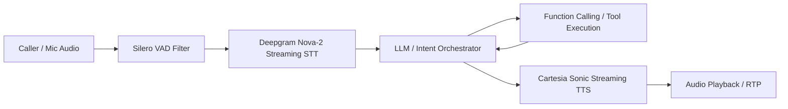

# 05. AI Agents, Personas & Voice Pipeline API

## 1. Agent Swarm & Audio Pipeline Architecture

The AI Orchestrator (`ai-orchestrator` `:8086` & `voice-service` `:8092`) manages **20 specialized autonomous AI agents** alongside an ultra-low latency real-time voice pipeline (<400ms end-to-end):



---

## 2. API Endpoints Reference

### 2.1 List All Available Autonomous AI Agents
* **Endpoint**: `GET /api/v1/ai/agents`
* **Response `200 OK`**:
```json
{
  "success": true,
  "data": {
    "agents": [
      {
        "id": "ag_phone_01",
        "slug": "phone-agent",
        "name": "Phone Assistant",
        "category": "voice",
        "defaultVoiceId": "cartesia_indian_female_01",
        "supportedDialects": ["en-IN", "hi-IN", "hinglish", "ta-IN", "te-IN"],
        "isActive": true
      },
      {
        "id": "ag_delivery_01",
        "slug": "delivery-agent",
        "name": "Delivery & Gate Shield",
        "category": "logistics",
        "defaultVoiceId": "cartesia_indian_male_02",
        "supportedDialects": ["hi-IN", "hinglish", "en-IN"],
        "isActive": true
      }
    ]
  }
}
```

---

### 2.2 Mint LiveKit WebRTC Voice Token with STT/TTS Binding
* **Endpoint**: `POST /api/v1/voice/token`
* **Request Body**:
```json
{
  "roomName": "call_room_cs01",
  "participantIdentity": "user_sanket",
  "agentSlug": "phone-agent",
  "voiceEngine": "cartesia_sonic",
  "sttEngine": "deepgram_nova_2",
  "languageCode": "hinglish"
}
```
* **Response `200 OK`**:
```json
{
  "success": true,
  "data": {
    "livekitToken": "eyJhbGciOi...",
    "livekitUrl": "ws://localhost:7880",
    "roomName": "call_room_cs01",
    "sttSampleRate": 16000,
    "ttsVoiceId": "cartesia_indian_female_01",
    "vadConfidenceThreshold": 0.55
  }
}
```

---

### 2.3 Update Agent Persona & System Instructions
* **Endpoint**: `PUT /api/v1/ai/agents/{agentId}/persona`
* **Request Body**:
```json
{
  "personaName": "Priya (Executive Assistant)",
  "temperature": 0.35,
  "systemInstructions": "You are Priya, an executive assistant for Sanket. Be polite, concise, and professional. Always verify caller identities before sharing scheduling details.",
  "ttsSpeed": 1.05,
  "defaultGreeting": "Hello, this is Priya answering for Sanket. How can I help you today?"
}
```
* **Response `200 OK`**:
```json
{
  "success": true,
  "data": {
    "agentId": "ag_phone_01",
    "updatedAt": "2026-08-25T20:00:00.000Z"
  }
}
```
