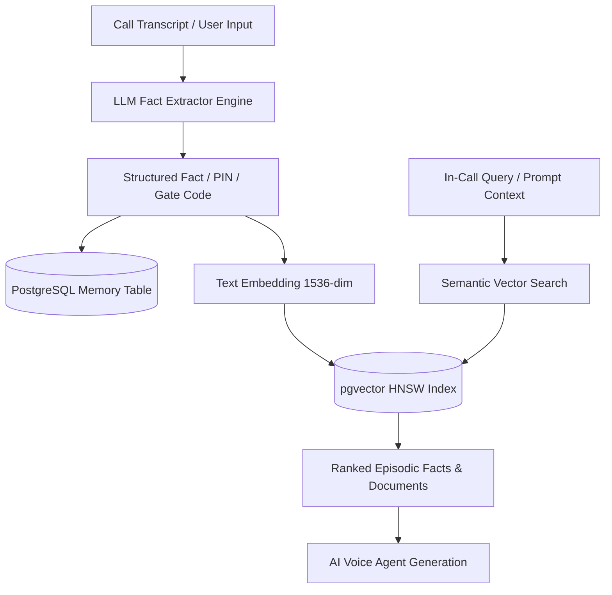

# 06. Memory, Knowledge & RAG Vector Search API

## 1. Hybrid Episodic Memory & Vector Architecture

The Memory & Knowledge subsystem (`memory-service` `:8094` & `search-service` `:8105`) provides persistent AI memory across calls, real-world fact retention, and semantic RAG retrieval powered by **PostgreSQL `pgvector` (HNSW cosine indexes)**:



---

## 2. API Endpoints Reference

### 2.1 Retrieve User Episodic Memory Facts
* **Endpoint**: `GET /api/v1/memory/facts?category=delivery`
* **Response `200 OK`**:
```json
{
  "success": true,
  "data": {
    "facts": [
      {
        "id": "mem_918231",
        "category": "delivery",
        "factKey": "default_delivery_pin",
        "factValue": "8492",
        "confidence": 0.99,
        "isSensitive": true,
        "source": "call_extraction",
        "lastConfirmedAt": "2026-08-25T18:30:00.000Z"
      },
      {
        "id": "mem_918232",
        "category": "logistics",
        "factKey": "society_gate_instructions",
        "factValue": "Pre-approved entry at Gate 2. Guard name Ram Singh.",
        "confidence": 0.95,
        "isSensitive": false,
        "source": "manual_entry",
        "lastConfirmedAt": "2026-08-20T10:00:00.000Z"
      }
    ]
  }
}
```

---

### 2.2 Semantic Vector Search Across Memory & Knowledge
* **Endpoint**: `POST /api/v1/memory/search`
* **Request Body**:
```json
{
  "query": "What is the delivery passcode for groceries?",
  "topK": 3,
  "minSimilarity": 0.78,
  "categoryFilter": ["delivery", "logistics"]
}
```
* **Response `200 OK`**:
```json
{
  "success": true,
  "data": {
    "results": [
      {
        "factKey": "default_delivery_pin",
        "factValue": "8492",
        "similarityScore": 0.924,
        "contextSnippet": "User's standard delivery PIN for Swiggy, Zomato, and Amazon is 8492."
      }
    ]
  }
}
```

---

### 2.3 Create or Upsert Memory Fact
* **Endpoint**: `POST /api/v1/memory/facts`
* **Request Body**:
```json
{
  "category": "medical",
  "factKey": "preferred_doctor",
  "factValue": "Dr. Aditi Sharma at Apollo Cradle (Cardiologist)",
  "isSensitive": false
}
```
* **Response `201 Created`**:
```json
{
  "success": true,
  "data": {
    "factId": "mem_918235",
    "status": "embedded_and_indexed",
    "embeddingDimensions": 1536
  }
}
```
