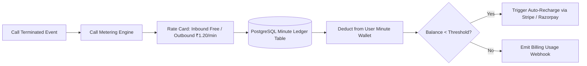

# 07. Billing, Wallets, Subscriptions & Metering API

## 1. Metering & Real-Time Minute Ledger Architecture

The Billing & Payment subsystem (`billing-service` `:8083` & `payment-service` `:8084`) provides precise per-second call metering, automated minute wallet deductions, auto-recharge rules, and payment gateway coordination across **Stripe** and **Razorpay**:



---

## 2. API Endpoints Reference

### 2.1 Fetch User Minute Wallet Balance
* **Endpoint**: `GET /api/v1/billing/wallet`
* **Response `200 OK`**:
```json
{
  "success": true,
  "data": {
    "walletId": "wal_009182",
    "currency": "INR",
    "availableMinutes": 485,
    "cashBalance": 1250.00,
    "autoRechargeEnabled": true,
    "autoRechargeThresholdMinutes": 30,
    "autoRechargeAmount": 500.00,
    "lastRechargedAt": "2026-08-20T12:00:00.000Z"
  }
}
```

---

### 2.2 Create Wallet Top-Up Payment Intent
* **Endpoint**: `POST /api/v1/payments/intent`
* **Request Body**:
```json
{
  "gateway": "razorpay",
  "amount": 500.00,
  "currency": "INR",
  "topUpMinutes": 250
}
```
* **Response `200 OK`**:
```json
{
  "success": true,
  "data": {
    "paymentIntentId": "pi_rzp_991823",
    "orderId": "order_KJh87yT6g5R4e3",
    "amount": 50000,
    "currency": "INR",
    "keyId": "rzp_live_9a8b7c6d5e"
  }
}
```

---

### 2.3 Query Call Usage & Minute Metering Ledger
* **Endpoint**: `GET /api/v1/billing/usage/ledger?startDate=2026-08-01&endDate=2026-08-25`
* **Response `200 OK`**:
```json
{
  "success": true,
  "data": {
    "totalInboundScreenedMinutes": 340,
    "totalOutboundMissionMinutes": 48,
    "totalCost": 57.60,
    "entries": [
      {
        "id": "ledg_102",
        "callSessionId": "cs01-0000-0000-0000-000000000001",
        "callType": "inbound_screening",
        "durationSeconds": 72,
        "billableUnits": 2,
        "ratePerUnit": 0.00,
        "totalDeduction": 0.00,
        "timestamp": "2026-08-25T18:45:00.000Z"
      },
      {
        "id": "ledg_103",
        "missionId": "msn_7739102",
        "callType": "outbound_mission",
        "durationSeconds": 119,
        "billableUnits": 2,
        "ratePerUnit": 1.20,
        "totalDeduction": 2.40,
        "timestamp": "2026-08-25T17:30:00.000Z"
      }
    ]
  }
}
```
