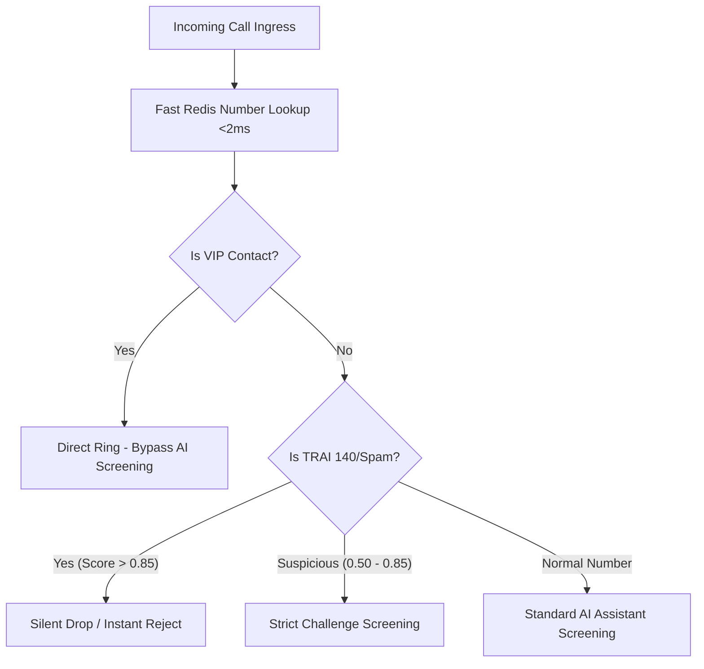

# 08. CRM Contacts, Whitelist & Spam Shield API

## 1. Contact Intelligence & TRAI Spam Shield Architecture

The Contact & Spam subsystem (`contact-service` `:8096` & `spam-service` `:8097`) evaluates every inbound call in under **15 milliseconds**, checking against the user's private address book, VIP direct-pass rules, STIR/SHAKEN verification tokens, and the **TRAI 140/160 Telemarketer Series Database**:



---

## 2. API Endpoints Reference

### 2.1 Fetch User Contacts with Screening Rules
* **Endpoint**: `GET /api/v1/contacts?search=Aditi`
* **Response `200 OK`**:
```json
{
  "success": true,
  "data": {
    "contacts": [
      {
        "id": "cnt_0019284",
        "name": "Dr. Aditi Sharma",
        "phoneNumber": "+919820112233",
        "relationship": "doctor",
        "isVip": true,
        "bypassScreening": true,
        "customGreeting": "Hello Dr. Aditi, Sanket is notified that you are calling.",
        "notes": "Cardiologist at Apollo"
      }
    ]
  }
}
```

---

### 2.2 Configure Whitelist & Direct Pass Rule
* **Endpoint**: `POST /api/v1/contacts/rules`
* **Request Body**:
```json
{
  "phoneNumber": "+919820112233",
  "ruleType": "vip_bypass",
  "action": "ring_immediate",
  "customAgentSlug": null,
  "expiresAt": null
}
```
* **Response `201 Created`**:
```json
{
  "success": true,
  "data": {
    "ruleId": "rul_991823",
    "status": "active_in_redis",
    "phoneNumber": "+919820112233"
  }
}
```

---

### 2.3 Check Number Spam & TRAI DND Reputation Score
* **Endpoint**: `POST /api/v1/spam/lookup`
* **Request Body**:
```json
{
  "phoneNumber": "+911409182310"
}
```
* **Response `200 OK`**:
```json
{
  "success": true,
  "data": {
    "phoneNumber": "+911409182310",
    "spamScore": 0.96,
    "isTraiTelemarketer": true,
    "seriesCategory": "TRAI 140 Telemarketing Series",
    "reputation": "high_risk_robocall",
    "recommendedAction": "silent_block",
    "communityReportsCount": 4210
  }
}
```
