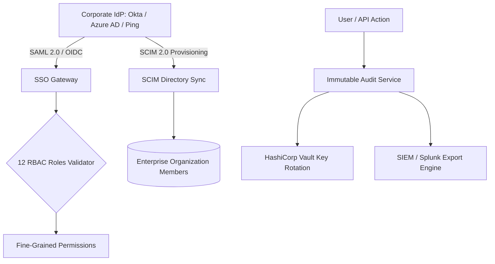

# 09. Enterprise Governance, SSO & Compliance API

## 1. Enterprise Security & Multi-Tenant RBAC Architecture

The Enterprise & Audit subsystem (`enterprise-service` `:8104`, `admin-service` `:8101` & `audit-service` `:8102`) enforces SOC 2, HIPAA, TCPA, and TRAI compliance through **12-Role RBAC hierarchy**, **SCIM 2.0 automated provisioning**, and **SAML/OIDC SSO**:



---

## 2. API Endpoints Reference

### 2.1 Configure SAML 2.0 / OIDC SSO Provider
* **Endpoint**: `POST /api/v1/enterprise/sso`
* **Headers**: `Authorization: Bearer <token>`, `x-tenant-id: <UUID>`
* **Request Body**:
```json
{
  "providerType": "saml",
  "issuerUrl": "https://identity.acme.com",
  "ssoUrl": "https://identity.acme.com/app/saml/sso",
  "x509Certificate": "-----BEGIN CERTIFICATE-----\nMIIDpDCCAoygAwIBAgIG...",
  "enforceSso": true,
  "defaultRoleId": "rol_team_member"
}
```
* **Response `200 OK`**:
```json
{
  "success": true,
  "data": {
    "ssoConfigId": "sso_001928",
    "acsUrl": "https://api.nexora.ai/api/v1/auth/saml/callback",
    "entityId": "https://api.nexora.ai/saml/metadata/acme",
    "status": "configured_and_active"
  }
}
```

---

### 2.2 SCIM 2.0 User Provisioning
* **Endpoint**: `POST /scim/v2/Users`
* **Request Body**:
```json
{
  "schemas": ["urn:ietf:params:scim:schemas:core:2.0:User"],
  "userName": "priya.sharma@acme.com",
  "name": { "givenName": "Priya", "familyName": "Sharma" },
  "emails": [{ "primary": true, "value": "priya.sharma@acme.com" }],
  "active": true
}
```
* **Response `201 Created`**:
```json
{
  "id": "usr_99182310-4d5e-6f7a-8b9c-0d1e2f3a4b5c",
  "userName": "priya.sharma@acme.com",
  "active": true
}
```

---

### 2.3 Query Compliance Audit Trail
* **Endpoint**: `GET /api/v1/audit/logs?eventType=CALL_TRANSCRIPT_VIEWED&page=1&limit=50`
* **Response `200 OK`**:
```json
{
  "success": true,
  "data": {
    "logs": [
      {
        "id": "aud_8819231",
        "actorUserId": "usr_admin_01",
        "action": "CALL_TRANSCRIPT_VIEWED",
        "resourceId": "cs01-0000-0000-0000-000000000001",
        "ipAddress": "192.168.1.100",
        "userAgent": "Mozilla/5.0 (Macintosh; Intel Mac OS X 10_15_7)",
        "redactedPii": true,
        "timestamp": "2026-08-25T19:00:00.000Z"
      }
    ],
    "pagination": { "page": 1, "limit": 50, "totalRecords": 820 }
  }
}
```
