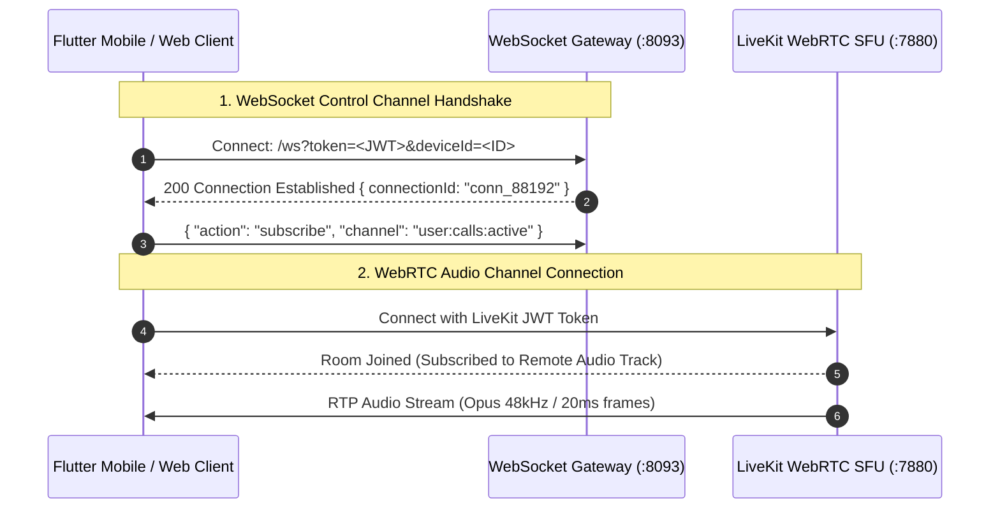

# 10. WebSocket & WebRTC Real-Time Streaming Protocol

## 1. Dual Real-Time Channel Architecture

The platform separates real-time communication into two distinct, high-performance channels:
1. **Control & Signaling Channel (WebSocket)**: Operates on `ws://localhost:8093/ws` (`wss://api.nexora.ai/ws`). Delivers live speech transcripts, whisper ACKs, takeover triggers, and screening events in JSON frames (<20ms).
2. **Media & Voice Channel (WebRTC)**: Operates via **LiveKit WebRTC SFU** on `ws://localhost:7880` (`wss://livekit.nexora.ai`). Streams 48kHz Opus audio packets with sub-100ms round-trip latency.



---

## 2. WebSocket Protocol & Message Framing

### 2.1 Connection Query Parameters
```http
GET /ws?token=eyJhbGciOi...&deviceId=dev_pixel8&tenantId=11111111-1111-1111-1111-111111111111 HTTP/1.1
Host: api.nexora.ai
Upgrade: websocket
Connection: Upgrade
```

### 2.2 Standard Message Envelope
All WebSocket messages are encoded in UTF-8 JSON:
```json
{
  "event": "screening:transcript_chunk",
  "channel": "screening:cs01-0000-0000-0000-000000000001",
  "data": {},
  "timestamp": 1756142400000
}
```

---

## 3. Core Event Catalog

### 3.1 Inbound Call Screening Started (`screening:started`)
* **Payload**:
```json
{
  "event": "screening:started",
  "channel": "user:calls:active",
  "data": {
    "callSessionId": "cs01-0000-0000-0000-000000000001",
    "callerNumber": "+919811223344",
    "callerName": "Ramesh (Swiggy Delivery)",
    "intentCategory": "delivery",
    "webrtcRoom": "call_room_cs01",
    "suggestedWhispers": ["Delivery PIN is 8492", "Leave with guard at Gate 2"]
  }
}
```

---

### 3.2 Live Diarized Speech Chunk (`screening:transcript_chunk`)
* **Payload**:
```json
{
  "event": "screening:transcript_chunk",
  "channel": "screening:cs01-0000-0000-0000-000000000001",
  "data": {
    "speaker": "caller",
    "text": "Bhaiya Swiggy delivery, gate 2 par khada hoon.",
    "isFinal": true,
    "confidence": 0.985,
    "audioTimestampMs": 4200
  }
}
```

---

### 3.3 Whisper Prompt Injected & Queued (`screening:whisper_queued`)
* **Payload**:
```json
{
  "event": "screening:whisper_queued",
  "channel": "screening:cs01-0000-0000-0000-000000000001",
  "data": {
    "whisperId": "wh_00192847",
    "promptText": "Delivery PIN is 8492",
    "queuePosition": 1,
    "status": "synthesizing"
  }
}
```

---

### 3.4 Live Takeover Completed (`screening:takeover_completed`)
* **Payload**:
```json
{
  "event": "screening:takeover_completed",
  "channel": "screening:cs01-0000-0000-0000-000000000001",
  "data": {
    "callSessionId": "cs01-0000-0000-0000-000000000001",
    "takenOverBy": "user_sanket",
    "handoverLatencyMs": 11,
    "aiMuted": true
  }
}
```

---

## 4. Heartbeat & Connection Health
* **Client Ping**: Every 30 seconds, send `{"action": "ping"}`.
* **Server Pong**: Responds immediately with `{"event": "pong", "timestamp": 1756142430000}`.
* **Timeout Threshold**: If no ping is received for 60 seconds, the server terminates the socket to reclaim resources.
