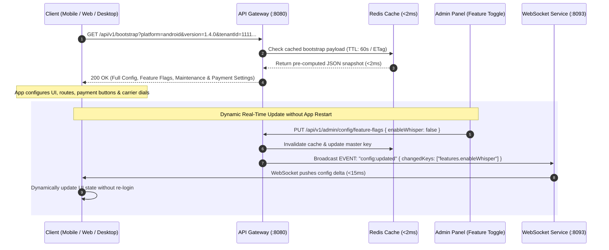

# 11. Universal Client Bootstrap & Remote Configuration API

## 1. Overview & Single-Call Client Initialization Architecture

The **Universal Client Bootstrap API** (`GET /api/v1/bootstrap` or `GET /api/v1/config/client-init`) is the foundational single-call endpoint requested by all client applications (**Flutter Mobile App**, **Next.js User Dashboard**, **Admin Panel**, and **Electron Desktop Softphone**) immediately upon application launch.

It delivers a comprehensive, real-time snapshot containing:
1. **Dynamic Feature Flags** (Enable / Disable features remotely per platform and tenant).
2. **App Versioning & Forced Upgrade Enforcement** (Play Store / App Store / APK direct download).
3. **System Maintenance Mode & Outage Shields** (Graceful downtime banner and service degradation notices).
4. **Payment Gateway & Pricing Configurations** (Razorpay, Stripe, UPI, wallet reload packs, per-minute rates).
5. **Telecom Carrier & Telephony Ingress Config** (MMI code templates, Coturn STUN/TURN credentials, LiveKit endpoints).
6. **AI Voice Personas & Dialect Presets** (Cartesia voices, Deepgram models, speed limits).
7. **Support, Legal & Regulatory Compliance** (TRAI guidelines, terms, privacy, support WhatsApp).



---

## 2. API Endpoints Reference

### 2.1 Fetch Universal Client Bootstrap Configuration
* **Endpoint**: `GET /api/v1/bootstrap`
* **Alternate Route**: `GET /api/v1/config/client-init`
* **Query Parameters**:
  * `platform` *(required, string)*: `android` | `ios` | `web` | `desktop`
  * `version` *(required, string)*: Semantic client version (e.g. `1.4.0`)
  * `buildNumber` *(optional, integer)*: E.g. `42`
  * `carrier` *(optional, string)*: `jio` | `airtel` | `vi` | `bsnl` | `att` | `verizon` | `tmobile`
* **Headers**: `Authorization: Bearer <token>` (optional for public guest bootstrap, required for tenant-specific overrides), `If-None-Match: "<ETAG>"`
* **Response `200 OK`**:
```json
{
  "success": true,
  "data": {
    "systemStatus": {
      "isUnderMaintenance": false,
      "maintenanceTitle": null,
      "maintenanceMessage": null,
      "estimatedDowntimeEnd": null,
      "affectedServices": [],
      "allowedBypassRoles": ["superadmin", "platform_engineer"]
    },
    "appVersionEnforcement": {
      "currentClientVersion": "1.4.0",
      "minimumSupportedVersion": "1.2.0",
      "latestAvailableVersion": "1.4.2",
      "forceUpdateRequired": false,
      "softUpdateRecommended": true,
      "updateTitle": "New AI Voice Dialects Available!",
      "updateMessage": "Version 1.4.2 includes ultra-fast Hinglish Cartesia voice synthesis and 1-tap call takeover improvements.",
      "updateUrls": {
        "googlePlay": "https://play.google.com/store/apps/details?id=com.trideocoders.nexora",
        "appStore": "https://apps.apple.com/app/nexora-ai-telephony/id98123456",
        "directApk": "https://releases.nexora.ai/android/app-release-latest.apk",
        "desktopMac": "https://releases.nexora.ai/desktop/Nexora-1.4.2-arm64.dmg",
        "desktopWindows": "https://releases.nexora.ai/desktop/Nexora-Setup-1.4.2.exe"
      },
      "releaseNotesUrl": "https://nexora.ai/releases/v1-4-2"
    },
    "featureFlags": {
      "enableCallScreening": true,
      "enableWhisperGuidance": true,
      "enableOneTapTakeover": true,
      "enableAutonomousOutboundMissions": true,
      "enableDualSimAutoDetection": true,
      "enableTraiSpamShield": true,
      "enableWebRtcSoftphone": true,
      "enableSocietyGatePassCode": true,
      "enableDeliveryPinAutoShare": true,
      "enableCustomAgentPromptEditing": true,
      "enableVoiceCloning": false,
      "enableCallRecordingTranscription": true,
      "enableMultiLanguageSwitching": true,
      "enableOfflineMmiDialer": true
    },
    "paymentAndPricing": {
      "enabledGateways": ["razorpay", "stripe", "upi"],
      "defaultGateway": "razorpay",
      "activeCurrency": "INR",
      "currencySymbol": "₹",
      "rates": {
        "inboundScreeningPerMinute": 0.00,
        "outboundMissionPerMinute": 1.20,
        "voiceSynthesisPerThousandChars": 0.40,
        "smsNotificationPerUnit": 0.15,
        "whatsappNotificationPerUnit": 0.45
      },
      "walletPresets": [
        { "amount": 200.00, "minutes": 100, "bonusMinutes": 0, "popular": false },
        { "amount": 500.00, "minutes": 250, "bonusMinutes": 25, "popular": true },
        { "amount": 1000.00, "minutes": 500, "bonusMinutes": 75, "popular": false }
      ],
      "minRechargeAmount": 100.00,
      "maxRechargeAmount": 50000.00,
      "taxPercentage": 18.00,
      "gatewayPublicKeys": {
        "razorpayKeyId": "rzp_live_9a8b7c6d5e",
        "stripePublishableKey": "pk_live_51NyT6g5R4e3..."
      }
    },
    "telephonyConfig": {
      "defaultForwardingDid": "+18008490192",
      "sipDomain": "sip.nexora.ai",
      "livekitWsUrl": "wss://livekit.nexora.ai",
      "websocketGatewayUrl": "wss://api.nexora.ai/ws",
      "stunTurnServers": [
        {
          "urls": [
            "stun:turn.nexora.ai:3478",
            "turn:turn.nexora.ai:3478?transport=udp",
            "turns:turn.nexora.ai:5349?transport=tcp"
          ],
          "username": "nexora_client_ephemeral",
          "credential": "turn_token_99182310"
        }
      ],
      "supportedCarriers": [
        { "name": "Reliance Jio 5G", "mccMnc": "405854", "activationMmi": "*004*+18008490192#", "deactivationMmi": "##004#" },
        { "name": "Bharti Airtel", "mccMnc": "404045", "activationMmi": "*004*+18008490192#", "deactivationMmi": "##004#" },
        { "name": "Vodafone Idea (Vi)", "mccMnc": "404020", "activationMmi": "*004*+18008490192#", "deactivationMmi": "##004#" },
        { "name": "BSNL Mobile", "mccMnc": "404034", "activationMmi": "*004*+18008490192#", "deactivationMmi": "##004#" }
      ]
    },
    "aiVoicePresets": {
      "defaultAgentSlug": "phone-agent",
      "defaultVoiceId": "cartesia_indian_female_01",
      "availableVoices": [
        { "id": "cartesia_indian_female_01", "name": "Priya (Indian English / Hindi)", "gender": "female", "sampleAudioUrl": "https://s3.nexora.ai/samples/priya.mp3" },
        { "id": "cartesia_indian_male_02", "name": "Arjun (Indian English / Hindi)", "gender": "male", "sampleAudioUrl": "https://s3.nexora.ai/samples/arjun.mp3" },
        { "id": "cartesia_american_female_01", "name": "Sarah (US English)", "gender": "female", "sampleAudioUrl": "https://s3.nexora.ai/samples/sarah.mp3" }
      ],
      "supportedDialects": [
        { "code": "hinglish", "label": "Hinglish (Hindi + English mix)" },
        { "code": "hi-IN", "label": "Hindi (शुद्ध हिन्दी)" },
        { "code": "en-IN", "label": "Indian English" },
        { "code": "ta-IN", "label": "Tamil (தமிழ்)" },
        { "code": "te-IN", "label": "Telugu (తెలుగు)" },
        { "code": "en-US", "label": "US English" }
      ],
      "ttsSpeedLimits": { "min": 0.80, "max": 1.40, "default": 1.05 }
    },
    "supportAndLegal": {
      "supportEmail": "support@nexora.ai",
      "supportWhatsApp": "+918008490192",
      "helpCenterUrl": "https://help.nexora.ai",
      "privacyPolicyUrl": "https://nexora.ai/privacy",
      "termsOfServiceUrl": "https://nexora.ai/terms",
      "traiDndGuidelinesUrl": "https://nexora.ai/compliance/trai-dnd",
      "callForwardingFailureGuideUrl": "https://nexora.ai/guides/call-forwarding-troubleshooting"
    }
  },
  "meta": {
    "etag": "W/\"bootstrap-cfg-20260825-v140\"",
    "cacheControl": "public, max-age=60, stale-while-revalidate=300",
    "serverTimestamp": "2026-08-25T20:00:00.000Z",
    "executionTimeMs": 2
  }
}
```

---

### 2.2 Update Remote Configuration & Feature Flags (Admin Only)
* **Endpoint**: `PUT /api/v1/admin/config/client-settings`
* **Headers**: `Authorization: Bearer <SUPERADMIN_JWT>`, `x-tenant-id: <UUID>`
* **Request Body**:
```json
{
  "systemStatus": {
    "isUnderMaintenance": false,
    "maintenanceTitle": null,
    "maintenanceMessage": null
  },
  "featureFlags": {
    "enableWhisperGuidance": true,
    "enableVoiceCloning": false
  },
  "appVersionEnforcement": {
    "minimumSupportedVersion": "1.3.0",
    "latestAvailableVersion": "1.4.2",
    "forceUpdateRequired": false
  },
  "paymentAndPricing": {
    "rates": {
      "outboundMissionPerMinute": 1.20
    }
  },
  "broadcastRealtimeUpdate": true
}
```
* **Response `200 OK`**:
```json
{
  "success": true,
  "data": {
    "updatedAt": "2026-08-25T20:01:00.000Z",
    "redisCacheInvalidated": true,
    "webSocketBroadcastCount": 18450
  }
}
```

---

## 3. Client-Side Implementation Guidelines

### 3.1 Mobile App (Flutter) Startup Sequence
```dart
Future<void> initializeAppBootstrap() async {
  final cachedEtag = await storage.read(key: 'bootstrap_etag');
  final response = await http.get(
    Uri.parse('https://api.nexora.ai/api/v1/bootstrap?platform=android&version=1.4.0'),
    headers: {
      if (cachedEtag != null) 'If-None-Match': cachedEtag,
    },
  );

  if (response.statusCode == 304) {
    // Configuration unchanged, use local cache
    return;
  }

  if (response.statusCode == 200) {
    final bootstrap = BootstrapResponse.fromJson(jsonDecode(response.body));
    
    // 1. Check Maintenance
    if (bootstrap.data.systemStatus.isUnderMaintenance) {
      router.go('/maintenance', extra: bootstrap.data.systemStatus);
      return;
    }

    // 2. Check Force Upgrade
    if (bootstrap.data.appVersionEnforcement.forceUpdateRequired) {
      router.go('/force-update', extra: bootstrap.data.appVersionEnforcement);
      return;
    }

    // 3. Register LiveKit WebRTC & STUN/TURN
    LiveKitClient.configureIceServers(bootstrap.data.telephonyConfig.stunTurnServers);

    // 4. Update Feature Flags State Store
    featureFlagsStore.update(bootstrap.data.featureFlags);
  }
}
```
