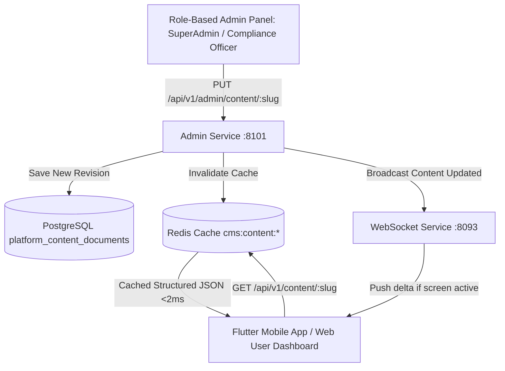

# 12. Dynamic CMS, Legal Pages, FAQs & Compliance Content API

## 1. Overview & DB-Driven Dynamic Content Architecture

To ensure all legal, regulatory, and help documentation (**Privacy Policy**, **Terms & Conditions**, **About Us**, **FAQs**, **Refund Policy**, **Call Forwarding Troubleshooting Guide**, and **TRAI DND Compliance**) remain 100% up to date without requiring mobile app store releases or web deployments:
1. All content is stored in **PostgreSQL** (`platform_content_documents` and `platform_faqs` tables) and cached in **Redis** with sub-2ms response latency.
2. The **Flutter Mobile App**, **Next.js Web Apps**, and **Desktop Softphone** dynamically fetch structured content on demand.
3. The **Admin Panel** provides role-based CRUD editing, revision history, markdown previewing, and one-click publishing with instant cache invalidation.



---

## 2. PostgreSQL Relational Schema

```sql
-- Platform Content Documents (Privacy, Terms, About Us, Refund, Guides)
CREATE TABLE IF NOT EXISTS platform_content_documents (
    id UUID PRIMARY KEY DEFAULT uuid_generate_v4(),
    slug VARCHAR(100) UNIQUE NOT NULL, -- e.g. 'privacy-policy', 'terms-and-conditions', 'about-us'
    title VARCHAR(255) NOT NULL,
    version VARCHAR(20) NOT NULL DEFAULT '1.0.0',
    language VARCHAR(10) NOT NULL DEFAULT 'en',
    summary TEXT,
    sections JSONB NOT NULL DEFAULT '[]', -- Structured array: [{ "heading": "...", "body": "...", "order": 1 }]
    raw_markdown TEXT,
    is_published BOOLEAN DEFAULT TRUE,
    effective_date TIMESTAMPTZ DEFAULT CURRENT_TIMESTAMP,
    last_edited_by UUID REFERENCES users(id),
    published_by UUID REFERENCES users(id),
    created_at TIMESTAMPTZ DEFAULT CURRENT_TIMESTAMP,
    updated_at TIMESTAMPTZ DEFAULT CURRENT_TIMESTAMP
);

-- Platform FAQs
CREATE TABLE IF NOT EXISTS platform_faqs (
    id UUID PRIMARY KEY DEFAULT uuid_generate_v4(),
    category VARCHAR(100) NOT NULL DEFAULT 'general', -- 'call_forwarding', 'pricing', 'ai_agents', 'privacy'
    question TEXT NOT NULL,
    answer TEXT NOT NULL,
    tags TEXT[] DEFAULT '{}',
    display_order INTEGER NOT NULL DEFAULT 0,
    is_published BOOLEAN DEFAULT TRUE,
    view_count INTEGER DEFAULT 0,
    helpful_count INTEGER DEFAULT 0,
    last_edited_by UUID REFERENCES users(id),
    created_at TIMESTAMPTZ DEFAULT CURRENT_TIMESTAMP,
    updated_at TIMESTAMPTZ DEFAULT CURRENT_TIMESTAMP
);

CREATE INDEX idx_content_docs_slug ON platform_content_documents(slug) WHERE is_published = TRUE;
CREATE INDEX idx_faqs_category ON platform_faqs(category, display_order) WHERE is_published = TRUE;
```

---

## 3. Public Client-Side Endpoints Reference

### 3.1 Fetch Specific Legal / CMS Document by Slug
* **Endpoint**: `GET /api/v1/content/{slug}`
* **Allowed Slugs**:
  * `privacy-policy`
  * `terms-and-conditions`
  * `about-us`
  * `refund-policy`
  * `call-forwarding-failure-rates`
  * `trai-dnd-compliance`
  * `security-and-encryption`
* **Query Parameters**:
  * `lang` *(optional, string)*: `en` (default), `hi`
* **Headers**: `If-None-Match: "<ETAG>"`
* **Response `200 OK`**:
```json
{
  "success": true,
  "data": {
    "slug": "privacy-policy",
    "title": "Nexora Privacy Policy",
    "version": "2.1.0",
    "effectiveDate": "2026-08-25T00:00:00.000Z",
    "lastUpdatedAt": "2026-08-25T18:30:00.000Z",
    "summary": "Nexora collects call audio streams and transcripts solely for executing real-time AI functions on your behalf. All data is AES-256 encrypted at rest and TLS 1.3 in transit.",
    "sections": [
      {
        "id": "sec_01",
        "order": 1,
        "heading": "1. Information We Collect",
        "body": "Nexora collects call audio streams, transcripts, and contact identifiers solely for the purpose of executing real-time AI assistant functions on your behalf. We never sell your personal data or conversation recordings.",
        "subsections": [
          {
            "subheading": "1.1 Audio Streams & Transcripts",
            "body": "Audio is processed in memory for live transcription (Deepgram Nova-2) and discarded after processing unless cloud recording is explicitly enabled in Settings."
          },
          {
            "subheading": "1.2 Contact Data & Whitelists",
            "body": "Device contacts are accessed locally to identify callers and execute VIP bypass rules without uploading your entire address book."
          }
        ]
      },
      {
        "id": "sec_02",
        "order": 2,
        "heading": "2. How We Protect Your Data",
        "body": "All audio streams, memory facts, and transcripts are protected by column-level encryption (pgcrypto) and HashiCorp Vault transit engine keys.",
        "subsections": []
      },
      {
        "id": "sec_03",
        "order": 3,
        "heading": "3. AI Processing & Global Model Isolation",
        "body": "Your private calls, delivery PINs, and conversation transcripts are strictly isolated in single-tenant memory partitions and are never used to train public machine learning models.",
        "subsections": []
      },
      {
        "id": "sec_04",
        "order": 4,
        "heading": "4. Your Rights & Data Deletion",
        "body": "You can request the immediate deletion of your account, call recordings, and generated transcripts at any time directly in Settings or by writing to support@nexora.ai.",
        "subsections": []
      }
    ],
    "supportContact": {
      "email": "privacy@nexora.ai",
      "dpoContact": "dpo@nexora.ai",
      "address": "Nexora AI Telephony Inc., Tech Park, Bangalore, India"
    }
  },
  "meta": {
    "etag": "W/\"doc-privacy-policy-v210\"",
    "cacheControl": "public, max-age=300, stale-while-revalidate=3600"
  }
}
```

---

### 3.2 Fetch All Published FAQs with Categorization
* **Endpoint**: `GET /api/v1/content/faqs?category=all`
* **Query Parameters**:
  * `category` *(optional, string)*: `call_forwarding` | `pricing` | `ai_agents` | `privacy` | `all`
  * `search` *(optional, string)*: E.g. `Jio 5G MMI code`
* **Response `200 OK`**:
```json
{
  "success": true,
  "data": {
    "categories": [
      {
        "categoryKey": "call_forwarding",
        "categoryName": "Call Forwarding & MMI Codes",
        "faqs": [
          {
            "id": "faq_01",
            "question": "How do I activate call forwarding on Reliance Jio 5G?",
            "answer": "Open your phone dialer and dial *004*+18008490192# then press Call. You will receive an on-screen confirmation indicating conditional call forwarding is active.",
            "tags": ["jio", "mmi", "forwarding", "setup"],
            "displayOrder": 1,
            "helpfulCount": 1420
          },
          {
            "id": "faq_02",
            "question": "Will I be charged by my telecom carrier for forwarding calls?",
            "answer": "Most Indian carriers (Jio, Airtel, Vi) include call forwarding within standard unlimited voice plans. Check with your carrier for roaming terms.",
            "tags": ["charges", "carrier", "billing"],
            "displayOrder": 2,
            "helpfulCount": 980
          }
        ]
      },
      {
        "categoryKey": "ai_agents",
        "categoryName": "AI Assistant & Live Screening",
        "faqs": [
          {
            "id": "faq_03",
            "question": "Can I take over the call from the AI assistant in real-time?",
            "answer": "Yes! When an incoming call is screened, the Green Card UI provides a 'Take Over' button. Tapping it bridges your microphone directly to the caller in under 15ms.",
            "tags": ["takeover", "green card", "barge-in"],
            "displayOrder": 1,
            "helpfulCount": 2350
          }
        ]
      }
    ]
  }
}
```

---

## 4. Role-Based Admin Panel Endpoints Reference

> [!IMPORTANT]
> Admin CMS endpoints require authentication with role: `superadmin`, `compliance_officer`, `content_manager`, or `tenant_admin`.

### 4.1 Update Document Content & Publish Revision
* **Endpoint**: `PUT /api/v1/admin/content/{slug}`
* **Headers**: `Authorization: Bearer <ADMIN_JWT>`, `x-tenant-id: <UUID>`
* **Request Body**:
```json
{
  "title": "Nexora Privacy Policy",
  "version": "2.2.0",
  "language": "en",
  "summary": "Updated data retention and TRAI DND policy section.",
  "sections": [
    {
      "id": "sec_01",
      "order": 1,
      "heading": "1. Information We Collect",
      "body": "Nexora collects call audio streams, transcripts, and contact identifiers solely for executing real-time AI assistant functions on your behalf.",
      "subsections": []
    }
  ],
  "rawMarkdown": "# Nexora Privacy Policy\n\n## 1. Information We Collect...",
  "publishImmediately": true
}
```
* **Response `200 OK`**:
```json
{
  "success": true,
  "data": {
    "documentId": "doc_99182310",
    "slug": "privacy-policy",
    "version": "2.2.0",
    "isPublished": true,
    "redisCacheInvalidated": true,
    "webSocketEventBroadcasted": "content:privacy-policy:updated",
    "publishedAt": "2026-08-25T20:20:00.000Z"
  }
}
```

---

### 4.2 Create or Update FAQ Item
* **Endpoint**: `POST /api/v1/admin/content/faqs`
* **Request Body**:
```json
{
  "category": "call_forwarding",
  "question": "How do I cancel call forwarding on Bharti Airtel?",
  "answer": "Dial ##004# or ##002# from your phone dialer and tap Call. A message will confirm that all call forwardings have been deactivated.",
  "tags": ["airtel", "deactivation", "mmi"],
  "displayOrder": 3,
  "isPublished": true
}
```
* **Response `201 Created`**:
```json
{
  "success": true,
  "data": {
    "faqId": "faq_099182",
    "category": "call_forwarding",
    "createdAt": "2026-08-25T20:21:00.000Z"
  }
}
```

---

## 5. Flutter Mobile App Integration Example

```dart
// Fetch dynamic Privacy Policy from DB via API with fallback to offline cache
Future<PrivacyPolicyData> loadDynamicPrivacyPolicy() async {
  try {
    final response = await http.get(
      Uri.parse('https://api.nexora.ai/api/v1/content/privacy-policy'),
      headers: {'Accept': 'application/json'},
    );

    if (response.statusCode == 200) {
      final json = jsonDecode(response.body);
      final data = PrivacyPolicyData.fromJson(json['data']);
      
      // Cache locally for offline availability
      await secureStorage.write(key: 'cached_privacy_policy', value: response.body);
      return data;
    }
  } catch (e) {
    debugPrint('Error loading dynamic privacy policy: $e');
  }

  // Fallback to local SQLite / cached storage
  final cached = await secureStorage.read(key: 'cached_privacy_policy');
  if (cached != null) {
    return PrivacyPolicyData.fromJson(jsonDecode(cached)['data']);
  }
  
  return PrivacyPolicyData.hardcodedDefault();
}
```
