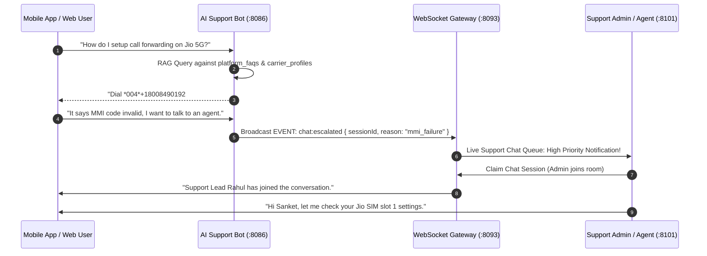

# 13. AI Support Bot & Live Admin Chat API

## 1. Overview & Dual-Tier Customer Support Architecture

The Support subsystem provides an integrated **Tier-1 Autonomous AI Support Bot** and **Tier-2 Human Admin Live Chat Helpdesk**:
1. **Tier-1 AI Support Bot**: Instantly resolves user inquiries regarding MMI codes, carrier forwarding troubleshooting, minute wallet balances, invoice breakdowns, and agent persona configurations using RAG knowledge search.
2. **Tier-2 Human Admin Live Chat**: When the user requests a human agent or the bot detects complex sentiment/refund disputes, the conversation seamlessly escalates to the **Admin Panel Live Chat Helpdesk** (<15ms handover) with full transcript context, caller metadata, and internal agent notes.



---

## 2. PostgreSQL Relational & Audit Schema

```sql
-- Support Chat Sessions
CREATE TABLE IF NOT EXISTS support_chat_sessions (
    id UUID PRIMARY KEY DEFAULT uuid_generate_v4(),
    tenant_id UUID REFERENCES tenants(id) ON DELETE CASCADE,
    user_id UUID REFERENCES users(id) ON DELETE CASCADE,
    status VARCHAR(50) NOT NULL DEFAULT 'bot_active', -- 'bot_active', 'agent_queue', 'agent_active', 'resolved', 'closed'
    assigned_agent_id UUID REFERENCES users(id) ON DELETE SET NULL,
    priority VARCHAR(20) NOT NULL DEFAULT 'medium', -- 'low', 'medium', 'high', 'urgent'
    category VARCHAR(100) DEFAULT 'general', -- 'mmi_forwarding', 'billing', 'voice_quality', 'takeover'
    escalation_reason TEXT,
    first_response_time_seconds INT,
    resolution_time_seconds INT,
    csat_score INT CHECK (csat_score >= 1 AND csat_score <= 5),
    csat_feedback TEXT,
    created_at TIMESTAMPTZ DEFAULT CURRENT_TIMESTAMP,
    updated_at TIMESTAMPTZ DEFAULT CURRENT_TIMESTAMP
);

-- Support Canned Responses (Quick Replies)
CREATE TABLE IF NOT EXISTS support_canned_responses (
    id UUID PRIMARY KEY DEFAULT uuid_generate_v4(),
    tenant_id UUID REFERENCES tenants(id) ON DELETE CASCADE,
    shortcut VARCHAR(50) NOT NULL, -- e.g. '/jio-mmi', '/refund-policy', '/takeover-help'
    title VARCHAR(255) NOT NULL,
    content TEXT NOT NULL,
    category VARCHAR(100) DEFAULT 'general',
    created_by UUID REFERENCES users(id),
    created_at TIMESTAMPTZ DEFAULT CURRENT_TIMESTAMP
);

-- Support Agent Presence
CREATE TABLE IF NOT EXISTS support_agent_presence (
    user_id UUID PRIMARY KEY REFERENCES users(id) ON DELETE CASCADE,
    status VARCHAR(50) NOT NULL DEFAULT 'offline', -- 'online', 'busy', 'away', 'offline'
    active_chat_count INT DEFAULT 0,
    max_concurrent_chats INT DEFAULT 5,
    last_seen_at TIMESTAMPTZ DEFAULT CURRENT_TIMESTAMP
);
```

---

## 3. Client-Side AI Support Bot Endpoints

### 3.1 Initialize or Resume Support Chat Session
* **Endpoint**: `POST /api/v1/support/chat/sessions`
* **Headers**: `Authorization: Bearer <USER_JWT>`, `Content-Type: application/json`
* **Request Body**:
```json
{
  "category": "call_forwarding",
  "initialMessage": "My Jio call forwarding is giving an error.",
  "clientDevice": {
    "platform": "android",
    "carrier": "Reliance Jio 5G",
    "appVersion": "1.4.0"
  }
}
```
* **Response `201 Created`**:
```json
{
  "success": true,
  "data": {
    "sessionId": "chat_ses_99182310",
    "status": "bot_active",
    "botResponse": {
      "messageId": "msg_001",
      "text": "Hello! I am Nexora Support Bot. For Reliance Jio 5G, conditional forwarding requires dialing *004*+18008490192#. If you are seeing an MMI error, would you like me to guide you through manual Android call forwarding settings or connect you with a live human support specialist?",
      "quickReplies": [
        "Show Manual Android Settings",
        "Check SIM Slot 1 Status",
        "Connect to Live Agent"
      ],
      "sentAt": "2026-08-25T20:30:00.000Z"
    }
  }
}
```

---

### 3.2 Send Message to AI Support Bot
* **Endpoint**: `POST /api/v1/support/chat/sessions/{sessionId}/messages`
* **Request Body**:
```json
{
  "text": "Please connect me to a human support agent."
}
```
* **Response `200 OK`**:
```json
{
  "success": true,
  "data": {
    "messageId": "msg_002",
    "status": "escalated_to_human",
    "botResponse": {
      "text": "I have escalated your issue to our live support engineering team. An agent will join this chat in approximately 1-2 minutes.",
      "estimatedWaitSeconds": 90
    }
  }
}
```

---

### 3.3 Submit CSAT Satisfaction Rating
* **Endpoint**: `POST /api/v1/support/chat/sessions/{sessionId}/feedback`
* **Request Body**:
```json
{
  "rating": 5,
  "feedback": "Agent Rahul solved my Jio MMI forwarding problem in 2 minutes! Great support."
}
```
* **Response `200 OK`**:
```json
{
  "success": true,
  "data": {
    "sessionId": "chat_ses_99182310",
    "status": "closed",
    "feedbackRecorded": true
  }
}
```

---

## 4. Role-Based Admin Panel Live Chat Helpdesk Endpoints

> [!IMPORTANT]
> Admin Support APIs require role: `CUSTOMER_SUPPORT`, `SUPPORT_LEAD`, `TENANT_ADMIN`, or `SUPERADMIN`.

### 4.1 Fetch Live Support Chat Queue & Active Sessions
* **Endpoint**: `GET /api/v1/admin/support/chats?status=agent_queue&priority=all`
* **Response `200 OK`**:
```json
{
  "success": true,
  "data": {
    "waitingCount": 3,
    "activeCount": 8,
    "queue": [
      {
        "sessionId": "chat_ses_99182310",
        "userId": "usr_99182310-4d5e-6f7a-8b9c-0d1e2f3a4b5c",
        "userName": "Sanket",
        "userPhone": "+919820188412",
        "carrier": "Reliance Jio 5G",
        "status": "agent_queue",
        "priority": "high",
        "category": "call_forwarding",
        "lastMessage": "MMI code invalid, need help.",
        "waitTimeSeconds": 45,
        "createdAt": "2026-08-25T20:30:00.000Z"
      }
    ]
  }
}
```

---

### 4.2 Claim Chat Session (Human Agent Joins)
* **Endpoint**: `POST /api/v1/admin/support/chats/{sessionId}/claim`
* **Response `200 OK`**:
```json
{
  "success": true,
  "data": {
    "sessionId": "chat_ses_99182310",
    "status": "agent_active",
    "assignedAgent": {
      "id": "usr_agent_rahul",
      "name": "Rahul (Support Lead)",
      "avatarUrl": "https://s3.nexora.ai/avatars/rahul.png"
    },
    "claimedAt": "2026-08-25T20:31:00.000Z"
  }
}
```

---

### 4.3 Send Admin Message or Quick Canned Response
* **Endpoint**: `POST /api/v1/admin/support/chats/{sessionId}/messages`
* **Request Body**:
```json
{
  "text": "Hi Sanket, I see you are on Jio 5G. Let me verify if your VoNR is enabled in phone settings.",
  "isInternalNote": false
}
```
* **Response `200 OK`**:
```json
{
  "success": true,
  "data": {
    "messageId": "msg_adm_003",
    "sentAt": "2026-08-25T20:31:15.000Z",
    "deliveredViaWebSocket": true
  }
}
```

---

### 4.4 Add Private Internal Staff Note
* **Endpoint**: `POST /api/v1/admin/support/chats/{sessionId}/internal-notes`
* **Request Body**:
```json
{
  "note": "User has SIM slot 1 set to Jio and SIM slot 2 on Airtel. Tested call forwarding manually, SIP trunk registered."
}
```
* **Response `201 Created`**:
```json
{
  "success": true,
  "data": {
    "noteId": "note_09912",
    "visibleToCustomer": false,
    "createdAt": "2026-08-25T20:32:00.000Z"
  }
}
```

---

### 4.5 Resolve & Close Support Ticket
* **Endpoint**: `POST /api/v1/admin/support/chats/{sessionId}/resolve`
* **Request Body**:
```json
{
  "resolutionSummary": "Guided user to enable VoLTE/VoNR on device. MMI *004*+18008490192# succeeded.",
  "resolutionCategory": "mmi_resolved",
  "triggerCsatSurvey": true
}
```
* **Response `200 OK`**:
```json
{
  "success": true,
  "data": {
    "sessionId": "chat_ses_99182310",
    "status": "resolved",
    "resolvedAt": "2026-08-25T20:34:00.000Z",
    "totalDurationSeconds": 240
  }
}
```

---

## 5. WebSocket Real-Time Chat Event Catalog

All real-time chat messages stream on `ws://api.nexora.ai/ws` on channel `chat:<sessionId>`:

| Event Name | Direction | Payload Description |
| :--- | :--- | :--- |
| `chat:message_received` | Server → Client | New message from bot, user, or human support agent. |
| `chat:typing_indicator` | Bi-directional | `{ "userId": "...", "isTyping": true }` |
| `chat:agent_joined` | Server → Client | Notification that human agent has claimed session. |
| `chat:bot_escalated` | Server → Admin | Notification to admin queue that user needs assistance. |
| `chat:session_resolved` | Server → Client | Session closed, triggers client CSAT star rating modal. |
