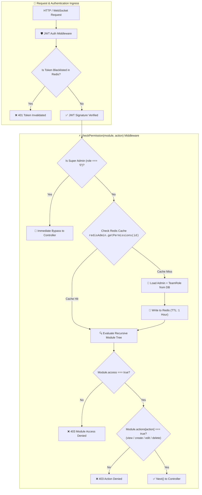

# 🔬 Deep Architectural Study: Enterprise Admin Model & Hierarchical RBAC

This study analyzes the enterprise-grade **Admin Model**, **Recursive Sub-Module Actions**, **Redis Two-Tier Permission Caching**, and **Token Blacklist Security Engine** adapted specifically for the **Nexora AI Telephony & Communication Platform**.

---

## 1. Comparative Architecture Overview



---

## 2. Core Architectural Pillars of the Admin Model

### A. Granular Action-Level Permissions (`permissionActionSchema`)
Instead of binary read/write, every feature in the platform is guarded by atomic CRUD operations:
- `view`: Allows viewing the list, details, and dashboards for the module.
- `create`: Allows provisioning new resources (e.g. creating a new SIP trunk, adding a customer).
- `edit`: Allows updating existing prompts, parameters, or configurations.
- `delete`: Allows removing or purging resources (guarded with confirmation).

```typescript
export interface PermissionActions {
  view: boolean;
  create: boolean;
  edit: boolean;
  delete: boolean;
}
```

---

### B. Recursive Sub-Module Navigation Tree (`subModuleSchema`)
Supports multi-level nested navigation sidebars. A module can contain arbitrary nested child sub-modules, inheriting or overriding specific action flags:

```typescript
export interface AdminSubModule {
  id?: string;
  name: string;
  path?: string;
  icon?: string;
  access: boolean;
  sidebar?: boolean;
  actions: PermissionActions;
  items?: AdminSubModule[]; // Recursive nested children
}

export interface AdminModulePermission {
  id?: string;
  name: string;
  path?: string;
  icon?: string;
  access: boolean;
  sidebar?: boolean;
  actions: PermissionActions;
  subModules?: AdminSubModule[];
}
```

---

### C. Nexora Module & Sub-Module Taxonomy

Adapted for AI Telephony, Voice Agents, and Omnichannel Communications:

| Top-Level Module | Nested Sub-Modules & Capabilities |
| :--- | :--- |
| **`Dashboard`** | `[Live Call Monitor, Real-Time Audio Latency, Daily Volume Meters, Agent Performance Map, Geo Dialing Heatmap]` |
| **`Telephony Manager`** | `[SIP Trunks (TLS/SRTP), DIDs & Numbers, Inbound Route Table, Outbound Trunks, Carrier MOS Quality, Emergency 911/112]` |
| **`Voice AI Platform`** | `[Agent Profiles, Speech Models (Deepgram STT), TTS Engines (Cartesia / ElevenLabs), System Prompts, VAD Speech Thresholds, Latency Benchmarks]` |
| **`Multi-Agent Orchestrator`** | `[20 Specialized Agents, Master Intent Classifier, Warm Transfer Rules, Human Hand-Off Triggers, Agent Escalation Queues]` |
| **`Omnichannel Messaging`** | `[WhatsApp Manager, SMS Broadcasts, Email Campaigns, Push Notifications (APNs/FCM), In-App Messages, Reusable Templates]` |
| **`Model Context Protocol (MCP)`**| `[MCP Server Registry, Local Dynamic Tools, Remote JSON-RPC Bridges, Tool Execution Audit Logs, Timeout Guards]` |
| **`Customer & CRM Manager`** | `[Customer Directory, Call Session Records, Audio Recording S3 Vault, Formatted Transcripts, Customer Facts & Notes, Blocked Phone Numbers]` |
| **`Support & Dispute Manager`** | `[Escalation Tickets, Silent Call Eavesdropping & Whisper, Agent Dispute Review, CSAT & NPS Satisfaction Scores]` |
| **`Marketing & Campaigns`** | `[Voice Call Blasts, Promotional WhatsApp Campaigns, Lead Conversion Funnels, ROI & Spend Metrics, Landing Page Webhooks]` |
| **`Finance & Billing`** | `[Stripe Subscriptions, Tenant Invoices, Pre-Paid Wallet Top-Ups, Cost Margin Analysis, Minute Rate Cards]` |
| **`Team & Roles Management`** | `[Team Member Directory, Custom Team Roles, Recursive Permission Tree, Multi-Device Session Invalidation]` |
| **`Security & Compliance`** | `[Immutable Audit Logs, SOC 2 / HIPAA PGP Exports, Token Blacklist Engine, Two-Factor Authentication, Master Password Safeguards]` |
| **`Settings & Appearance`** | `[System Appearance, Theme Modes (Dark/Light), Custom Branding, Sound FX & Alerts, Webhook Dispatchers]` |

---

## 3. High-Performance Redis Caching & Invalidation Pattern

### A. Two-Tier Caching Flow
1. **Fast Path**: On every incoming request, check `redis.getPermissions(adminId)`. If cached, permissions evaluate in `<0.5ms`.
2. **SuperAdmin Bypass**: If `adminPayload.role === "0"`, bypass permission evaluation immediately.
3. **Cache Miss**: Load role from PostgreSQL / MongoDB, store in Redis with a 3600-second TTL.
4. **Immediate Invalidation**: Whenever a role or user permission is updated (`PATCH /api/v1/admin/roles/:id`), immediately execute:
   ```typescript
   await redis.del(`nexora:admin:perms:${adminId}`);
   // Or invalidate all team members belonging to the role:
   await redis.delPattern(`nexora:admin:perms:*`);
   ```

---

## 4. Multi-Device Token Invalidation & Session Blacklist

To prevent stale tokens after password reset, logout, or privilege revocation:
1. When user logs out or is suspended, token hash is stored in Redis:
   ```text
   SET nexora:blacklist:token:<jwt_hash> "1" EX <token_remaining_ttl_seconds>
   ```
2. Authentication middleware verifies:
   ```typescript
   const isBlacklisted = await redis.exists(`nexora:blacklist:token:${tokenHash}`);
   if (isBlacklisted) {
     return res.status(401).json({ success: false, message: 'Session invalidated. Please login again.' });
   }
   ```

---

## 5. Middleware Implementation for Nexora (`checkPermission.ts`)

```typescript
import { Request, Response, NextFunction } from 'express';
import { redisClient } from '@nexora/database';
import type { AdminModulePermission, PermissionActions } from '@nexora/types';

export function checkPermission(
  moduleName: string,
  action: keyof PermissionActions = 'view'
) {
  return async (req: Request, res: Response, next: NextFunction) => {
    try {
      const admin = (req as any).admin;
      if (!admin) {
        return res.status(401).json({ success: false, error: 'UNAUTHORIZED', message: 'Authentication required' });
      }

      // 1. SuperAdmin (role === '0' or 'superadmin') -> instant bypass
      if (admin.role === '0' || admin.role === 'superadmin') {
        return next();
      }

      const adminId = admin.id || admin._id;
      const cacheKey = `nexora:admin:perms:${adminId}`;

      // 2. Fetch permissions from Redis Cache
      let cached = await redisClient.get(cacheKey);
      let permissions: AdminModulePermission[] = [];

      if (cached) {
        permissions = JSON.parse(cached);
      } else {
        // 3. Fallback: Load from DB & Populate Redis
        permissions = await loadPermissionsFromDb(adminId);
        await redisClient.set(cacheKey, JSON.stringify(permissions), 'EX', 3600);
      }

      // 4. Recursive lookup across modules and nested subModules
      const targetModule = findModuleRecursive(permissions, moduleName);

      if (!targetModule || !targetModule.access) {
        return res.status(403).json({
          success: false,
          error: 'FORBIDDEN',
          message: `Access denied to module '${moduleName}'.`,
        });
      }

      // 5. Verify action permission (view / create / edit / delete)
      if (action && targetModule.actions && !targetModule.actions[action]) {
        return res.status(403).json({
          success: false,
          error: 'FORBIDDEN_ACTION',
          message: `Permission denied to perform '${action}' on module '${moduleName}'.`,
        });
      }

      (req as any).adminPermissions = permissions;
      return next();
    } catch (err) {
      return res.status(500).json({ success: false, error: 'INTERNAL_ERROR', message: 'Permission check failed' });
    }
  };
}

function findModuleRecursive(modules: AdminModulePermission[], name: string): AdminModulePermission | null {
  const norm = name.trim().toLowerCase();
  for (const m of modules) {
    if (m.name.trim().toLowerCase() === norm) return m;
    if (m.subModules && m.subModules.length > 0) {
      const found = findModuleRecursive(m.subModules, name);
      if (found) return found;
    }
  }
  return null;
}
```
