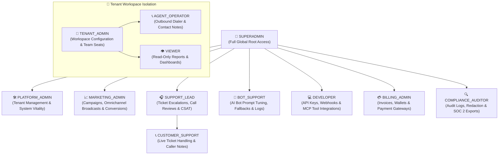

# 🛡️ Nexora Platform — Comprehensive Role-Based Access Control (RBAC) Matrix

This document defines the complete **Role-Based Access Control (RBAC)** architecture, system role hierarchy, and granular permission namespace scopes across SuperAdmin, Tenant Operations, Marketing, Support, Bot Support, and Developer surfaces.

---

## 1. System Roles Hierarchy



---

## 2. Detailed Role Definitions & Responsibilities

| Role Identifier | System Tier | Key Responsibilities |
| :--- | :--- | :--- |
| **`SUPERADMIN`** | Global Platform | Global root control: raw cluster nodes, master database schemas, secret rotations, cross-tenant overrides. |
| **`PLATFORM_ADMIN`** | Global Platform | Tenant lifecycle provisioning, quota adjustments, global carrier SIP trunk health, and AI provider routing. |
| **`MARKETING_ADMIN`** | Platform / Tenant | Omnichannel marketing campaigns (SMS, WhatsApp, Email), promotional templates, lead conversion funnels, landing page tracking. |
| **`SUPPORT_LEAD`** | Global / Tenant | Manages customer support queues, reviews escalated call recordings with audit logs, monitors CSAT/NPS, manages customer dispute tickets. |
| **`CUSTOMER_SUPPORT`** | Workspace | Day-to-day customer issue resolution, caller lookup, contact history notes, ticket updates. |
| **`BOT_SUPPORT`** | Platform / Tenant | AI conversational bot supervision: analyzes low-confidence transcripts, tunes prompt instructions, adjusts VAD speech thresholds, inspects tool execution failures. |
| **`DEVELOPER`** | Platform / Tenant | Technical integration management: creates and rotates API keys, configures webhooks, registers Model Context Protocol (MCP) servers, inspects API logs. |
| **`BILLING_ADMIN`** | Global Platform | Manages Stripe integrations, invoices, wallet credit top-ups, dispute refunds, and revenue analytics. |
| **`COMPLIANCE_AUDITOR`** | Global Platform | Compliance auditing: immutable audit trail access, PII redaction policy checks, SOC 2 / HIPAA encrypted export bundles. |
| **`TENANT_ADMIN`** | Tenant Workspace | Workspace owner: configures AI agent profiles, provisions DIDs, invites team members, manages workspace billing. |
| **`AGENT_OPERATOR`** | Tenant Workspace | Softphone agent: dispatches AI and manual calls, executes warm transfers, edits contact details. |
| **`VIEWER`** | Tenant Workspace | Read-only access to operational dashboards and aggregated reports without edit capabilities. |

---

## 3. Granular Permission Scopes Matrix

| Permission Scope | Scope Description | `SUPER` | `PLATFORM` | `MARKET` | `SUPPORT` | `BOT_SUP` | `DEV` | `BILLING` | `AUDITOR` | `TENANT` | `OPERATOR` | `VIEWER` |
| :--- | :--- | :---: | :---: | :---: | :---: | :---: | :---: | :---: | :---: | :---: | :---: | :---: |
| **Marketing & Campaigns** | | | | | | | | | | | | |
| `campaigns:read` | View marketing campaigns | ✅ | ✅ | ✅ | ❌ | ❌ | ❌ | ❌ | ❌ | ✅ | ❌ | ✅ |
| `campaigns:create` | Launch SMS/WhatsApp broadcasts | ✅ | ❌ | ✅ | ❌ | ❌ | ❌ | ❌ | ❌ | ✅ | ❌ | ❌ |
| `campaigns:analytics` | View conversion & ROI metrics | ✅ | ✅ | ✅ | ❌ | ❌ | ❌ | ✅ | ❌ | ✅ | ❌ | ✅ |
| `templates:manage` | Edit marketing message templates | ✅ | ❌ | ✅ | ❌ | ❌ | ❌ | ❌ | ❌ | ✅ | ❌ | ❌ |
| **Customer Support** | | | | | | | | | | | | |
| `tickets:manage` | Create, update & close tickets | ✅ | ✅ | ❌ | ✅ | ❌ | ❌ | ❌ | ❌ | ✅ | ✅ | ❌ |
| `calls:listen_escalated`| Review flagged call audio | ✅ | ❌ | ❌ | ✅* | ❌ | ❌ | ❌ | ❌ | ✅ | ❌ | ❌ |
| `csat:read` | View customer feedback & NPS | ✅ | ✅ | ✅ | ✅ | ✅ | ❌ | ❌ | ❌ | ✅ | ❌ | ✅ |
| **Bot Support & AI Tuning**| | | | | | | | | | | | |
| `bots:transcripts_audit`| Review bot failure transcripts | ✅ | ✅ | ❌ | ✅ | ✅ | ❌ | ❌ | ❌ | ✅ | ❌ | ❌ |
| `bots:prompts_tune` | Adjust agent system prompts | ✅ | ❌ | ❌ | ❌ | ✅ | ❌ | ❌ | ❌ | ✅ | ❌ | ❌ |
| `bots:fallbacks_manage`| Configure human handoff triggers| ✅ | ✅ | ❌ | ❌ | ✅ | ❌ | ❌ | ❌ | ✅ | ❌ | ❌ |
| `bots:simulate_test` | Run prompt sandbox benchmarks | ✅ | ❌ | ❌ | ❌ | ✅ | ✅ | ❌ | ❌ | ✅ | ❌ | ❌ |
| **Developer & Integrations**| | | | | | | | | | | | |
| `api_keys:manage` | Issue & revoke API tokens | ✅ | ❌ | ❌ | ❌ | ❌ | ✅ | ❌ | ❌ | ✅ | ❌ | ❌ |
| `webhooks:manage` | Configure webhook endpoints | ✅ | ❌ | ❌ | ❌ | ❌ | ✅ | ❌ | ❌ | ✅ | ❌ | ❌ |
| `mcp:servers_manage` | Install & sync MCP servers | ✅ | ❌ | ❌ | ❌ | ❌ | ✅ | ❌ | ❌ | ✅ | ❌ | ❌ |
| `logs:api_inspect` | Debug real-time API latency | ✅ | ✅ | ❌ | ❌ | ❌ | ✅ | ❌ | ❌ | ✅ | ❌ | ❌ |
| **Tenants & Platform** | | | | | | | | | | | | |
| `tenants:manage` | Provision & suspend workspaces | ✅ | ✅ | ❌ | ❌ | ❌ | ❌ | ❌ | ❌ | ❌ | ❌ | ❌ |
| `calls:read_global` | Global active call streams | ✅ | ✅ | ❌ | ✅ | ❌ | ❌ | ❌ | ❌ | ❌ | ❌ | ❌ |
| `billing:invoices_manage`| Invoices, top-ups & refunds | ✅ | ❌ | ❌ | ❌ | ❌ | ❌ | ✅ | ❌ | ✅ | ❌ | ❌ |
| `audit:logs_read` | View tamper-evident logs | ✅ | ✅ | ❌ | ✅ | ❌ | ❌ | ✅ | ✅ | ❌ | ❌ | ❌ |

*\*Note: Support access to listen to call recordings requires an active escalation ticket and logs an immutable audit trail entry.*

---

## 4. JWT Claims Example with Scoped Permissions

```json
{
  "sub": "usr_dev_integration_99",
  "email": "dev.lead@partner.com",
  "role": "DEVELOPER",
  "tenantId": "tenant_enterprise_01",
  "permissions": [
    "api_keys:manage",
    "webhooks:manage",
    "mcp:servers_manage",
    "logs:api_inspect",
    "bots:simulate_test"
  ],
  "mfaVerified": true,
  "iat": 1786980000,
  "exp": 1787066400
}
```
