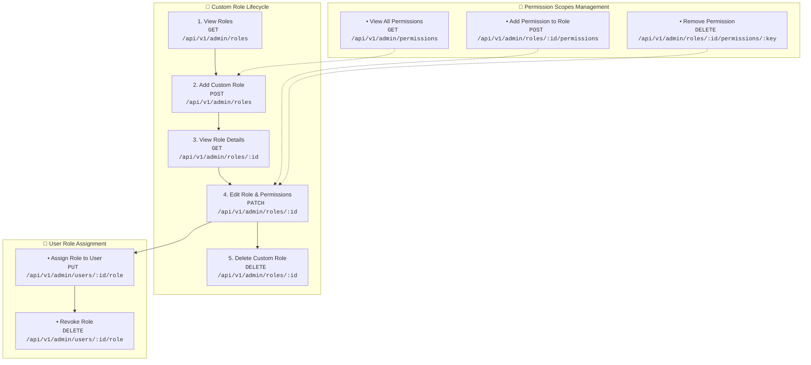

# 🛡️ Roles & Permissions CRUD Management API Reference

This document provides complete instructions and endpoint specifications for **Viewing**, **Adding (Creating)**, **Editing (Updating)**, and **Deleting** Roles and Permissions in the Nexora Admin and Multi-Tenant platform.

---

## 📌 1. Roles & Permissions CRUD Flow



---

## 👥 2. Role Management APIs (CRUD)

### A. View All Roles (`GET /api/v1/admin/roles`)
Retrieves a paginated list of system and custom roles with user counts and permission summaries.
- **Required Roles**: `SUPERADMIN`, `PLATFORM_ADMIN`, `TENANT_ADMIN`
- **Required Scope**: `users:read`

#### Query Parameters:

| Parameter | Type | Required | Default | Description |
| :--- | :--- | :---: | :---: | :--- |
| `page` | `integer` | No | `1` | Page number. |
| `pageSize` | `integer` | No | `20` | Items per page (max: 100). |
| `type` | `string` | No | `all` | Filter: `all`, `system`, `custom`. |
| `tenantId` | `string` | No | - | Filter roles specific to a tenant workspace. |
| `search` | `string` | No | - | Query role name, slug, or description. |

#### Response `200 OK`:
```json
{
  "success": true,
  "statusCode": 200,
  "data": [
    {
      "id": "role_custom_marketing_lead",
      "name": "Senior Campaign Manager",
      "slug": "senior-campaign-manager",
      "description": "Full access to launch voice and SMS broadcasts with daily budget caps.",
      "isSystemRole": false,
      "tenantId": "tenant_enterprise_01",
      "permissions": [
        "campaigns:read",
        "campaigns:create",
        "campaigns:analytics",
        "templates:manage"
      ],
      "userCount": 4,
      "createdAt": "2026-08-15T10:00:00Z",
      "updatedAt": "2026-08-17T14:30:00Z"
    },
    {
      "id": "role_system_superadmin",
      "name": "Super Administrator",
      "slug": "superadmin",
      "description": "Global platform root administrator.",
      "isSystemRole": true,
      "tenantId": null,
      "permissions": ["*"],
      "userCount": 3,
      "createdAt": "2026-01-01T00:00:00Z",
      "updatedAt": "2026-01-01T00:00:00Z"
    }
  ],
  "pagination": {
    "page": 1,
    "pageSize": 20,
    "totalPages": 1,
    "totalCount": 2,
    "hasNextPage": false,
    "hasPrevPage": false
  }
}
```

---

### B. View Single Role Details (`GET /api/v1/admin/roles/:id`)
Fetches complete metadata, permission definitions, and assigned user list for a specific role.

#### Path Parameters:
- `id` (`string`, required): Unique Role ID (e.g. `role_custom_marketing_lead`).

#### Response `200 OK`:
```json
{
  "success": true,
  "statusCode": 200,
  "data": {
    "id": "role_custom_marketing_lead",
    "name": "Senior Campaign Manager",
    "slug": "senior-campaign-manager",
    "description": "Full access to launch voice and SMS broadcasts with daily budget caps.",
    "isSystemRole": false,
    "tenantId": "tenant_enterprise_01",
    "permissions": [
      "campaigns:read",
      "campaigns:create",
      "campaigns:analytics",
      "templates:manage"
    ],
    "assignedUsers": [
      {
        "id": "usr_991823749",
        "name": "Sarah Connor",
        "email": "sarah@acme.com",
        "assignedAt": "2026-08-15T11:00:00Z"
      }
    ],
    "createdAt": "2026-08-15T10:00:00Z",
    "updatedAt": "2026-08-17T14:30:00Z"
  }
}
```

---

### C. Add (Create) New Role (`POST /api/v1/admin/roles`)
Creates a new custom role with specified permission scopes.
- **Required Roles**: `SUPERADMIN`, `PLATFORM_ADMIN`, `TENANT_ADMIN`
- **Required Scope**: `roles:create`

#### Request Body:
```json
{
  "name": "AI Bot Quality Supervisor",
  "description": "Inspects low-confidence bot transcripts and tunes prompt instructions.",
  "tenantId": "tenant_enterprise_01",
  "permissions": [
    "bots:transcripts_audit",
    "bots:prompts_tune",
    "bots:simulate_test",
    "csat:read"
  ]
}
```

#### Response `201 Created`:
```json
{
  "success": true,
  "statusCode": 201,
  "data": {
    "id": "role_bot_quality_supervisor_991",
    "name": "AI Bot Quality Supervisor",
    "slug": "ai-bot-quality-supervisor",
    "description": "Inspects low-confidence bot transcripts and tunes prompt instructions.",
    "isSystemRole": false,
    "tenantId": "tenant_enterprise_01",
    "permissions": [
      "bots:transcripts_audit",
      "bots:prompts_tune",
      "bots:simulate_test",
      "csat:read"
    ],
    "userCount": 0,
    "createdAt": "2026-08-17T16:45:00Z",
    "updatedAt": "2026-08-17T16:45:00Z"
  },
  "message": "Custom role created successfully"
}
```

#### Error Response:
- **`400 Bad Request`** (Invalid permission scope):
  ```json
  {
    "success": false,
    "statusCode": 400,
    "error": "INVALID_PERMISSION_SCOPE",
    "message": "Permission 'invalid_permission_xyz' is not recognized by system."
  }
  ```

---

### D. Edit (Update) Role (`PATCH /api/v1/admin/roles/:id`)
Modifies an existing custom role's title, description, or permission set.
- **Required Roles**: `SUPERADMIN`, `PLATFORM_ADMIN`, `TENANT_ADMIN`
- **Required Scope**: `roles:update`

#### Request Body:
```json
{
  "name": "Senior Bot Quality & Compliance Lead",
  "description": "Inspects bot transcripts and manages fallback triggers to human agents.",
  "permissions": [
    "bots:transcripts_audit",
    "bots:prompts_tune",
    "bots:fallbacks_manage",
    "bots:simulate_test",
    "csat:read"
  ]
}
```

#### Response `200 OK`:
```json
{
  "success": true,
  "statusCode": 200,
  "data": {
    "id": "role_bot_quality_supervisor_991",
    "name": "Senior Bot Quality & Compliance Lead",
    "slug": "senior-bot-quality-compliance-lead",
    "permissions": [
      "bots:transcripts_audit",
      "bots:prompts_tune",
      "bots:fallbacks_manage",
      "bots:simulate_test",
      "csat:read"
    ],
    "updatedAt": "2026-08-17T16:50:00Z"
  },
  "message": "Role updated successfully"
}
```

---

### E. Delete Role (`DELETE /api/v1/admin/roles/:id`)
Deletes a custom role.
- **Safety Safeguards**:
  1. System roles (`isSystemRole: true`) **cannot** be deleted (`403 Forbidden`).
  2. Roles with active assigned users (`userCount > 0`) **cannot** be deleted until users are reassigned (`409 Conflict`).
- **Required Roles**: `SUPERADMIN`, `PLATFORM_ADMIN`, `TENANT_ADMIN`
- **Required Scope**: `roles:delete`

#### Query Parameters:
- `reassignRoleId` (`string`, optional): Automatically reassign all existing users to this fallback role upon deletion.

#### Response `200 OK`:
```json
{
  "success": true,
  "statusCode": 200,
  "data": {
    "id": "role_bot_quality_supervisor_991",
    "deleted": true,
    "reassignedUserCount": 0
  },
  "message": "Custom role deleted successfully"
}
```

---

## 🔑 3. Permissions Management APIs

### A. View All System Permissions (`GET /api/v1/admin/permissions`)
Returns the complete list of system permission keys, categories, and descriptions.

#### Response `200 OK`:
```json
{
  "success": true,
  "statusCode": 200,
  "data": {
    "categories": [
      {
        "category": "marketing",
        "name": "Marketing & Campaigns",
        "permissions": [
          { "key": "campaigns:read", "name": "View Campaigns", "description": "View marketing campaign metrics and schedules." },
          { "key": "campaigns:create", "name": "Create Campaigns", "description": "Launch voice broadcasts and message campaigns." },
          { "key": "campaigns:analytics", "name": "Campaign Analytics", "description": "View ROI, delivery rates, and conversion reports." },
          { "key": "templates:manage", "name": "Manage Templates", "description": "Create and edit message templates." }
        ]
      },
      {
        "category": "ai_bots",
        "name": "AI Bot Support & Tuning",
        "permissions": [
          { "key": "bots:transcripts_audit", "name": "Audit Bot Transcripts", "description": "Review low-confidence and error transcripts." },
          { "key": "bots:prompts_tune", "name": "Tune Bot Prompts", "description": "Modify agent system instructions and tone." },
          { "key": "bots:fallbacks_manage", "name": "Manage Fallbacks", "description": "Configure rules to escalate to human softphone operators." },
          { "key": "bots:simulate_test", "name": "Run Bot Simulations", "description": "Execute prompt test sandboxes and benchmarks." }
        ]
      },
      {
        "category": "developers",
        "name": "Developer & Integrations",
        "permissions": [
          { "key": "api_keys:manage", "name": "Manage API Keys", "description": "Issue, rotate, and revoke cryptographic API tokens." },
          { "key": "webhooks:manage", "name": "Manage Webhooks", "description": "Subscribe to real-time event webhooks." },
          { "key": "mcp:servers_manage", "name": "Manage MCP Servers", "description": "Install, update, and remove Model Context Protocol servers." },
          { "key": "logs:api_inspect", "name": "Inspect API Logs", "description": "View real-time API latency and payload traces." }
        ]
      },
      {
        "category": "support",
        "name": "Customer Support",
        "permissions": [
          { "key": "tickets:manage", "name": "Manage Tickets", "description": "Create, assign, escalate, and resolve customer support tickets." },
          { "key": "calls:listen_escalated", "name": "Listen to Flagged Audio", "description": "Listen to call recordings associated with support disputes." },
          { "key": "csat:read", "name": "View CSAT Scores", "description": "View customer satisfaction and NPS trends." }
        ]
      }
    ]
  }
}
```

---

### B. Add / Attach Permission to Role (`POST /api/v1/admin/roles/:id/permissions`)
Attaches a new permission scope to an existing role.

#### Request Body:
```json
{
  "permissionKey": "campaigns:analytics"
}
```

---

### C. Remove / Revoke Permission from Role (`DELETE /api/v1/admin/roles/:id/permissions/:permissionKey`)
Removes a specific permission scope from a role.

#### Response `200 OK`:
```json
{
  "success": true,
  "statusCode": 200,
  "data": {
    "roleId": "role_custom_marketing_lead",
    "removedPermission": "campaigns:analytics",
    "activePermissions": ["campaigns:read", "campaigns:create", "templates:manage"]
  },
  "message": "Permission revoked from role"
}
```
