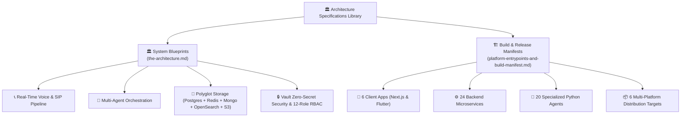

# 🏛️ Nexora System Architecture Specifications Directory

This directory contains the central architectural specifications, polyglot runtime boundaries, system entrypoints, port matrix, and release target configurations for the **Nexora AI Telephony & Communication Platform**.

---

## 📑 Architectural Documents Index

| Specification Document | Focus & Key Contents |
| :--- | :--- |
| [**`the-architecture.md`**](./the-architecture.md) | Definitive System Architecture Blueprint: polyglot runtime partitioning (Go media/telephony, Python LiveKit/AI cognition, Node.js microservices/BFF, Flutter mobile/desktop, Next.js web), real-time call sequence flows, multi-agent orchestration, and polyglot storage architecture. |
| [**`platform-entrypoints-and-build-manifest.md`**](./platform-entrypoints-and-build-manifest.md) | Platform Master Entrypoints Matrix: complete mappings for all 6 applications, 24 microservices (ports `:4000`–`:4020`, `:8085`, `:8086`, `:5060`, `:50051`), 20 specialized Python agents, and multi-platform release artifacts in `.github/release/`. |

---

## 🧭 Architecture Subsystems Map

