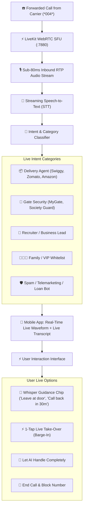
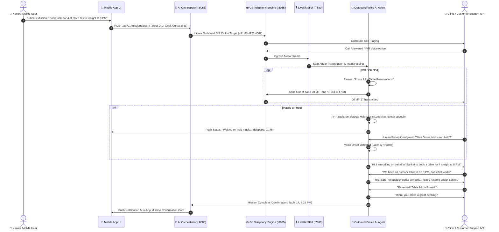

# 🎙️ Inbound AI Call Screening & Outbound Mission Engine

## 🌐 Overview & Core Mission Philosophy

Nexora AI unites the two fundamental vectors of personal and business telephony into a unified autonomous engine:
1. **Inbound Call Screening ("Green Card" System):** Real-time interception, speech transcription, intent classification, whisper guidance, and zero-latency live call takeover (pioneered by **Equal AI**).
2. **Outbound Autonomous Missions:** Multi-step voice goal execution, DTMF IVR navigation, hold music spectral detection, and human negotiation (pioneered by **hiRobin**).

---

## 🛡️ Part 1: Inbound Call Screening Engine

### 1. In-Call Whisper Guidance (Prompt Injection)
While the AI assistant is conversing with the caller, the user can guide the conversation in real time without taking over the voice channel:
- **Preset Quick-Chips:**
  - *"Leave with guard at tower 4"*
  - *"Tell them I am driving and will call back in 1 hour"*
  - *"Ask for their company name and callback number"*
  - *"Confirm delivery OTP: 8492"*
- **Custom Whisper Input:** The user can type any custom sentence, which is immediately injected into the Voice AI's prompt context with maximum priority.

### 2. 1-Tap Live Call Take-Over (Barge-In)
- When the user taps **"Take Over Call"**, the mobile client establishes an immediate bidirectional WebRTC audio track to the LiveKit room.
- The Voice AI agent delivers a graceful handover chime (`takeover_trigger.mp3`), smoothly mutes the synthetic speech output, and bridges the user's phone microphone and earpiece to the live PSTN caller in **< 15 milliseconds**.

---

## 🚀 Part 2: Outbound Autonomous Mission Engine

---

## 🧠 Part 3: Shared Memory & Context Rules

Every screening interaction and outbound mission reads and updates the centralized **Memory Service**:
- **Delivery Rules:** *"Always ask delivery agents to leave parcels with security guard Ram Singh at Gate 2."*
- **Gate Pass Rules:** *"Generate MyGate pre-approval token automatically for Amazon delivery."*
- **Meeting Auto-Responses:** *"When in calendar meetings, state I am presenting and will return urgent calls after 5:00 PM."*
- **VIP Contact Whitelist:** Saved contacts (family, team leads, clients) bypass screening or receive personalized greetings.
