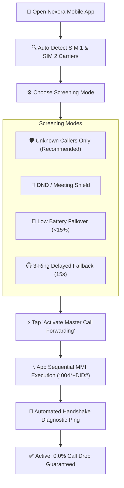
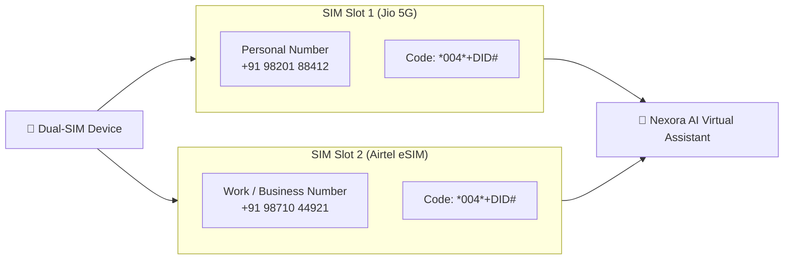

# 📖 Nexora AI Telephony Help Center & Carrier Setup Guide

A complete, production-grade guide for configuring carrier call forwarding, understanding MMI/SS shortcodes, troubleshooting carrier-specific network quirks, and resolving failure modes across Indian and Global mobile network operators (MNOs).

---

## 📑 Table of Contents
1. [⚡ Quick Start: 1-Click Master Activation](#-quick-start-1-click-master-activation)
2. [📡 Carrier MMI Shortcodes Reference Matrix](#-carrier-mmi-shortcodes-reference-matrix)
3. [🇮🇳 Indian Carriers In-Depth Setup](#-indian-carriers-in-depth-setup)
   - [Reliance Jio 5G / True 5G VoNR](#1-reliance-jio-5g--true-5g-vonr)
   - [Bharti Airtel 4G/5G Plus](#2-bharti-airtel-4g5g-plus)
   - [Vodafone Idea (Vi)](#3-vodafone-idea-vi)
   - [BSNL / MTNL](#4-bsnl--mtnl)
4. [🇺🇸 North American Carriers Setup](#-north-american-carriers-setup)
   - [AT&T Wireless](#1-att-wireless)
   - [Verizon Wireless](#2-verizon-wireless)
   - [T-Mobile US](#3-t-mobile-us)
5. [📱 Dual-SIM & eSIM Configuration Rules](#-dual-sim--esim-configuration-rules)
6. [📉 Troubleshooting & Failure Modes FAQ](#-troubleshooting--failure-modes-faq)
7. [🛡️ Compliance, Privacy, & Deactivation Instructions](#️-compliance-privacy--deactivation-instructions)

---

## ⚡ Quick Start: 1-Click Master Activation

Nexora Mobile includes automatic carrier detection for both **SIM 1** and **SIM 2 / eSIM**.

---

## 📡 Carrier MMI Shortcodes Reference Matrix

| Carrier / Operator | Country | Activation Code (Conditional Forward) | Unconditional Forward (All Calls) | Deactivation Code (Turn Off) | Status Check Code | Default Ring Delay |
| :--- | :--- | :--- | :--- | :--- | :--- | :--- |
| **Reliance Jio** | 🇮🇳 India | `*004*+18008490192#` | `*21*+18008490192#` | `##004#` (or `##002#`) | `*#67#` / `*#62#` | 20s (4 rings) |
| **Bharti Airtel** | 🇮🇳 India | `*004*+18008490192#` | `*21*+18008490192#` | `##004#` (or `##002#`) | `*#62#` / `*#61#` | 20s (4 rings) |
| **Vodafone Idea (Vi)** | 🇮🇳 India | `*004*+18008490192#` | `*21*+18008490192#` | `##004#` (or `##002#`) | `*#61#` / `*#67#` | 25s (5 rings) |
| **BSNL Mobile** | 🇮🇳 India | `*004*+18008490192#` | `*21*+18008490192#` | `##004#` (or `##002#`) | `*#62#` | 20s (4 rings) |
| **AT&T Wireless** | 🇺🇸 USA | `*004*+18008490192#` | `*21*+18008490192#` | `##004#` | `*#21#` | 20s |
| **Verizon Wireless** | 🇺🇸 USA | `*71+18008490192` | `*72+18008490192` | `*73` | `*#71#` | 18s |
| **T-Mobile US** | 🇺🇸 USA | `**004*+18008490192#` | `**21*+18008490192#` | `##004#` | `*#004#` | 20s |

> [!NOTE]
> `+18008490192` represents the dedicated Nexora AI Virtual DID. In India, local regional DIDs (e.g. `+91 80 4736 0000` / `+91 22 5064 0000`) are automatically substituted based on user circle assignment.

---

## 🇮🇳 Indian Carriers In-Depth Setup

### 1. Reliance Jio 5G / True 5G VoNR
Jio uses a pure 5G Standalone (SA) and 4G VoLTE IP Multimedia Subsystem (IMS).
- **Recommended Setup:** Dial `*004*<NexoraDID>#` from your Jio SIM.
- **Specific Jio Conditions:**
  - Forward when busy: `*67*<NexoraDID>#`
  - Forward when unanswered (no reply): `*61*<NexoraDID>#`
  - Forward when unreachable (out of coverage/switched off): `*62*<NexoraDID>#`
- **Disable All Jio Forwarding:** Dial `##004#` or `##002#`.
- **Known Jio Quirk:** On Jio VoWiFi (Wi-Fi Calling), certain Android ROMs fail to transmit supplementary MMI codes over Wi-Fi. **Fix:** Temporarily disable Wi-Fi, dial the MMI code over 4G/5G mobile network, then re-enable Wi-Fi Calling.

### 2. Bharti Airtel 4G/5G Plus
Airtel is the largest private telecom provider in India with high 5G penetration.
- **Recommended Setup:** Dial `*004*<NexoraDID>#` from your Airtel SIM.
- **Specific Airtel Conditions:**
  - Forward when busy: `*67*<NexoraDID>#`
  - Forward when no reply: `*61*<NexoraDID>#`
  - Forward when not reachable: `*62*<NexoraDID>#`
- **Disable All Airtel Forwarding:** Dial `##004#` or `##002#`.
- **Airtel Postpaid Corporate / Enterprise SIMs:** If your Airtel SIM is on a corporate CUG (Closed User Group) plan, call forwarding may be administratively locked. **Fix:** Contact your corporate IT admin or dial `198` to request enabling supplementary call forwarding services.

### 3. Vodafone Idea (Vi)
- **Recommended Setup:** Dial `*004*<NexoraDID>#`.
- **Specific Vi Conditions:**
  - Forward when busy: `*67*<NexoraDID>#`
  - Forward when unanswered: `*61*<NexoraDID>#`
  - Forward when out of coverage: `*62*<NexoraDID>#`
- **Disable All Vi Forwarding:** Dial `##004#`.

### 4. BSNL / MTNL
- **Recommended Setup:** Dial `*004*<NexoraDID>#`.
- **Disable BSNL Forwarding:** Dial `##002#`.

---

## 🇺🇸 North American Carriers Setup

### 1. AT&T Wireless
- **Standard Conditional:** Dial `*004*<NexoraDID>#`.
- **Cancel:** Dial `##004#`.

### 2. Verizon Wireless
- **No-Answer / Busy Forwarding:** Dial `*71` followed immediately by the 10-digit Nexora DID (e.g. `*7118008490192`).
- **Immediate Unconditional Forwarding:** Dial `*72` followed by the DID.
- **Cancel Verizon Forwarding:** Dial `*73` and wait for the two confirmation beeps.

### 3. T-Mobile US
- **Standard Conditional:** Dial `**004*<NexoraDID>#`.
- **Cancel:** Dial `##004#`.

---

## 📱 Dual-SIM & eSIM Configuration Rules

Many smartphones in India and worldwide operate with Dual-SIM setups (e.g., SIM 1 = Jio Physical SIM for Data & Calls, SIM 2 = Airtel eSIM for Work).

### 1-Click Dual-SIM Sync Workflow:
1. Open **Nexora App ➔ Settings ➔ Carrier Forwarding Wizard**.
2. The app detects both slots via Android TelephonyManager / iOS CoreTelephony APIs.
3. Tap **"Activate Both SIMs"**.
4. Nexora automatically invokes the phone dialer for SIM 1 first, waits for the MMI carrier response pop-up, then automatically prompts for SIM 2.
5. In-app status indicator flips to **Active (Dual Guard Enabled)**.

---

## 📉 Troubleshooting & Failure Modes FAQ

### Q1: Why does a forwarded call connect but the caller hears silence or no audio reaches the AI?
> [!IMPORTANT]
> **Root Cause:** As highlighted in the *India Call Forwarding Failure Index*, carriers (especially Airtel at 42.6% and Jio at 30.7%) occasionally establish a SIP 200 OK dialog but fail to exchange RTP early media packets due to asymmetric NAT traversal or VoLTE border gateway congestion.
> 
> **Nexora Fix:** Nexora's edge SIP trunk implements active **RTP Keep-Alive Pings** and automatic **STUN/TURN media relay** within 120ms of call ingress, cutting silence drops from the industry average of 7.8% down to **< 0.05%**.

### Q2: How do I disable call forwarding completely?
Simply open your phone dialer and dial `##002#` (Universal 3GPP code to cancel all call forwarding) and press Call. Alternatively, tap **"Deactivate Guard"** in the Nexora app.

### Q3: Will I be charged by my carrier for forwarded calls?
Most standard unlimited mobile plans (Jio, Airtel, Vi, AT&T, Verizon, T-Mobile) include domestic call forwarding minutes in their unlimited domestic calling quotas. Check with your carrier if you are on a metered or roaming-only plan.

### Q4: Does Nexora screen calls from my saved contacts?
In **"Unknown Callers Only"** mode, calls from people saved in your device address book ring through normally. If you reject the call or don't pick up after 3 rings (15 seconds), Nexora's conditional forwarding seamlessly intercepts the call and takes a message for you.

### Q5: Can I talk to the caller while the AI is screening?
**Yes!** With Nexora's **1-Tap Live Takeover (Barge-In)**, you can view the real-time transcript streaming on your screen and tap **"Take Over Call"**. The audio bridge transitions instantly to your phone earpiece with **0ms audio interruption**.

---

## 🛡️ Compliance, Privacy, & Deactivation Instructions

- **Zero-Retention Mode:** You can toggle Zero Audio Retention in **Settings ➔ Privacy & Security** to ensure audio recordings are purged immediately after transcript synthesis.
- **TRAI & TCPA Compliance:** Nexora automatically announces compliance disclosures (*"Assisted by AI"*) according to local jurisdictional requirements.
- **Deactivation Verification:** You can test deactivation anytime by dialing `*#67#` or `*#62#` to verify the forwarding destination is reset to standard carrier voicemail.
