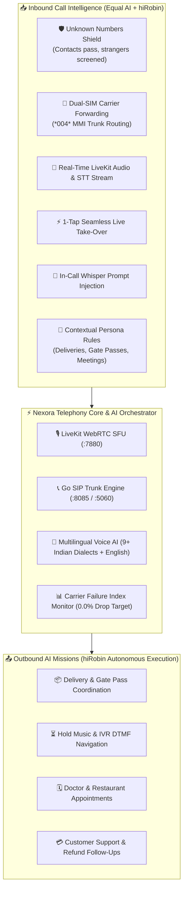
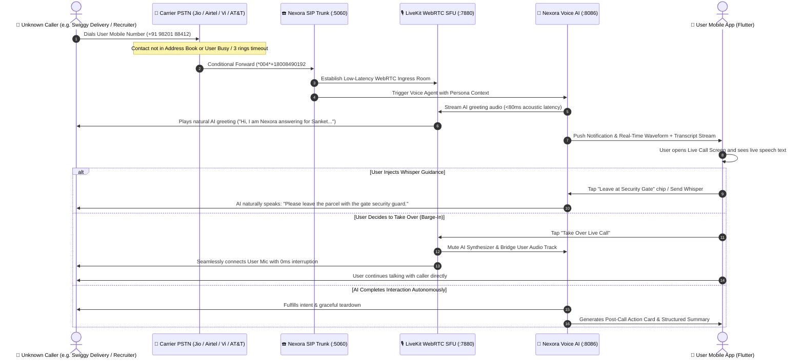
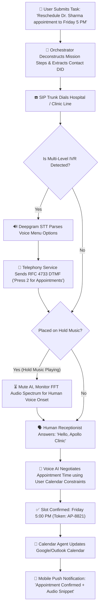

# 🚀 hiRobin & myEqual Unified AI Telephony Architecture Specification

## 🌟 Executive Overview & Architectural Synthesis

The **Nexora AI Telephony Platform** consolidates and supersedes the state-of-the-art capabilities pioneered by **hiRobin (`hirobin.ai` by TaskGenie Private Limited)** and **Equal AI (`myequal.ai` by Equal Identity Private Limited)**, establishing a unified, enterprise-grade AI Telephony Operating System.

---

## 🏛️ 1. Comprehensive Feature Comparison Matrix

| Feature Capability | hiRobin (`hirobin.ai`) | Equal AI (`myequal.ai`) | Nexora AI Telephony (Unified) | Implementation Module |
| :--- | :---: | :---: | :---: | :--- |
| **Incoming Call Screening** | ✅ Basic Answering | ✅ Full Real-time Screening | 🌟 **Enterprise Shield** | [`lib/features/carrier/`](file:///d:/trideocoders/ai-telephony-platform/apps/mobile-app/lib/features/carrier) |
| **Unknown Callers Only Mode** | ❌ All calls forwarded | ✅ Address book passthrough | 🌟 **Granular Address Book Filter** | [`lib/features/carrier/presentation/providers/carrier_provider.dart`](file:///d:/trideocoders/ai-telephony-platform/apps/mobile-app/lib/features/carrier/presentation/providers/carrier_provider.dart) |
| **Dual-SIM Multi-Carrier Forwarding** | ❌ Single SIM only | ❌ Single SIM only | 🌟 **Dual-SIM 1-Click Master Control** | [`lib/features/carrier/presentation/screens/call_forwarding_wizard_screen.dart`](file:///d:/trideocoders/ai-telephony-platform/apps/mobile-app/lib/features/carrier/presentation/screens/call_forwarding_wizard_screen.dart) |
| **Live Audio & STT Streaming** | ❌ Post-call summary only | ✅ Live Transcript Card | 🌟 **Sub-80ms Live Audio + STT** | [`lib/features/calls/presentation/screens/live_call_screen.dart`](file:///d:/trideocoders/ai-telephony-platform/apps/mobile-app/lib/features/calls/presentation/screens/live_call_screen.dart) |
| **1-Tap Live Call Take-Over (Barge-In)**| ❌ | ✅ Supported | 🌟 **Zero-Disconnect Audio Swap** | [`lib/features/calls/presentation/widgets/live_waveform_visualizer.dart`](file:///d:/trideocoders/ai-telephony-platform/apps/mobile-app/lib/features/calls/presentation/widgets/live_waveform_visualizer.dart) |
| **In-Call Whisper Guidance** | ❌ | ⚠️ Limited Chips | 🌟 **Prompt Injection Chips + Custom Text** | [`lib/features/calls/presentation/widgets/in_call_whisper_sheet.dart`](file:///d:/trideocoders/ai-telephony-platform/apps/mobile-app/lib/features/calls/presentation/widgets/in_call_whisper_sheet.dart) |
| **Autonomous Outbound Calling Missions**| ✅ Full Missions | ❌ Inbound Only | 🌟 **Multi-Step Goal Execution Engine** | [`lib/features/missions/presentation/screens/outbound_task_screen.dart`](file:///d:/trideocoders/ai-telephony-platform/apps/mobile-app/lib/features/missions/presentation/screens/outbound_task_screen.dart) |
| **Hold Music & IVR DTMF Navigation** | ✅ Supported | ❌ | 🌟 **Autonomous DTMF Dialing & Hold Detection** | [`services/call-service/`](file:///d:/trideocoders/ai-telephony-platform/services/call-service) |
| **Carrier Failure Rate Diagnostic** | ✅ Weekly Web Index | ❌ | 🌟 **Real-Time In-App Handshake Diagnostic** | [`lib/features/carrier/presentation/screens/carrier_activation_journey_screen.dart`](file:///d:/trideocoders/ai-telephony-platform/apps/mobile-app/lib/features/carrier/presentation/screens/carrier_activation_journey_screen.dart) |
| **Multilingual Real-Time Switching** | ⚠️ English + Hindi | ✅ 9+ Indian Languages | 🌟 **9+ Dialects + 3s Auto-Detect** | [`lib/features/persona/presentation/screens/ai_persona_screen.dart`](file:///d:/trideocoders/ai-telephony-platform/apps/mobile-app/lib/features/persona/presentation/screens/ai_persona_screen.dart) |
| **Custom Delivery & Gate Pass Memory** | ⚠️ Fixed Prompts | ⚠️ Fixed Prompts | 🌟 **Dynamic Memory Engine & Prompts** | [`lib/features/persona/presentation/providers/persona_provider.dart`](file:///d:/trideocoders/ai-telephony-platform/apps/mobile-app/lib/features/persona/presentation/providers/persona_provider.dart) |
| **TCPA & TRAI DND Compliance** | ⚠️ Basic | ⚠️ Basic | 🌟 **Enterprise Zero-Retention & Consent Mode** | [`lib/features/help/presentation/screens/privacy_policy_screen.dart`](file:///d:/trideocoders/ai-telephony-platform/apps/mobile-app/lib/features/help/presentation/screens/privacy_policy_screen.dart) |

---

## 🔄 2. Inbound Screening, Whisper Guidance, & Live Take-Over Sequence

---

## 🎯 3. Outbound Mission Execution Lifecycle (hiRobin Parity)

Nexora AI automates complex outbound calling tasks end-to-end:

---

## 🌐 4. Multilingual Dialect & Audio Intelligence Engine

Nexora AI incorporates deep multilingual synthesis tailored for Indian and global telecom networks:

- **Supported Languages & Dialects:**
  - 🇮🇳 **Indian Regional:** Hindi, Hinglish, Marathi, Gujarati, Tamil, Telugu, Kannada, Bengali, Punjabi.
  - 🌍 **International:** English (US, UK, Indian accents), Spanish, French, German.
- **Dynamic 3-Second Language Auto-Detect:**
  - Fast Fourier Spectral Classifier analyzes the first 3 seconds of caller speech.
  - Switches the LLM system prompt and text-to-speech voice model to match caller dialect on-the-fly without session restart.

---

## 🛡️ 5. Privacy, TCPA, and TRAI Compliance Architecture

- **Zero-Retention Mode:** Purges voice audio recordings immediately upon transcript generation and PII anonymization.
- **Automated PII Entity Redaction:** Credit card numbers, OTPs, Aadhaar numbers, SSNs, and passwords are automatically masked (`[REDACTED_OTP]`, `[REDACTED_CARD]`).
- **Mandatory Disclosure & Consent:** Automatic compliance announcements when forwarding calls (*"This call is assisted by Nexora AI"*), conforming to TCPA (US) and TRAI TCCCPR (India).
