# 📱 Nexora Mobile Softphone — Master UI/UX & API Architecture Specification (A to Z)

> **Authoritative UI/UX Decompilation & Microservice Integration Guide**  
> **Based on:** 55 Reference Screenshots in [`apps/mobile-app/others platform ui`](file:///d:/trideocoders/ai-telephony-platform/apps/mobile-app/others%20platform%20ui)  
> **API Gateway & Swagger Source:** [`http://localhost:8080/docs/`](http://localhost:8080/docs/) & [`services/api-gateway/src/swagger/specs.ts`](file:///d:/trideocoders/ai-telephony-platform/services/api-gateway/src/swagger/specs.ts)  
> **Target Codebase:** [`apps/mobile-app/lib/`](file:///d:/trideocoders/ai-telephony-platform/apps/mobile-app/lib)

---

## 🌟 1. Executive Summary & Architectural Vision

The **Nexora Mobile Softphone** unifies the two leading paradigms in AI-assisted voice communications:
1. **Equal AI (`myequal.ai`)**: Inbound live call screening, real-time audio/STT waveform visualizer, <18ms whisper guidance, <15ms atomic takeover barge-in, and selective contact passthrough.
2. **hiRobin (`hirobin.ai`)**: Autonomous outbound mission dispatching, hold music detection, multi-level IVR DTMF traversal, delivery notification auto-context injection, and dual-SIM carrier forwarding automation.

Every screen in the 55 reference screenshots has been analyzed down to the pixel, interaction state, micro-animation, and backend API mapping.

---

## 🎨 2. Design System Tokens & Component Library

```mermaid
graph LR
    subgraph Colors["🎨 Color Tokens"]
        Brand["#2A2EE8 (Primary)"]
        Purple["#7C3AED (Missions)"]
        Green["#10B981 (Active SIM)"]
        Red["#EF4444 (Spam Shield)"]
        Surface["#FFFFFF / #F8FAFC"]
    end
    subgraph Components["🧩 Signature Components"]
        Capsule["Floating Split Capsule Button"]
        StatusPill["Status Dropdown & Pause Timer"]
        Waveform["Real-Time Audio Waveform"]
        Stepper["Carrier Dual-SIM Stepper"]
        BottomSheet["Stacked Interactive Sheets"]
    end
    subgraph CoreEngine["⚡ Engine Integration"]
        REST["API Gateway :8080"]
        LiveKit["SFU WebRTC :7880"]
        WS["WebSocket :8093"]
        FCM["Push Notification :8090"]
    end
    Colors --> Components
    Components --> CoreEngine
```



### Color Palette Specification
| Token Name | Hex Code | Purpose & Component Association |
| :--- | :--- | :--- |
| `primaryBrand` | `#2A2EE8` | Primary CTAs, active bottom nav items, header gradient banner, live badges |
| `primaryAccent` | `#4F46E5` | Sliders, audio playback scrubber, active focus border on OTP digit inputs |
| `secondaryGradient` | `#7C3AED` ➔ `#6366F1` | Outgoing tasks gradient card, AI task chat send capsule button |
| `successGreen` | `#10B981` | Active SIM indicator, provisioning checklist green checkmarks, answered calls |
| `spamRed` | `#EF4444` | Spam call pill (`• SPAM`), failed SIM MMI cross badge, delete buttons |
| `amberWarning` | `#F59E0B` | In-progress verification spinners, retry status badges |
| `surfaceScaffold` | `#F8FAFC` | Main app scaffold background |
| `surfaceCard` | `#FFFFFF` | Elevated cards, bottom sheets, list items (Border: `#E2E8F0` 1px) |
| `textPrimary` | `#0F172A` | Primary headlines, contact names, phone numbers |
| `textSecondary` | `#64748B` | Subtitles, timestamps, transcript previews |
| `textMuted` | `#94A3B8` | Input placeholders, inactive tabs, unselected states |

---

## 🗺️ 3. Complete A-to-Z Screen & API Mapping Catalog

### Module 1: Splash, Gesture Enter & Onboarding (Screenshots 1–8)

#### Screen 1.1: Minimalist Splash (`Screenshot 1`)
- **Scaffold:** Clean white background with centered Nexora emblem.
- **Backend API:** `GET /api/v1/bootstrap` (Fetches feature flags, system status, ICE TURN servers, and carrier MMI codes).
- **Navigation:** Automatically animates to Screen 1.2 after 1.2s.

#### Screen 1.2: Gesture Unlock Intro (`Screenshots 2–3`)
- **Scaffold:** Hero value proposition with 3D floating icons (Calendar, Clock, Shield, Phone, Pin, Voice Wave).
- **Headline:** *"Meet Nexora / An executive assistant for all your phone calls. Nexora will handle both your incoming and outgoing calls."*
- **Interaction:** Bottom half-circle pull indicator: *"Swipe up to enter"*.

#### Screen 1.3: Phone Number Authentication (`Screenshot 4`)
- **Scaffold:** Bottom sheet with `+91` country code picker, phone input, and custom in-app soft numeric dialpad.
- **Backend API:** `POST /api/v1/auth/otp/send`
  ```json
  { "phone": "+919820188412", "channel": "sms" }
  ```
- **Legal Links:** Dynamic CMS links (`Terms`, `Privacy Policy`, `AI Data Sharing Policy`) backed by `GET /api/v1/content/:slug`.

#### Screen 1.4: 6-Digit OTP Verification (`Screenshot 5`)
- **Scaffold:** 6 individual bordered digit cells with active focus border, countdown resend timer (*"Resend code in 28s"*), and `Let's go` button.
- **Backend API:** `POST /api/v1/auth/otp/verify`
  ```json
  { "phone": "+919820188412", "otp": "488488" }
  ```
- **Post-Auth Action:** `POST /api/v1/devices/register` (Registers FCM/APNs token for VoIP push).

#### Screen 1.5: Permissions Onboarding Sequence (`Screenshots 6–8`)
- **Scaffold:** Explainer screen highlighting privacy guarantees:
  - *Make & Manage calls* (*"Active only when a call comes"*)
  - *Access Contacts* (*"Stays on your phone · Never uploaded · never shared"*)
  - *Notification Access* (*"For instant delivery & ride updates"*)
- **Native Bridges:** `permission_handler` + `notification_listener_service`.

---

### Module 2: Dual-SIM MMI Carrier Provisioning Engine (Screenshots 9–12, 55)

#### Screen 2.1: Automated Provisioning Stepper (`Screenshots 9–11`)
- **Scaffold:** Pulsing Nexora logo with real-time checklist:
  - Step 1: `Setting up call forwarding` (Green check)
  - Step 2: `Starting call forwarding setup` (Green check)
  - Step 3: `Setting up SIM 1 — 917378768735` (Active spinner ➔ Green check)
  - Step 4: `Setting up SIM 2` (Graceful failure detection ➔ non-blocking red alert with `Reactivate` option)
  - Step 5: `Finalising setup` (Green check)
- **Backend APIs:**
  - `GET /api/v1/telephony/carriers/detect?mccMnc=405854` (Auto-detects Jio, Airtel, Vi, BSNL).
  - `POST /api/v1/telephony/sim-slots` (Registers SIM slot preferences and virtual DID forward route).
  - `POST /api/v1/telephony/sim-slots/{id}/verify` (Verifies MMI carrier registration).

#### Screen 2.2: Setup Success & Call Forwarding Health Check (`Screenshots 12, 55`)
- **Scaffold:** Confirmation badge: *"Nexora is ready / Calls from unknown number will be handled by Nexora automatically."*
- **Health Check Screen:** Dual-SIM card status list with `[Reactivate]` and `[Check]` trigger buttons for instant MMI re-probing.

---

### Module 3: Main Dashboard, Status Dropdown & Mode Selector (Screenshots 13, 17, 42–54)

#### Screen 3.1: Main Home Feed (`Screenshots 13, 17`)
- **Dynamic Header:**
  - Greeting: *"Good evening, sanket pujari"*
  - Status Dropdown Pill: `🟢 Nexora Active ⌵`
  - Quick Test Call CTA: `⋈ Call` (Triggers `POST /api/v1/telephony/calls/dispatch` for instant user test).
- **Floating Split Capsule Action Pill:**
  - Left button: `[📄 New Instruction]` (Routes to Screen 5.1).
  - Right button: `[New Call 📞]` (Routes to Screen 7.2).
- **Horizontal Tips & Guides Carousel:**
  - Card 1: *Manual vs Automatic* (`Screenshots 44–47`)
  - Card 2: *Pause when you need it* (`Screenshots 48–49`)
  - Card 3: *Keep Nexora connected* (`Screenshot 55`)
  - Card 4: *Nexora can answer calls from contacts too* (`Screenshots 33, 50`)
  - Card 5: *Nexora can call for you* (`Screenshot 51`)
  - Card 6: *Urgent calls still reach you* (`Screenshots 52–53`)
  - Card 7: *Nexora speaks your language* (`Screenshot 54`)
- **Metric Cards:**
  - `Incoming (0) ➔` (Royal blue card)
  - `Outgoing (0) ➔` (Purple card)
- **Feature Banners:**
  - State A: `Read App Notifications (Enable >)`
  - State B: `Hear Nexora in action (Play audio sample ▶)`

#### Screen 3.2: Quick Pause Modal (`Screenshots 48–49`)
- **Trigger:** Tapping `🟢 Nexora Active ⌵` status pill.
- **Options:** `30 mins`, `1 hr`, `2 hrs`, `8 hrs`.
- **Backend API:** `PATCH /api/v1/users/me/screening-mode`
  ```json
  { "mode": "paused", "pauseDurationMinutes": 60 }
  ```

#### Screen 3.3: Manual vs Automatic Mode Explainer (`Screenshots 44–47, 52–53`)
- **Manual Mode (`YOU DECIDE`):** Incoming call rings phone first. If declined or unanswered after 3 rings, Nexora answers.
- **Automatic Mode (`INTERRUPTION FREE`):** Unknown numbers routed immediately to AI; phone never rings.
- **5-Minute Emergency Bypass Rule:** If the same caller dials a second time within 5 minutes, AI steps aside and rings the phone directly.

#### Screen 3.4: Incoming & Outgoing Analytics Bar Charts (`Screenshots 42–43`)
- **Scaffold:** Weekly bar chart (Mon–Sun) with `This week` / `Last week` filters.
- **Legend:** 🔵 All Calls, 🔴 Spam Calls.
- **Backend API:** `GET /api/v1/analytics/calls/summary?range=weekly`

---

### Module 4: App Notification Interceptor & Delivery Automation (Screenshots 14–16, 36, 37)

#### Screen 4.1: Delivery Interception Banner & Preview (`Screenshot 14`)
- **Scaffold:** Shows interactive preview of Amazon delivery notification mapped to AI instruction (*"leave it with Bikesh at security"*).

#### Screen 4.2: Notification Listener Settings & App Switches (`Screenshots 15, 16, 37`)
- **Scaffold:** Toggles for supported platforms: **Amazon**, **Blinkit**, **Flipkart**, **Swiggy**, **Zomato**.
- **Context Extraction Pipeline:**
  ```text
  Android Push Notification -> Regex/LLM Parser -> Extracts OTP/PIN/Courier Contact -> Injects into Persona Memory (/api/v1/memory/facts)
  ```

---

### Module 5: Context, Prompt & Geolocation Engine (Screenshots 18–25, 35, 50)

#### Screen 5.1: Instruction Creator (`Screenshots 18, 20`)
- **Scaffold:** Multi-line text field with microphone speech-to-text button.
- **Quick Template Chips:** `[📦 Delivery Instruction]`, `[123 OTP]`, `[🚗 Cab Drivers]`.
- **Backend API:** `POST /api/v1/memory/instructions`
  ```json
  {
    "category": "delivery",
    "promptText": "Delivery PIN is 8492. Leave package at security gate.",
    "expiry": "until_deleted"
  }
  ```

#### Screen 5.2: Voice Prompt Recording Call (`Screenshot 19`)
- **Scaffold:** *"Leave instructions via Call (Used 1/5)"* — AI calls the user to record spoken custom prompts over telephony.
- **Backend API:** `POST /api/v1/telephony/calls/record-prompt`

#### Screen 5.3: Google Maps Pin Picker & Address Linking (`Screenshots 21–23`)
- **Scaffold:** Integrated Google Maps picker with reverse geocoding and category badges (`Home`, `Office`, `Custom`).

#### Screen 5.4: Contact-Specific Instructions (`Screenshot 50`)
- **Scaffold:** `@` mention syntax (e.g. `@Mom: Tell Mom I'm in a meeting and will call back at 6pm`).

#### Screen 5.5: Saved Instructions List (`Screenshot 35`)
- **Scaffold:** Card list of active instructions with category tag pills and delete buttons.

---

### Module 6: Call Logs, Audio Player & Spam Shield (Screenshots 26, 38–40)

#### Screen 6.1: Incoming Calls Feed (`Screenshot 26`)
- **Scaffold:** Date-grouped call history with caller name/number, timestamp, AI call summary snippet, waveform indicator, and red `• SPAM` badge.
- **Backend API:** `GET /api/v1/calls/history?direction=inbound`

#### Screen 6.2: Call Detail Bottom Sheet (`Screenshots 38–40`)
- **Header:** Formatted phone number (`+91 9922304412`), date/time, and share button.
- **AI Call Summary:** Structured bullet points (Caller name, Purpose, Key offers, Autonomous AI resolution).
- **Autonomous DND Rejection:** E.g., *"Robin declined the offer and asked to be removed from the list."*
- **Interactive Audio Player:** In-line waveform scrubber, play/pause toggle, timer (`0:00 / 0:30`), secure storage lock indicator.
- **Quick Action CTAs:** `[⋈ Call with Nexora]` (AI follow-up) and `[📞 Callback]` (Direct dialer).
- **User Feedback:** Thumbs up 👍 / Thumbs down 👎 rating for AI accuracy (`POST /api/v1/calls/{id}/feedback`).
- **Contact Actions:** `[Add to Contacts]`, `[Delete Call]`.

---

### Module 7: Autonomous Outbound Tasks / Mission Dispatcher (Screenshots 27, 41, 51)

#### Screen 7.1: Outgoing Tasks History (`Screenshot 27`)
- **Scaffold:** Date-grouped list of user-dispatched autonomous telephony tasks with status badges (Completed, In Progress, Scheduled).
- **Backend API:** `GET /api/v1/missions`

#### Screen 7.2: Conversational Mission Dispatcher Chat (`Screenshot 41`)
- **Header:** `[💬 New Chat]` pill.
- **AI Greeting:** *"What can Nexora do for you?"*
- **Quick Suggestion Pills:**
  - *"Call Air India to check the status of my refund"*
  - *"Book a table for 2 at Shiro, 9pm tonight"*
  - *"Find the cheapest iPhone 17 Pro near me"*
  - *"Call my @Dad and tell him to collect the order"*
- **Chat Input:** Text input with mic STT button and circular send button.
- **Backend API:** `POST /api/v1/missions`
  ```json
  {
    "missionType": "custom_task",
    "goal": "Call Air India to check refund status for PNR 88912",
    "targetPhoneNumber": "+918041234567"
  }
  ```

---

### Module 8: Settings, Multi-Lingual & Personalization (Screenshots 28–34, 36, 54)

#### Screen 8.1: Profile Screen (`Screenshot 28`)
- **Scaffold:** User avatar, name (*sanket pujari*), phone number (`+91 7378768735`), Dual-SIM status card (`🟢 SIM 1 Active`, `🔘 SIM 2 Reactivate`).

#### Screen 8.2: Language Selector Modal (`Screenshots 29, 54`)
- **Scaffold:** Multi-lingual engine supporting 15+ Indian languages (Hindi, English, Bengali, Tamil, Telugu, Marathi, Gujarati, Kannada, Malayalam, etc.) with dynamic mid-call language switching.
- **Backend API:** `PATCH /api/v1/users/me/preferences` (`language: "hi-IN"`).

#### Screen 8.3: AI Voice Selector Modal (`Screenshots 30, 31`)
- **Scaffold:** Male (*"Deep & confident"*) / Female (*"Clear & warm"*) with live audio sample playback buttons.
- **Backend API:** `PATCH /api/v1/agents/persona` (`voiceId: "cartesia_sonic_male_hi"`).

#### Screen 8.4: Selective Contact Screening (`Screenshots 33, 34`)
- **Scaffold:** Searchable contact checklist with "Select All" toggle (`1091/1091 selected`).
- **Backend API:** `POST /api/v1/contacts/screening-whitelist`

#### Screen 8.5: Settings & Dynamic Legal CMS (`Screenshot 36`)
- **Scaffold:** `Manage Notification Apps [BETA]`, `Privacy Policy`, `Terms & Conditions`, `AI Data Sharing Policy`, `Delete Account`.
- **Backend API:** `GET /api/v1/content/{slug}`

---

## 🏗️ 4. Flutter Clean Architecture Codebase Plan (`apps/mobile-app/lib`)

```text
apps/mobile-app/lib/
├── core/
│   ├── app_constants/
│   │   ├── app_colors.dart         ← Color tokens (Hex mapped above)
│   │   ├── app_pages.dart          ← go_router declarative routes
│   │   └── strings.dart            ← Localized string constants
│   ├── network/
│   │   ├── api_client.dart         ← Dio client with JWT interceptor & retry
│   │   ├── api_endpoints.dart      ← Master :8080 route constants
│   │   └── websocket_client.dart   ← WS client for live screening (:8093)
│   ├── services/
│   │   ├── sound_service.dart      ← 12 synthetic audio cues
│   │   ├── telephony_service.dart  ← MMI dialer & carrier detection bridge
│   │   └── notification_service.dart ← Push & notification listener bridge
│   └── global_widgets/             ← Reusable buttons, badges, chips, dialogs
│
├── features/
│   ├── onboarding/                 ← Splash, Gesture unlock, Phone Auth, OTP, Permissions
│   ├── carrier/                    ← Dual-SIM MMI provisioning, health check, status pill
│   ├── landing/                    ← Home feed, horizontal tips carousel, metrics, floating capsule pill
│   ├── screening/                  ← Green Card live screening, live waveform, whisper sheet, takeover
│   ├── calls/                      ← Call logs, spam shield, call detail bottom sheet, audio player
│   ├── missions/                   ← Outbound task feed, conversational task dispatcher chat
│   ├── instructions/               ← Prompt creator, IVR voice recorder, Google Maps pin picker
│   ├── notifications/              ← App notification listener toggles (Amazon, Swiggy, etc.)
│   ├── contacts/                   ← Selective contact screening picker with search
│   ├── persona/                    ← 15+ Indian languages selector, AI voice audition player
│   ├── accounts/                   ← Minute wallets, recharge payment intents (Razorpay/Stripe)
│   └── help/                       ← Support chat helpdesk, FAQs accordion, dynamic legal CMS
│
└── main.dart                       ← App bootstrap, theme configuration, provider setup
```

---

## ✅ 5. Summary & Next Steps

This study links every visual element across the 55 reference screenshots to the 24 backend microservices and API specifications at `http://localhost:8080/docs/`. The mobile app UI is now ready for end-to-end implementation and polish.
