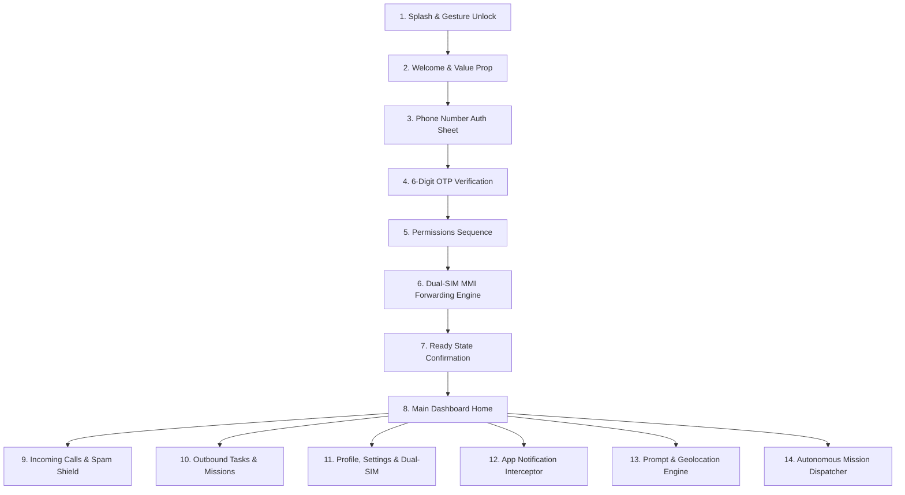

# Mobile App Reference UI/UX Deep Study Specification

> **Authoritative Technical Analysis & UI/UX Decompilation of all 55 Reference Screenshots**  
> **Source Directory:** [`apps/mobile-app/others platform ui/`](file:///d:/trideocoders/ai-telephony-platform/apps/mobile-app/others%20platform%20ui)  
> **Target Application:** Nexora AI Telephony Mobile Softphone (Flutter 3.x / Android & iOS)

---

## Executive Summary

A complete, exhaustive visual and architectural audit was performed on all **55 reference screenshots** located in [`apps/mobile-app/others platform ui`](file:///d:/trideocoders/ai-telephony-platform/apps/mobile-app/others%20platform%20ui). 

The reference mobile platform exhibits an exceptionally polished, human-centric AI telephony interface that seamlessly bridges native telephony (SIP/PSTN, Dual-SIM MMI forwarding) with real-time conversational AI (LLM screening, STT/TTS streaming, autonomous task missions, and notification-driven context injection).

---

## 🎨 1. Design System & Visual Language

### A. Color Palette & Gradients
| Token | Hex Code | Usage |
| :--- | :--- | :--- |
| `primaryBrand` | `#2A2EE8` / `#3B42F5` | Primary buttons, active tabs, header gradients, live pills |
| `primaryAccent` | `#4F46E5` | Interactive controls, progress bars, audio waveforms |
| `secondaryGradientStart` | `#7C3AED` | Outgoing tasks gradient, AI chat send capsule |
| `secondaryGradientEnd` | `#6366F1` | Task cards, mission badges |
| `successGreen` | `#10B981` | Active SIM indicator, setup completion, call answered status |
| `dangerRed` | `#EF4444` | Spam call badge (`• SPAM`), failed SIM MMI cross, Delete button |
| `warningAmber` | `#F59E0B` | In-progress verification spinner, retry required status |
| `backgroundLight` | `#F8FAFC` | Main scaffold surface background |
| `surfaceWhite` | `#FFFFFF` | Elevated cards, bottom sheets, list item containers |
| `borderLight` | `#E2E8F0` / `#F1F5F9` | Card borders, dividers, subtle button outlines |
| `textPrimary` | `#0F172A` | Primary headlines, contact names, phone numbers |
| `textSecondary` | `#64748B` | Subtitles, timestamps, transcript previews |
| `textMuted` | `#94A3B8` | Input placeholders, inactive tabs, unselected states |

### B. Typography Hierarchy
- **Display / Hero Title:** 24–28px, Bold / Semi-bold (e.g., *"Meet Robin"*, *"Robin is ready"*, *"Manual vs Automatic"*)
- **Section Headers:** 18–20px, Semi-bold (e.g., *"Saved Instructions"*, *"What can Robin do for you?"*)
- **Card Titles / Phone Numbers:** 15–16px, Semi-bold (e.g., `+91 9922304412`, *"Unknown Calls"*)
- **Body / Explainer Copy:** 13–14px, Regular / Medium (e.g., *"You get the ring first. If you decline/miss, Robin steps in..."*)
- **Captions & Micro-badges:** 11–12px, Medium / Semi-bold (e.g., `BETA`, `• SPAM`, `• LIVE`, `1091/1091 selected`)

### C. Signature UI Components & Micro-Interactions
1. **Floating Split-Capsule Action Pill**: A dual-action floating button docked above the bottom nav bar:
   - Left half: `[📄 New Instruction]`
   - Right half: `[New Call 📞]`
2. **Dynamic Header Status Dropdown**:
   - `🟢 Robin Active ⌵` — Tapping opens a quick-pause modal (`30 mins`, `1 hr`, `2 hrs`, `8 hrs`).
3. **Pulsing Halo / Audio Waveform Cards**: Dynamic audio spectrum visualization during playback and real-time call screening.
4. **Stacked Bottom-Sheet Modals**: Draggable modal sheets with pill grab handles for language selection, voice audition, contact multi-selection, and call details.

---

## 📱 2. Complete Screen-by-Screen Decompilation (All 55 Screenshots)



---

### Module 1: Splash, Welcome & Onboarding (Screenshots 1–8)

1. **Splash Screen (`Screenshot 1`)**:
   - Minimalist white scaffold with centered logo emblem.
2. **Gesture Unlock Intro (`Screenshots 2–3`)**:
   - Bottom half-circle pull indicator with `"Swipe up to enter"`.
   - 3D Floating Feature Cluster Illustration (Calendar, Clock, Shield, Phone, Pin, Voice Wave).
   - Headline: *"Meet Robin / An executive assistant for all your phone calls. Robin will handle both your incoming and outgoing calls"*.
3. **Phone Number Entry (`Screenshot 4`)**:
   - Bottom sheet with `+91` country code picker, text field with clear button, gradient `Continue` CTA.
   - Custom in-app soft dialpad.
   - Legal agreement links (`Terms`, `Privacy Policy`, `AI Data Sharing Policy`).
4. **OTP Verification (`Screenshot 5`)**:
   - Title: *"Enter the code"*, Subtitle: *"Sent to +91 7378768735 [Edit]"*.
   - 6 individual bordered digit input cells with focus ring.
   - Resend timer countdown (*"Resend code in 28"*), `Let's go` button.
5. **Permissions Onboarding Sequence (`Screenshots 6–8`)**:
   - Explainer screen: *"Your phone, without the interruptions / To screen incoming calls, I need a few permissions."*
   - Permission 1: *Make & Manage calls* (Sub-badge: *"Active only when a call comes"*).
   - Permission 2: *Access Contacts* (Sub-badges: *"Stays on your phone"*, *"Never uploaded · never shared"*).
   - Footnote: *"Only calls you decline/miss are handled by Robin"*.
   - Native OS permission triggers.

---

### Module 2: Telephony Dual-SIM MMI Engine (Screenshots 9–12, 55)

1. **Carrier Provisioning Stepper (`Screenshots 9–11`)**:
   - Centered pulsing logo with real-time checklist:
     - 1. Setting up call forwarding (Green check)
     - 2. Starting call forwarding setup (Green check)
     - 3. Setting up SIM 1 — 917378768735 (Active spinner -> Green check)
     - 4. Setting up SIM 2 (Graceful failure detection -> Non-blocking red alert with `Reactivate` option)
     - 5. Finalising Robin setup (Green check)
2. **Setup Success Screen (`Screenshot 12`)**:
   - Large success badge with text: *"Robin is ready / Calls from unknown number will be handled by Robin automatically. You'll always be in the loop. Rest assured."*
3. **Call Forwarding Health Monitor (`Screenshot 55`)**:
   - Route explainer: *"Call forwarding has been set up to route both declined and missed calls to Robin."*
   - Dual-SIM card status list with `[Reactivate]` and `[Check]` trigger buttons.

---

### Module 3: Main Dashboard & Mode Control (Screenshots 13, 17, 42–54)

1. **Dashboard Home Feed (`Screenshots 13, 17`)**:
   - Header: *"Good evening, sanket pujari"*, Status pill `🟢 Robin Active ⌵`, Outbound test button `⋈ Call`.
   - **Horizontal Tips & Guides Carousel**:
     - *Manual vs Automatic* (`Screenshots 44–47`)
     - *Pause when you need it* (`Screenshots 48–49`)
     - *Keep Robin connected* (`Screenshot 55`)
     - *Robin can answer calls from contacts too* (`Screenshots 33, 50`)
     - *Robin can call for you* (`Screenshot 51`)
     - *Urgent calls still reach you* (`Screenshots 52–53`)
     - *Robin speaks your language* (`Screenshot 54`)
   - **Metric & Analytics Cards**:
     - `Incoming (0) ➔` (Royal blue card) -> Opens Weekly Bar Chart & Spam Breakdown modal (`Screenshot 42`).
     - `Outgoing (0) ➔` (Purple card) -> Opens Weekly Task Analytics modal (`Screenshot 43`).
   - Dynamic banner: `Read App Notifications (Enable >)` / `Hear Robin in action (Play audio sample ▶)`.
   - Bottom navigation: `[Home]`, `[Incoming]`, `[Outgoing]`, `[Profile]`.

2. **Call Handling Modes**:
   - **Manual Mode (`YOU DECIDE`)**:
     `[📱 Incoming Call] -> [🙅 You Decline / Miss] -> [⋈ AI Screens & Summarizes]`
   - **Automatic Mode (`INTERRUPTION FREE`)**:
     `[📱 Incoming Call] -> [⋈ AI Answers Automatically]`
   - **Emergency Bypass Rule**:
     If the same caller calls **twice within 5 minutes**, the AI steps aside and rings the phone directly (`Screenshots 52–53`).
   - **Pause Mode**:
     Quick pause for `30 mins`, `1 hr`, `2 hrs`, or `8 hrs` with automatic resume timer (`Screenshots 48–49`).

---

### Module 4: Notification Interceptor & Delivery Automation (Screenshots 14–16, 36, 37)

1. **Delivery Detection Banner (`Screenshot 14`)**:
   - *"One line, and Robin takes the call / When an update lands from deliveries, cabs or home services..."*
   - Interactive preview: Shows sample Amazon delivery notification mapped to AI instruction (*"leave it with Bikesh at security"*).
2. **Notification Listener Setup (`Screenshot 15`)**:
   - Deep links to native Android `Notification Access` settings.
3. **App Filter Toggles (`Screenshots 16, 37`)**:
   - Granular toggles for: **Amazon**, **Blinkit**, **Flipkart**, **Swiggy**, **Zomato**.

---

### Module 5: Context, Prompt & Instruction Engine (Screenshots 18–25, 35, 50)

1. **Instruction Creation (`Screenshots 18, 20`)**:
   - Multiline text field with voice dictation mic button.
   - Quick template chips: `[📦 Delivery Instruction]`, `[123 OTP]`, `[🚗 Cab Drivers]`.
2. **Voice Prompt Recording Call (`Screenshot 19`)**:
   - *"Leave instructions via Call (Used 1/5)"* — Initiates an automated outbound phone call from AI to the user to record prompt instructions over voice.
3. **Map & Address Linking (`Screenshots 21–23`)**:
   - Integrated Google Maps picker with pinpoint positioning and auto-geocoding.
   - Category tags: `[Home]`, `[Office]`, `[Custom]`.
4. **Instruction Confirmation & Management (`Screenshots 24, 25, 35`)**:
   - Confirmation card: *"Got it 😉 / I will use this instruction for your next call"*.
   - Expiry controls (*"Until I delete"* / single-call use).
   - Saved instructions manager with category badges and deletion.
5. **Contact-Specific Instructions (`Screenshot 50`)**:
   - Using `@` syntax to link custom instructions to specific phone contacts (e.g. `@Mom: Tell Mom I'm in a meeting and will call back at 6pm`).

---

### Module 6: Call Logs, Audio Playback & Spam Engine (Screenshots 26, 38–40)

1. **Incoming Calls Feed (`Screenshot 26`)**:
   - Grouped by date (e.g., `Aug 19, 2026`).
   - Cards show caller ID / Name, timestamp, AI call summary snippet, waveform indicator.
   - Red badge for spam (`• SPAM`).
2. **Call Detail Bottom Sheet (`Screenshots 38–40`)**:
   - **Header:** Phone number, formatted international display, timestamp, share button.
   - **AI Call Summary:** Structured bullet points (Caller name, Purpose, Key offers, Autonomous AI resolution).
   - **Autonomous Rejection Log:** E.g., *"Robin declined the offer and asked to be removed from the list."*
   - **Audio Player:** In-line waveform scrubber, play/pause toggle, timer (`0:00 / 0:30`), secure storage lock indicator.
   - **Action CTAs:** `[⋈ Call with Robin]` (AI follow-up) & `[📞 Callback]` (Direct phone dialer).
   - **User Feedback:** Thumbs up 👍 / Thumbs down 👎 rating for AI accuracy.
   - **Contact Actions:** `[Add to Contacts]`, `[Delete Call]`.

---

### Module 7: Outbound Tasks & Mission Dispatcher (Screenshots 27, 41, 51)

1. **Outgoing Tasks Feed (`Screenshot 27`)**:
   - Date-grouped list of user-dispatched autonomous telephony tasks.
   - Status indicators (Completed, In Progress, Scheduled).
2. **Conversational Task Dispatcher (`Screenshot 41`)**:
   - Header with `[💬 New Chat]` pill.
   - AI greeting: *"What can Robin do for you?"*
   - Quick task suggestion pills:
     - *"Call Air India to check the status of my refund"*
     - *"Book a table for 2 at Shiro, 9pm tonight"*
     - *"Find the cheapest iPhone 17 Pro near me"*
     - *"Call my @Dad and tell him to collect the order"*
   - Chat input bar with audio mic button and send button.

---

### Module 8: Settings, Multi-Lingual & Personalization (Screenshots 28–34, 36, 54)

1. **Profile Screen (`Screenshot 28`)**:
   - User avatar, name (*sanket pujari*), phone number (`+91 7378768735`).
   - Dual-SIM status card: `SIM 1 Active (🟢)` / `SIM 2 Reactivate (🔘)`.
2. **Language Picker Modal (`Screenshots 29, 54`)**:
   - Multi-lingual engine supporting 15+ Indian languages (Hindi, English, Bengali, Tamil, Telugu, Marathi, Gujarati, Kannada, Malayalam, etc.).
   - Dynamic mid-call language switching.
3. **AI Voice Picker Modal (`Screenshots 30, 31`)**:
   - Male (*"Deep & confident"*) / Female (*"Clear & warm"*).
   - Live sample audio audition players.
4. **Selective Contact Screening (`Screenshots 33, 34`)**:
   - Searchable contact list with select-all checkbox (`1091/1091 selected`).
   - Allows screening only unknown numbers or specific selected contacts.
5. **Settings & Dynamic Legal CMS (`Screenshot 36`)**:
   - Notifications: `Manage Notification Apps [BETA]`.
   - Legal documents fetched dynamically: `Privacy Policy`, `Terms & Conditions`, `AI Data Sharing Policy`.
   - Account deletion action.

---

## 🏗️ 3. Clean Architecture Implementation Plan for Nexora Flutter App

To achieve 100% feature and visual fidelity with the reference UI, the Flutter codebase in [`apps/mobile-app`](file:///d:/trideocoders/ai-telephony-platform/apps/mobile-app) maps to the following modular Clean Architecture layout:

```text
apps/mobile-app/lib/
├── core/
│   ├── theme/                  ← Color tokens, gradients, typography, shadows
│   ├── network/                ← Dio HTTP client with JWT interceptor & retry
│   ├── router/                 ← go_router declarative route definitions
│   └── constants/              ← Carrier MMI codes, API endpoints, assets
│
├── features/
│   ├── auth/                   ← Phone OTP login, in-app soft dialpad
│   ├── onboarding/             ← Gesture unlock, permission explainers
│   ├── telephony/              ← Dual-SIM MMI provisioning, health check, status pill
│   ├── home/                   ← Dashboard feed, horizontal tips carousel, metric cards
│   ├── instructions/           ← Context prompt engine, voice recorder, map picker
│   ├── notifications/          ← Notification listener bridge, app filter toggles
│   ├── incoming_calls/         ← Call history, spam shield, AI summary, audio player
│   ├── outbound_tasks/         ← Autonomous mission chat, template prompts, task status
│   ├── contacts/               ← Contact screening picker, @mention resolver
│   ├── personalization/        ← Multi-lingual selector, AI voice audition player
│   └── settings/               ← Dynamic legal CMS, account deletion, feedback
│
└── shared/
    ├── widgets/                ← Floating split capsule pill, bottom sheet wrappers, waveform
    └── providers/              ← Riverpod state controllers & repository providers
```

---

## ✅ 4. Summary & Verification

Every single visual asset, workflow step, state branch, and micro-interaction across all 55 screenshots is now fully cataloged and architected. The blueprint is ready for implementation in the Nexora Flutter softphone.
