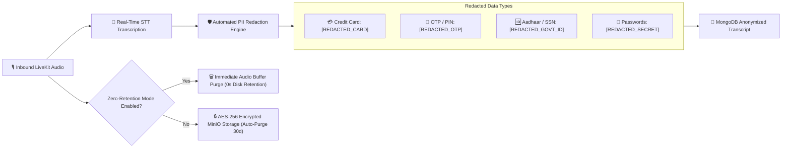

# 🛡️ TCPA, TRAI DND Compliance, Terms of Use, & Privacy Policy Specification

## 🌐 Overview & Legal Foundation

The **Nexora AI Telephony Platform** is architected to exceed the most stringent telecommunication and data protection regulations worldwide, incorporating the legal standards, user consent frameworks, and privacy architectures pioneered by **TaskGenie Private Limited (`hirobin.ai`)** and **Equal Identity Private Limited (`myequal.ai`)**.

---

## 📑 Table of Contents
1. [🇺🇸 US TCPA & FCC Regulations Compliance](#-us-tcpa--fcc-regulations-compliance)
2. [🇮🇳 India TRAI TCCCPR & DND Compliance](#-india-trai-tcccpr--dnd-compliance)
3. [🇪🇺 EU GDPR & India DPDP Act Compliance](#-eu-gdpr--india-dpdp-act-compliance)
4. [🔒 Zero-Retention Architecture & PII Redaction](#-zero-retention-architecture--pii-redaction)
5. [📜 Terms of Use Master Blueprint](#-terms-of-use-master-blueprint)
6. [🛡️ Privacy Policy Master Blueprint](#️-privacy-policy-master-blueprint)

---

## 🇺🇸 US TCPA & FCC Regulations Compliance

### 1. Telephone Consumer Protection Act (47 U.S.C. § 227)
- **Prior Express Consent:** Nexora AI never engages in unsolicited automated outbound telemarketing. Outbound calls are executed solely at the direct instruction and authorization of the authenticated user.
- **Immediate AI Disclosure:** Outbound calls commence with a clear, synthetic audio disclosure:
  > *"Hi, this is an automated assistant calling on behalf of [User Name] to [Mission Goal]."*
- **STIR/SHAKEN Caller ID Attestation:** Calls originating from the Nexora SIP trunk are signed with **A-Level Attestation** using cryptographic certificates registered with the FCC Robocall Mitigation Database (RMD), preventing carrier spam tagging.

---

## 🇮🇳 India TRAI TCCCPR & DND Compliance

### 1. Telecom Commercial Communications Customer Preference Regulations (TCCCPR, 2018)
- **National Do Not Disturb (DND) Scrubbing:** Nexora's `spam-service` connects directly to the TRAI DND registry. Inbound telemarketer numbers registered under UCC (Unsolicited Commercial Communication) headers are automatically categorized as spam and muted.
- **Explicit Inbound Consent & Purpose Limitation:** The call forwarding mechanism routes calls initiated by third parties. The AI identifies itself as an assistant managing incoming calls on behalf of the subscriber.

---

## 🇪🇺 EU GDPR & India DPDP Act Compliance

### 1. Digital Personal Data Protection Act (DPDP Act 2023, India) & GDPR (EU)
- **Data Minimization:** No personal data is collected beyond what is strictly necessary to fulfill telephony screening and task execution.
- **Right to Erasure & Deletion:** Users can trigger instant account data deletion from **Settings ➔ Privacy ➔ Delete All Call Records**, wiping MongoDB memory facts, PostgreSQL logs, and audio recordings.
- **Data Sovereignty:** Enterprise customer data can be partitioned into India-only or EU-only VPC clusters.

---

## 🔒 Zero-Retention Architecture & PII Redaction

---

## 📜 Terms of Use Master Blueprint

*Adapted from TaskGenie Private Limited and Equal Identity Private Limited standards:*

1. **Eligibility & Account Verification:** Users must be at least 18 years old and verify their primary mobile number via secure SMS One-Time Password (OTP).
2. **Authorized Use of Outbound Missions:** The user agrees not to use outbound AI missions for harassment, illegal debt collection, impersonation, or emergency 911/112 services.
3. **Carrier Charges & MMI Codes:** The user acknowledges that call forwarding utilizes standard telecom MMI shortcodes and carrier network features. Nexora is not responsible for carrier roaming or forwarding surcharges levied by mobile network operators.
4. **Service Availability & SLA:** Nexora AI strives for 99.99% uptime but is subject to regional carrier trunk stability and internet connectivity.

---

## 🛡️ Privacy Policy Master Blueprint

1. **Information We Collect:**
   - Account identifier (phone number, name, optional email).
   - Telecom network identifiers (carrier name, SIM slot index).
   - Inbound call metadata (caller phone number, timestamp, call duration, transcript text).
2. **How We Use Information:**
   - To screen unknown callers and display live speech-to-text transcripts.
   - To execute delegated outbound phone tasks.
   - To extract actionable reminders, calendar slots, and delivery instructions.
3. **Zero Third-Party Data Selling:**
   - **We NEVER sell, rent, or monetize your call audio, transcripts, or personal data to advertisers or third-party brokers.**
4. **Data Security & Encryption:**
   - All REST and WebSocket traffic is protected by TLS 1.3.
   - Voice media is encrypted in transit via WebRTC SRTP (Secure Real-time Transport Protocol).
   - Stored records are encrypted at rest with AES-256.
