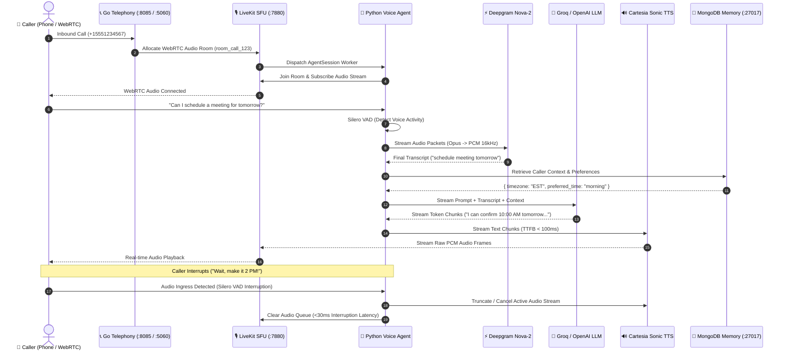
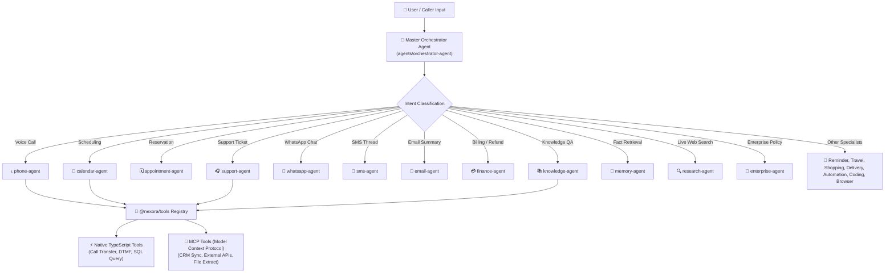

# 🏛️ Nexora AI Telephony Platform — System Architecture Blueprint

This document defines the definitive system architecture, polyglot runtime boundaries, communication protocols, multi-model storage layer, and execution lifecycle for the **Nexora AI Telephony & Communication Platform**.

---

## 🎯 1. Architectural Philosophy & Polyglot Runtime Boundaries

Nexora is designed around a fundamental engineering principle:

> **Languages and runtimes are partitioned by technical responsibility and latency requirements, not by arbitrary business features.**

```mermaid
graph TB
    subgraph ClientLayer["📱 Client Applications (Cross-Platform)"]
        FlutterMobile["📱 Flutter Mobile (Android / iOS)<br/><i>Dart 3.x</i>"]
        FlutterDesktop["💻 Flutter Desktop (Windows / macOS)<br/><i>Dart 3.x</i>"]
        NextPortals["🌐 Next.js 14 Portals (User / Admin / Enterprise / Docs)<br/><i>TypeScript / React 19</i>"]
        PSTNPhone["☎️ PSTN / Carrier Trunk (Inbound/Outbound)<br/><i>SIP / E.164</i>"]
    end

    subgraph IngressGateway["🚪 Ingress & Gateway Layer"]
        APIGateway["⚡ API Gateway (:4000)<br/><i>Node.js / Express / TypeScript</i>"]
        LiveKitSFU["🎙️ LiveKit WebRTC Media SFU (:7880)<br/><i>Real-time Audio / Video SFU</i>"]
        SIPTrunkEngine["📞 Telephony SIP Engine (:8085 / :5060)<br/><i>Go 1.22 / Gin / SIP Stack</i>"]
    end

    subgraph CoreServices["⚙️ Backend Microservices Layer (24 Microservices)"]
        AuthSvc["🔐 auth-service (:4001)"]
        CallSvc["📞 call-service (:4002)"]
        UserSvc["👤 user-service (:4003)"]
        BillingSvc["💳 billing-service (:4004)"]
        NotifSvc["🔔 notification-service (:4005)"]
        ContactSvc["📇 contact-service (:4006)"]
        TransSvc["📝 transcript-service (:4007)"]
        AnalyticsSvc["📊 analytics-service (:4008)"]
        WSSvc["📡 websocket-service (:4009)"]
        PaymentSvc["💰 payment-service (:4010)"]
        StorageSvc["🪣 storage-service (:4011)"]
        SpamSvc["🛡️ spam-service (:4012)"]
        MemorySvc["🧠 memory-service (:4013)"]
        AdminSvc["👔 admin-service (:4014)"]
        AuditSvc["🔍 audit-service (:4015)"]
        EnterpriseSvc["🏢 enterprise-service (:4016)"]
        RecordSvc["🎙️ recording-service (:4017)"]
        SchedSvc["⏰ scheduler-service (:4018)"]
        SearchSvc["🔎 search-service (:4019)"]
        WorkflowSvc["🔄 workflow-service (:4020)"]
    end

    subgraph AIEngine["🤖 AI Cognition & Orchestration Layer"]
        AIOrchestrator["🧠 ai-orchestrator (:8086 / :50051)<br/><i>Go 1.22 / Gin / gRPC</i>"]
        VoiceAgent["📞 voice-service / phone-agent<br/><i>Python 3.11 / LiveKit Agents</i>"]
        AgentEcosystem["🤖 20 Specialized Python Agents<br/><i>LangGraph / PromptCompiler / MCP</i>"]
        TemporalOrch["⏳ Temporal Orchestration (:8088)<br/><i>Durable Workflows & State</i>"]
    end

    subgraph StorageLayer["💾 Multi-Model Storage Infrastructure"]
        Postgres[("🐘 PostgreSQL 16 + pgvector (:5432)<br/>Relational Schemas & Embeddings")]
        RedisDB[("🔴 Redis 7.2 (:6379)<br/>Token Buckets, Locks & Sessions")]
        MongoDB[("🍃 MongoDB 6.0 (:27017)<br/>Facts & Semi-Structured Memory")]
        OpenSearchDB[("🔍 OpenSearch 2.13 (:9200)<br/>Full-Text BM25 & Transcripts")]
        MinIODB[("🪣 MinIO S3 (:9000)<br/>Audio Recordings & Waveforms")]
        VaultDB[("🔒 HashiCorp Vault (:8200)<br/>Zero-Secret KV v2 Credentials")]
    end

    FlutterMobile --> APIGateway
    FlutterDesktop --> APIGateway
    NextPortals --> APIGateway
    PSTNPhone --> SIPTrunkEngine
    SIPTrunkEngine --> LiveKitSFU
    FlutterMobile -.->|WebRTC Audio| LiveKitSFU
    FlutterDesktop -.->|WebRTC Audio| LiveKitSFU

    APIGateway --> CoreServices
    LiveKitSFU <--> VoiceAgent
    CoreServices --> AIOrchestrator
    AIOrchestrator --> AgentEcosystem
    AgentEcosystem --> TemporalOrch

    CoreServices --> Postgres
    CoreServices --> RedisDB
    CoreServices --> VaultDB
    AgentEcosystem --> MongoDB
    TransSvc --> OpenSearchDB
    CallSvc --> MinIODB
```



---

## ⚡ 2. Technical Boundary & Runtime Partitioning

| Runtime Layer | Technology | Primary Domain Responsibility | Rationale |
| :--- | :--- | :--- | :--- |
| **Media & Telephony** | **Go 1.22** | SIP protocol handling, RTP media bridging, LiveKit room creation, high-throughput network routing. | Microsecond concurrency, garbage-collection efficiency, native network primitives. |
| **AI Cognition & Audio** | **Python 3.11** | Real-time speech pipeline (Silero VAD, Deepgram STT, Cartesia/ElevenLabs TTS), memory fact extraction, MCP tools, LangGraph workflows. | Native AI/ML ecosystem, LiveKit Agents SDK, PyTorch/NumPy acceleration. |
| **Business Logic & APIs**| **TypeScript / Node.js 20** | API Gateway, JWT/OTP authentication, Stripe/Razorpay billing, RBAC access control, multi-tenant database repositories. | Rapid iteration, rich package ecosystem, isomorphic typing with web clients via `@nexora/types`. |
| **Web Applications** | **Next.js 14 / React 19** | User Dashboard, Admin Control Center, Enterprise Portal, Marketing Landing Page, Developer Docs. | Server-side rendering (SSR), high SEO performance, shared design system (`@nexora/ui`). |
| **Mobile & Desktop** | **Flutter 3.x / Dart 3.x** | Cross-platform mobile dialer (Android/iOS) and desktop softphone (Windows/macOS). | 80%+ shared codebase, 60fps hardware-accelerated WebRTC rendering, unified UI. |
| **Durable Execution** | **Temporal** | Multi-day call workflows, payment retries, appointment reminders, human-in-the-loop AI state. | Zero state loss, deterministic retries, multi-language worker SDKs. |

---

## 📞 3. Real-Time Audio & Telephony Pipeline



---

## 🤖 4. The Multi-Agent Orchestration Architecture



---

## 💾 5. Polyglot Storage Architecture

```text
PostgreSQL 16 (+ pgvector)
├── tenants          (Multi-tenant isolation)
├── users            (RBAC credentials & auth)
├── agents           (Voice & LLM configurations)
├── calls            (Call records & cost tracking)
├── memories         (Structured facts & user preferences)
└── embeddings       (HNSW 1536-dim pgvector index for RAG)

Redis 7.2
├── nexora:ratelimit:{tenantId}:{ip}    (Token bucket rate limits)
├── nexora:session:{userId}:{sessionId} (Active JWT auth sessions)
├── nexora:otp:{phoneNumber}            (5-minute verification codes)
├── nexora:call:active:{callId}         (Real-time active call state)
└── nexora:lock:call:{callId}           (Distributed Redlock mutex)

MongoDB 6.0
├── conversation_memories (Semi-structured context & sentiment history)
└── knowledge_chunks      (Knowledge base documents & metadata)

OpenSearch 2.13
└── call-transcripts-v1   (BM25 full-text + nested utterance timestamps)

MinIO S3
├── /recordings/{tenantId}/{callId}.wav (Original audio recordings)
└── /waveforms/{callId}.json            (Pre-computed 60fps audio waveforms)

HashiCorp Vault KV v2
└── secret/data/nexora/{env}            (Zero-secret encrypted keys & tokens)
```

---

## 🛡️ 6. Security, Compliance & Multi-Tenancy

1. **Schema Multi-Tenancy**: Every relational table in [`packages/database/src/migrations/0001_initial.sql`](file:///d:/trideocoders/ai-telephony-platform/packages/database/src/migrations/0001_initial.sql) includes `tenant_id UUID NOT NULL` with foreign key constraints.
2. **Zero-Secret Commits**: Application secrets, database passwords, and provider API keys are never stored in source code. [`@nexora/config`](file:///d:/trideocoders/ai-telephony-platform/packages/config) dynamically retrieves credentials from HashiCorp Vault at runtime.
3. **Automated PII Redaction**: [`@nexora/logger`](file:///d:/trideocoders/ai-telephony-platform/packages/logger) and [`@nexora/prompts`](file:///d:/trideocoders/ai-telephony-platform/packages/prompts) actively sanitize credit cards, passwords, SSNs, and JWT tokens before emission.
4. **12-Role RBAC Matrix**: Access control spans 12 system roles (`SUPERADMIN`, `PLATFORM_ADMIN`, `MARKETING_ADMIN`, `SUPPORT_LEAD`, `CUSTOMER_SUPPORT`, `BOT_SUPPORT`, `DEVELOPER`, `BILLING_ADMIN`, `COMPLIANCE_AUDITOR`, `TENANT_ADMIN`, `AGENT_OPERATOR`, `VIEWER`) cached in Redis.
