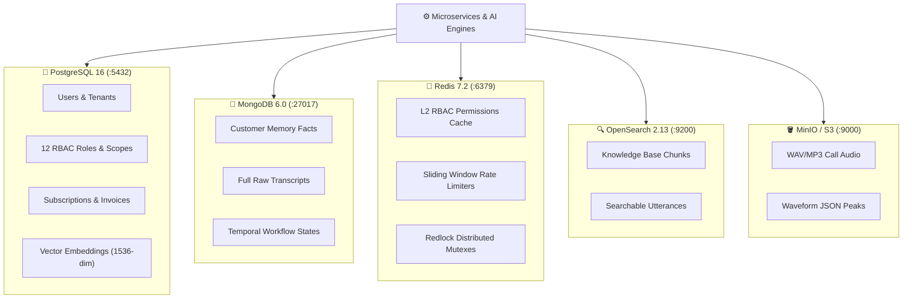

# 💾 Data Storage & Caching Architecture Design Specification

---

## 1. Multi-Model Data Storage Infrastructure

Nexora employs a polyglot persistence strategy optimized for relational integrity, vector similarity search, low-latency caching, and audio binary storage:



---

## 2. Multi-Tenant Isolation Pattern

All relational tables enforce strict multi-tenant separation using mandatory `tenant_id` foreign keys indexed with composite B-Trees:

```sql
CREATE TABLE call_sessions (
    id UUID PRIMARY KEY DEFAULT gen_random_uuid(),
    tenant_id UUID NOT NULL REFERENCES tenants(id) ON DELETE CASCADE,
    agent_id UUID NOT NULL REFERENCES agents(id),
    caller_phone VARCHAR(32) NOT NULL,
    status VARCHAR(32) NOT NULL,
    created_at TIMESTAMPTZ NOT NULL DEFAULT NOW()
);

CREATE INDEX idx_call_sessions_tenant ON call_sessions (tenant_id, created_at DESC);
```
