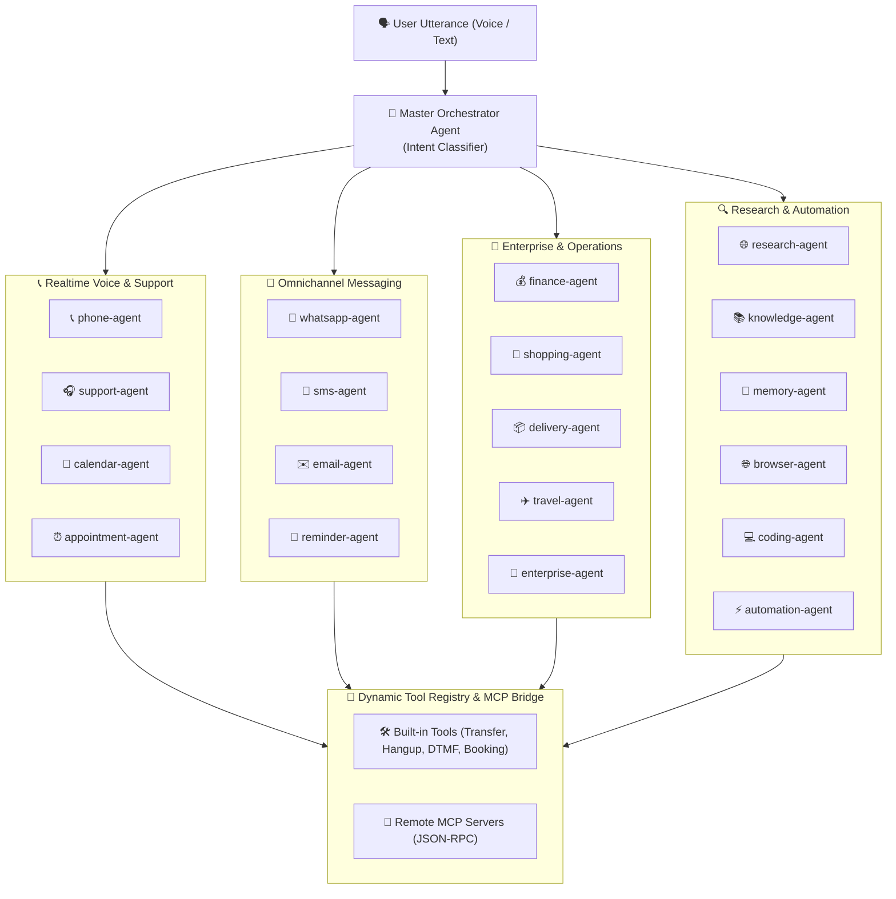

# 🤖 Multi-Agent Orchestration & Tool Registry Design Specification

---

## 1. Multi-Agent Routing Topology

Nexora coordinates 20 specialized Python AI agents through a master intent router:

---

## 2. Dynamic Tool Registry & MCP Integration

- **Standard Schemas**: Tools define parameters using Zod schemas compiled to JSON Schema Draft 7 via `@nexora/tools`.
- **Model Context Protocol (MCP)**: Agents dynamically connect to external MCP servers over stdio or SSE/JSON-RPC without local code modifications.
