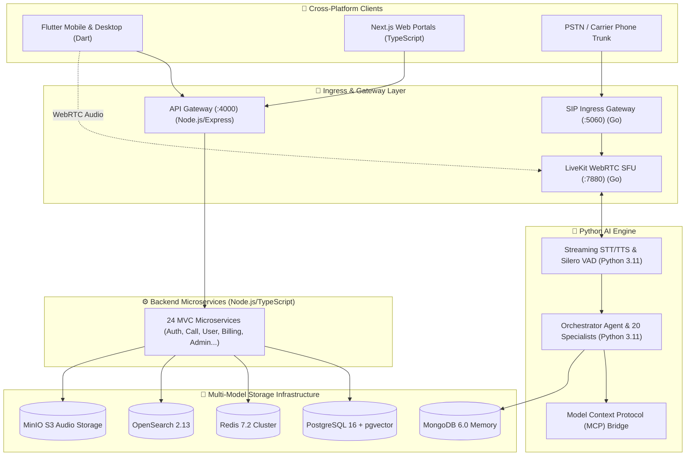

# 🏛️ System Architecture Design Specification

---

## 1. High-Level Polyglot Architecture

Nexora is designed with language partitioning based on **technical responsibility**:

---

## 2. Ingress & Media Path Separation

- **Control Plane**: HTTP REST and JSON-RPC APIs routed through `api-gateway` on port `4000`.
- **Data Plane (Audio Media)**: Low-latency WebRTC RTP media streams handled directly by `LiveKit` SFU on port `7880` and `telephony-service` SIP gateway on port `5060`.
- **Event Plane**: NATS JetStream and Kafka handle asynchronous event streaming, post-call diarization, and billing ledger updates.
