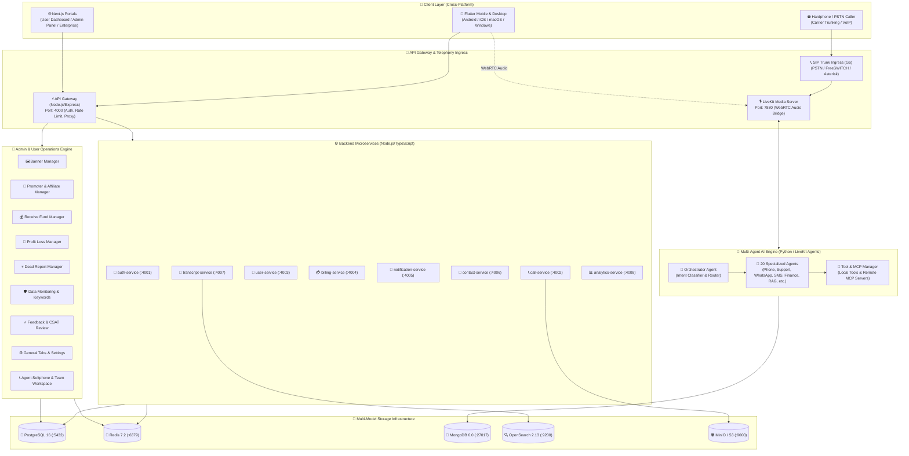

# 🗺️ Nexora Platform Master Architecture & Diagrams Blueprint

Comprehensive architectural blueprints, entity-relationship diagrams (ERDs), call sequence flows, and multi-agent coordination topologies for the Nexora AI Communication Platform.

---

## 📑 Visual Architecture Index

| Document | Focus Area | Key Diagrams & Data Structures |
| :--- | :--- | :--- |
| [**1. Diagram Inventory & Specs**](./diagram-inventory-and-specs.md) | Complete Catalog | Master inventory of all diagrams, notations, and diagram sources. |
| [**2. System Architecture**](./system-architecture.md) | Polyglot System Topology & Ingress | Master system map, WebRTC media path, API Gateway routing, NATS/Kafka event bus. |
| [**3. Database & Data Structures ERD**](./db/database-schemas-erd.md) | Multi-Database Storage Layer | PostgreSQL relational ERD, MongoDB memory/fact schemas, Redis key-space & TTLs, OpenSearch indices. |
| [**4. Microservices Architecture**](./services/microservices-architecture.md) | Node.js / Express Microservices | MVC service layers, Inter-service RPC & event payloads, API Gateway route map. |
| [**5. Real-time Call Flow Sequences**](./call-flow-sequence.md) | Telephony & Voice Audio Pipelines | Inbound/outbound call lifecycle, LiveKit room allocation, streaming STT/TTS, tool execution. |
| [**6. Multi-Agent & MCP Coordination**](./multi-agent-coordination.md) | AI Engine & MCP Ecosystem | 20 specialized agent graph, intent routing, dynamic tool registry, remote MCP server bridge. |
| [**7. Admin Operations & Platform Modules**](./services/admin-operations-flow.md) | 9 Core Operations Pipelines | Banner delivery, Promoter/affiliate payouts, Receive funds, Profit/Loss margins, Notifications with DND, Dead call reports, Data monitoring & keywords, Feedback CSAT, General tabs. |
| [**8. User & Agent Operator Flow**](./services/user-operations-flow.md) | Workspace & Softphone Calling | Softphone outbound/inbound dialer flow, live in-call assistance AI, team invites, and customer self-service. |

---

## 🏛️ Platform Core Architecture Overview

