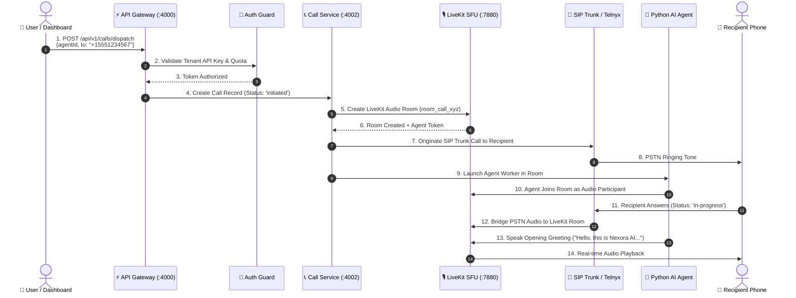
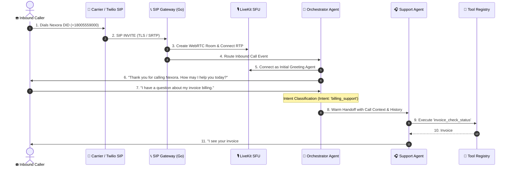
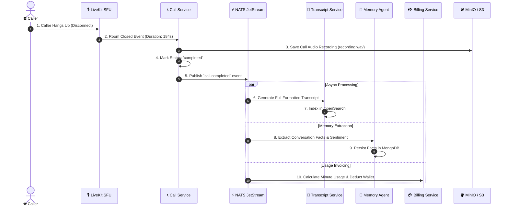

# 📞 Real-Time Call Flow & Telephony Sequences

---

## 1. Outbound AI Call Dispatch Sequence

---

## 2. Inbound SIP Call Routing & Intent Handoff Sequence

---

## 3. Post-Call Async Lifecycle Sequence

