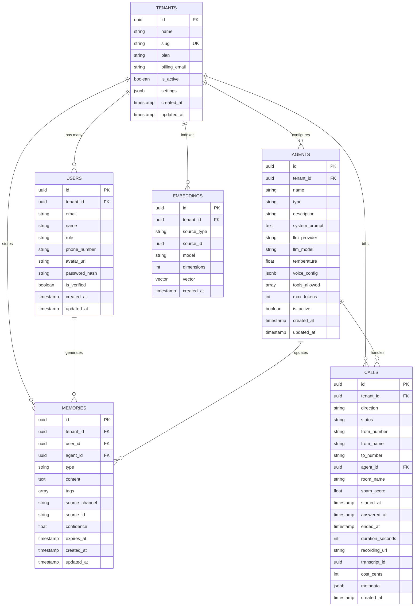

# 💾 Multi-Database Architecture & Data Structures ERD

Nexora leverages a polyglot multi-model data storage layer tailored for durability, vector retrieval, in-memory caching, and sub-millisecond locks:
- **PostgreSQL 16**: Primary relational storage, multi-tenant schemas, billing, and `pgvector` embeddings ([`packages/database/src/migrations/0001_initial.sql`](file:///d:/trideocoders/ai-telephony-platform/packages/database/src/migrations/0001_initial.sql)).
- **MongoDB 6.0**: Unstructured conversation memory facts, agent context trees, and session history.
- **Redis 7.2**: In-memory token bucket rate limiting, distributed mutex locks, active call states, and auth sessions.
- **OpenSearch 2.13**: Full-text transcript indexing, keyword BM25 search, and semantic document RAG.
- **MinIO (S3)**: Call recording audio streams, waveforms, and export artifacts.

---

## 1. PostgreSQL Relational Entity-Relationship Diagram (ERD)



---

## 2. MongoDB Document Schemas (`MongoDB 6.0`)

### A. Conversation Memory Facts Collection (`conversation_memories`)
```json
{
  "_id": { "$oid": "64f1a2b3c4d5e6f7a8b9c0d1" },
  "tenantId": "tenant_enterprise_01",
  "phoneNumber": "+15552345678",
  "customerId": "cust_alex_992",
  "facts": [
    {
      "factId": "f_1",
      "category": "preference",
      "statement": "Prefers morning telephone appointments between 09:00 - 11:00 AM EST",
      "confidence": 0.96,
      "sourceCallId": "call_WMfEmtY8z58qYZ5uVe2pi",
      "createdAt": "2026-08-17T14:35:26.124Z"
    },
    {
      "factId": "f_2",
      "category": "technical",
      "statement": "Requires 500 concurrent SIP trunk channels for AWS US-East-1 deployment",
      "confidence": 0.98,
      "sourceCallId": "call_WMfEmtY8z58qYZ5uVe2pi",
      "createdAt": "2026-08-17T14:35:26.124Z"
    }
  ],
  "sentimentHistory": [
    { "callId": "call_123", "score": 0.88, "dominantEmotion": "satisfied" }
  ],
  "updatedAt": "2026-08-17T14:35:26.124Z"
}
```

### B. Knowledge Document Chunks & Vectors (`knowledge_chunks`)
```json
{
  "_id": { "$oid": "64f1a2b3c4d5e6f7a8b9c0d2" },
  "tenantId": "tenant_enterprise_01",
  "knowledgeBaseId": "kb_telephony_compliance",
  "documentTitle": "SIP Trunking SLA and Failover Protocol",
  "chunkIndex": 3,
  "content": "In case of primary gateway timeout (>500ms), traffic is rerouted over secondary TLS SRTP trunk.",
  "embedding": [0.0124, -0.0432, 0.0891, "...(1536 dimensions)"],
  "metadata": {
    "section": "Disaster Recovery",
    "updatedAt": "2026-08-01T00:00:00Z"
  }
}
```

---

## 3. Redis Key Structures & TTL Strategy (`Redis 7.2`)

```text
┌─────────────────────────────────────────────────────────────────────────────────────────────────┐
│                                   REDIS KEY-SPACE BLUEPRINT                                     │
├────────────────────────────────────────┬─────────────┬──────────┬───────────────────────────────┤
│ Key Format                             │ Data Type   │ TTL      │ Purpose / Data Structure      │
├────────────────────────────────────────┼─────────────┼──────────┼───────────────────────────────┤
│ `nexora:ratelimit:{tenantId}:{ip}`     │ String (Int)│ 60s      │ Token bucket request counter  │
│ `nexora:session:{userId}:{sessionId}`  │ Hash / JSON │ 24 Hours │ Active user JWT auth session  │
│ `nexora:otp:{formattedPhoneNumber}`    │ String      │ 5 Min    │ 6-digit numeric verification  │
│ `nexora:call:active:{callId}`          │ Hash        │ 2 Hours  │ Real-time active call state   │
│ `nexora:lock:call:{callId}`            │ String      │ 10s      │ Distributed Redlock Mutex     │
│ `nexora:agent:cache:{agentId}`         │ String(JSON)│ 10 Min   │ Cached AgentProfile config    │
│ `nexora:metrics:calls:hourly:{YYYYMMDD}`│ Sorted Set │ 30 Days  │ Hourly call volume time series│
└────────────────────────────────────────┴─────────────┴──────────┴───────────────────────────────┘
```

---

## 4. OpenSearch Indices & Mappings (`OpenSearch 2.13`)

### Index: `call-transcripts-v1`
```json
{
  "mappings": {
    "properties": {
      "callId": { "type": "keyword" },
      "tenantId": { "type": "keyword" },
      "agentId": { "type": "keyword" },
      "startedAt": { "type": "date" },
      "durationSeconds": { "type": "integer" },
      "transcriptText": {
        "type": "text",
        "analyzer": "standard",
        "fields": {
          "keyword": { "type": "keyword", "ignore_above": 256 }
        }
      },
      "utterances": {
        "type": "nested",
        "properties": {
          "speaker": { "type": "keyword" },
          "text": { "type": "text" },
          "startTimeMs": { "type": "integer" },
          "endTimeMs": { "type": "integer" },
          "sentiment": { "type": "float" }
        }
      },
      "sentimentScore": { "type": "float" },
      "tags": { "type": "keyword" }
    }
  }
}
```
