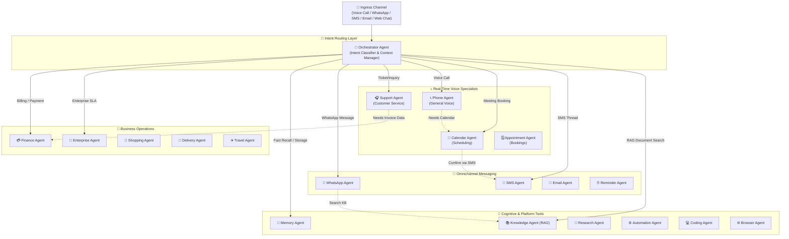

# 🤖 Multi-Agent AI Engine & MCP Coordination Topology

The Nexora AI Platform utilizes an event-driven **Hierarchical Multi-Agent Graph** where a master **Orchestrator Agent** dynamically routes incoming requests to 20 specialized sub-agents with hot context preservation and shared tool access.

---

## 1. 20 Specialized Agent Topology & Handoff Graph



---

## 2. Dynamic Tool & MCP Server Architecture (`@nexora/tools`)

```mermaid
graph LR
    subgraph AgentRuntime["🤖 Agent Runtime"]
        Agent["🤖 Active AI Agent<br/>(Phone / Support / Calendar)"]
    end

    subgraph Registry["📦 @nexora/tools Ecosystem"]
        ToolReg["📋 ToolRegistry<br/>(Builtins & Custom Tools)"]
        MCPMgr["🌐 MCPManager<br/>(Remote MCP Server Bridge)"]
    end

    subgraph LocalTools["🛠️ Local Built-in Tools"]
        T1["📞 call_transfer"]
        T2["📅 calendar_check_availability"]
        T3["🗓️ appointment_create"]
        T4["💬 whatsapp_send"]
        T5["📱 sms_send"]
        T6["🔍 knowledge_search"]
        T7["🧾 invoice_check_status"]
    end

    subgraph RemoteMCPServers["🌐 Remote MCP Servers (JSON-RPC)"]
        HubSpotMCP["🏢 HubSpot CRM MCP Server<br/>(hubspot_query, hubspot_create_contact)"]
        StripeMCP["💳 Stripe Billing MCP Server<br/>(stripe_refund, stripe_charge)"]
        JiraMCP["🎫 Jira Support MCP Server<br/>(jira_create_ticket)"]
    end

    Agent -->|1. Request Function Call| ToolReg
    ToolReg -->|2a. Local Execution| LocalTools
    ToolReg -->|2b. Remote MCP Tool| MCPMgr

    MCPMgr -->|3. JSON-RPC over HTTP/SSE| HubSpotMCP
    MCPMgr -->|3. JSON-RPC over HTTP/SSE| StripeMCP
    MCPMgr -->|3. JSON-RPC over HTTP/SSE| JiraMCP

    RemoteMCPServers -->>|4. Structured Output| MCPMgr
    MCPMgr -->>|5. ToolResult| ToolReg
    ToolReg -->>|6. LLM Context Injection| Agent
```

---

## 3. Tool Definition & Execution Lifecycle

```text
┌────────────────────────────────────────────────────────────────────────────────────────┐
│                              TOOL EXECUTION PIPELINE                                   │
├─────────┬──────────────────────────────────────────────────────────────────────────────┤
│ Phase 1 │ Schema Declaration: Zod schema converted to OpenAPI / JSON Schema.           │
│ Phase 2 │ Parameter Validation: Validates incoming LLM arguments against Zod schema.   │
│ Phase 3 │ Timeout Protection: Wrapped in `timeout(promise, timeoutMs)` (Default: 30s).  │
│ Phase 4 │ Telemetry & Error Capture: Returns structured `ToolResult` (latency, error). │
│ Phase 5 │ Result Serialization: Injected back into LLM conversation context stream.   │
└─────────┴──────────────────────────────────────────────────────────────────────────────┘
```
