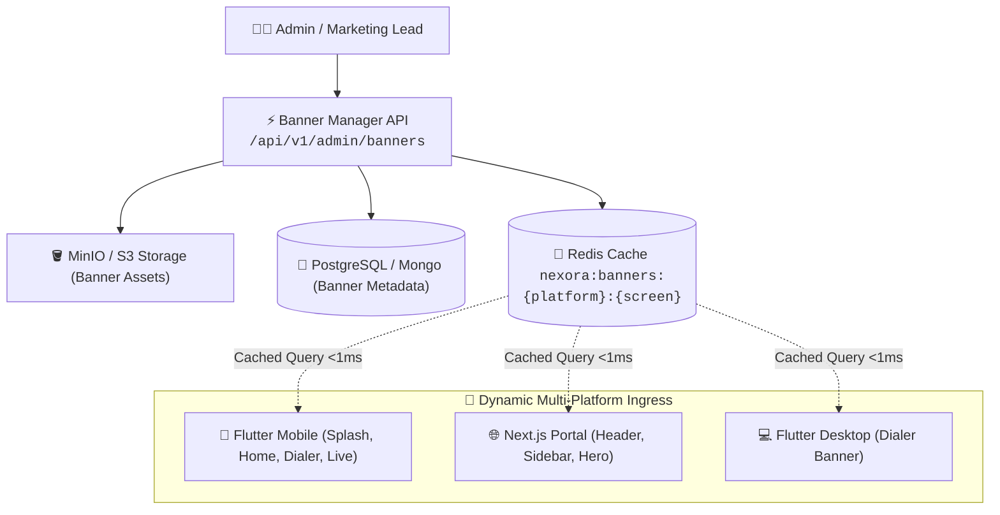
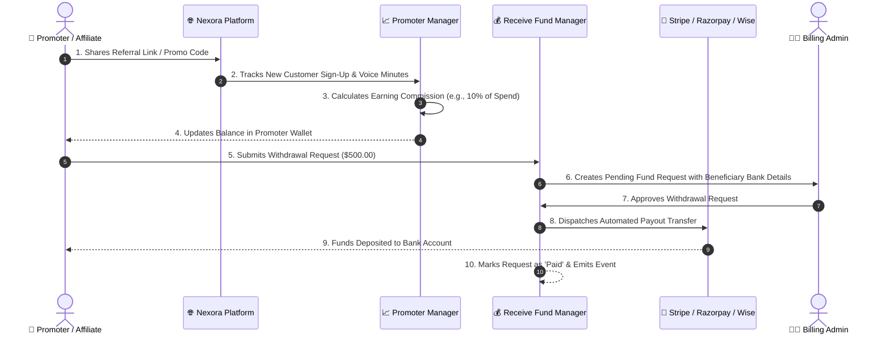
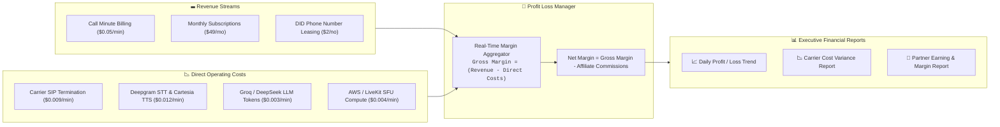
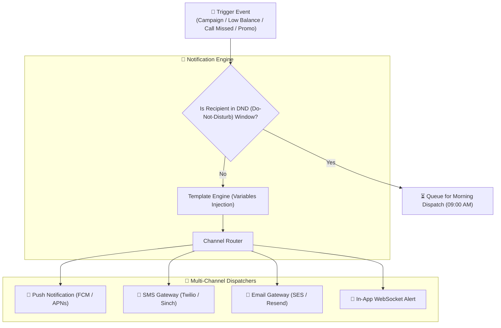
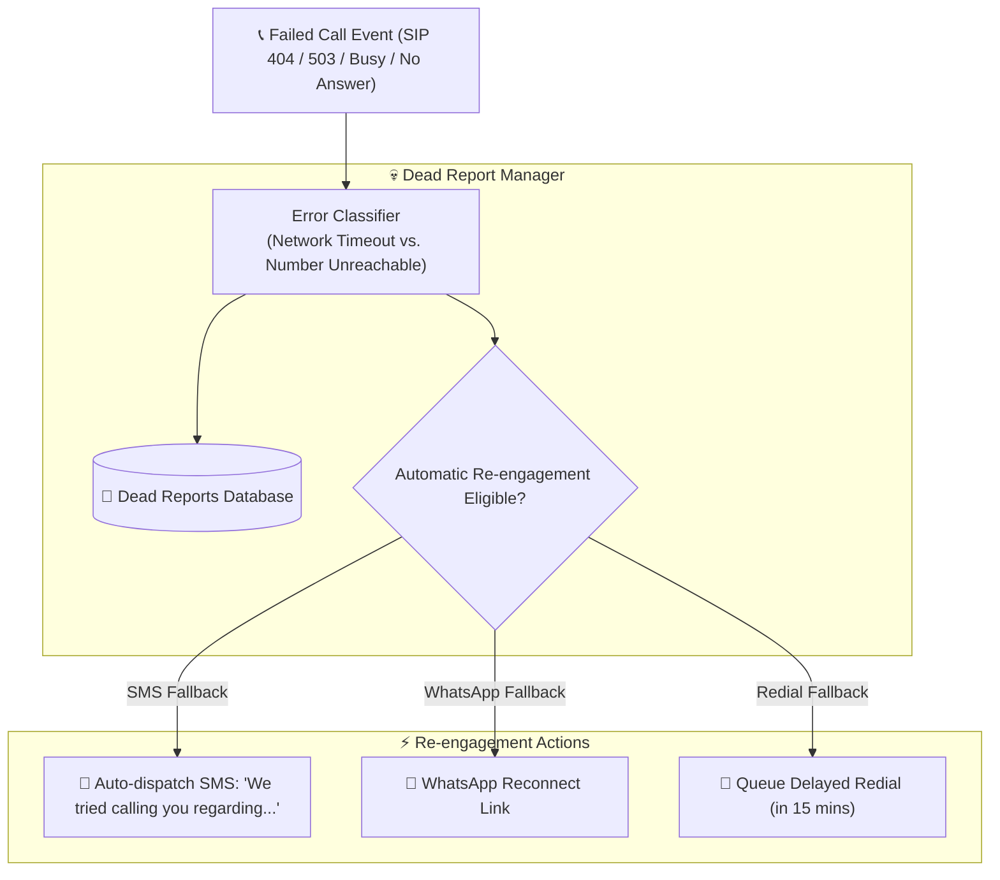
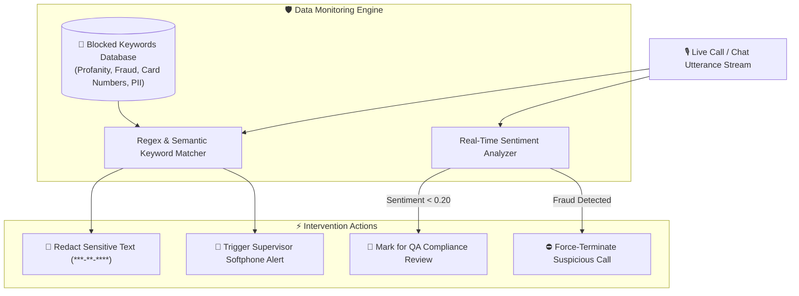

# 📊 Admin Operations & Management Diagrams Flow

This document details the architectural flows and data structures for the 9 core management modules:
1. **Banner Manager**
2. **Promoter Manager**
3. **Receive Fund Manager**
4. **Profit Loss Manager**
5. **Notifications Engine**
6. **Dead Report Manager**
7. **Data Monitoring & Block Keywords**
8. **Feedback & CSAT Review**
9. **General Tabs & Master Configuration**

---

## 1. Banner Management & Dynamic App Delivery Flow

---

## 2. Promoter, Affiliate & Payout Flow (`Promoter Manager` & `Receive Fund Manager`)

---

## 3. Real-Time Profit & Loss Analysis Engine (`Profit Loss Manager`)

---

## 4. Multi-Channel Notification Pipeline with DND Protection

---

## 5. Dead Report & Failed Call Re-Engagement Engine

---

## 6. Real-Time Data Monitoring & Keyword Blockage Pipeline

