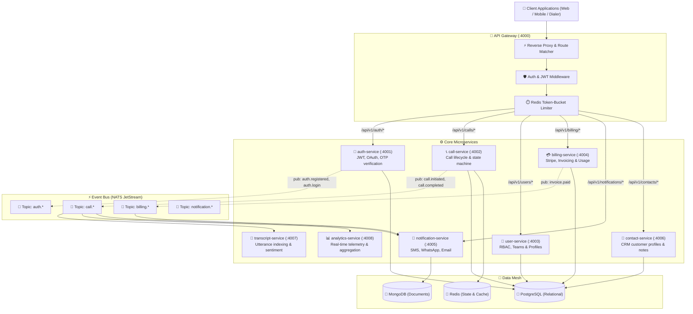

# ⚙️ Node.js Microservices Architecture & MVC Topology

All backend microservices in [`services/`](file:///d:/trideocoders/ai-telephony-platform/services) adhere to a strict **Model-View-Controller (MVC)** design pattern, powered by Express, TypeScript ESM, and `@nexora/*` foundation packages.

---

## 1. Microservices Interaction Topology



---

## 2. Strict Service MVC Directory Blueprint

Every microservice in `services/` is structured consistently:

```text
services/<microservice-name>/
├── src/
│   ├── controllers/       ── HTTP Request/Response handlers, status codes & validation
│   ├── routes/            ── Express Router definitions & URL paths
│   ├── services/          ── Pure business logic, external API calls & domain rules
│   ├── models/            ── Data access objects, in-memory stores & DB repositories
│   ├── middlewares/       ── Authentication, rate limiting, error handling & structured logging
│   ├── utils/             ── Helper methods, response formatters, crypto & token utilities
│   └── index.ts           ── Express application bootstrap & port listener
├── package.json           ── Workspace package metadata & dependencies
├── tsconfig.json          ── TypeScript compiler configuration (NodeNext)
└── dist/                  ── Compiled JavaScript output
```

---

## 3. Standard API Response Structure (`utils/response.ts`)

Every HTTP endpoint returns a unified standard envelope:

```typescript
// Success Response (HTTP 200 / 201 / 202)
export interface ApiResponse<T> {
  success: true;
  data: T;
  message?: string;
  statusCode: number;
}

// Error Response (HTTP 400 / 401 / 403 / 404 / 500)
export interface ApiErrorResponse {
  success: false;
  error: string;
  statusCode: number;
  details?: unknown;
}
```

---

## 4. NATS JetStream Event Taxonomy

```text
┌────────────────────────────────────────────────────────────────────────────────────────┐
│                              EVENT BUS TOPOLOGY (NATS)                                 │
├──────────────────────┬──────────────────────┬──────────────────────────────────────────┤
│ Event Subject        │ Source Service       │ Target Consumers                         │
├──────────────────────┼──────────────────────┼──────────────────────────────────────────┤
│ `call.initiated`     │ api-gateway          │ call-service, livekit-agent-pool         │
│ `call.ringing`       │ call-service         │ analytics-service, websocket-service     │
│ `call.in-progress`   │ call-service         │ analytics-service, transcript-service    │
│ `call.completed`     │ call-service         │ memory-agent, transcript-service, billing│
│ `call.failed`        │ call-service         │ notification-service, analytics-service  │
│ `auth.registered`    │ auth-service         │ notification-service (Welcome email)     │
│ `auth.otp.sent`      │ auth-service         │ sms-agent, audit-service                 │
│ `billing.invoice.paid`│ billing-service     │ notification-service, user-service       │
│ `mcp.tool.executed`  │ mcp-manager          │ audit-service, analytics-service         │
└──────────────────────┴──────────────────────┴──────────────────────────────────────────┘
```
