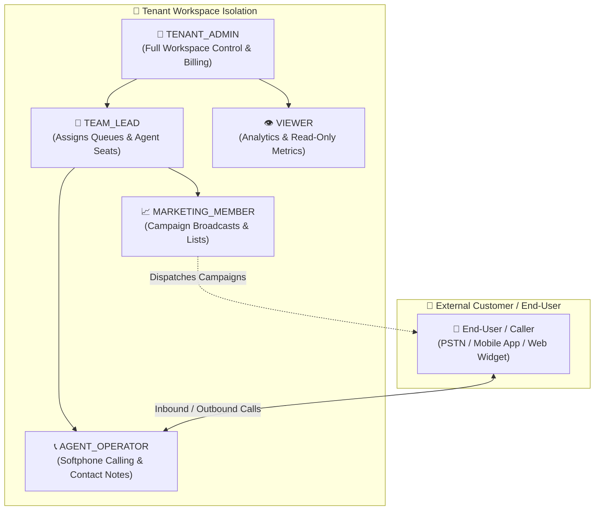
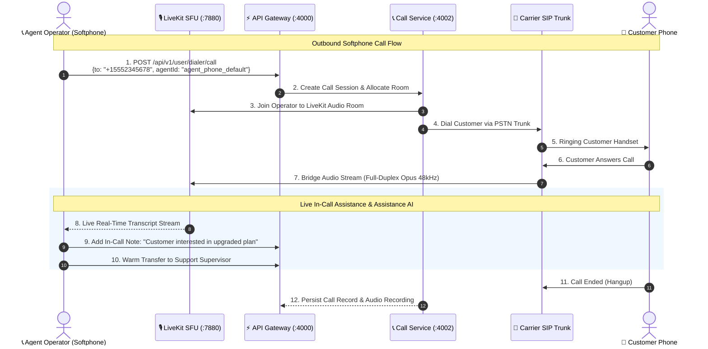
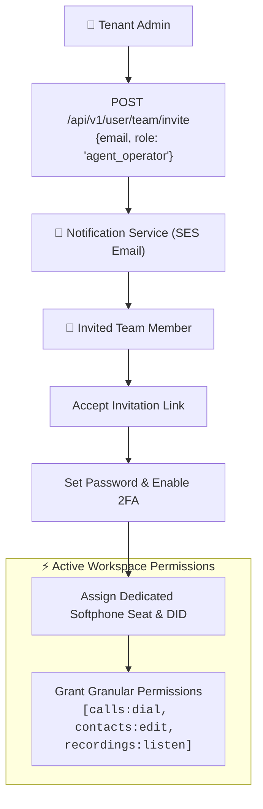
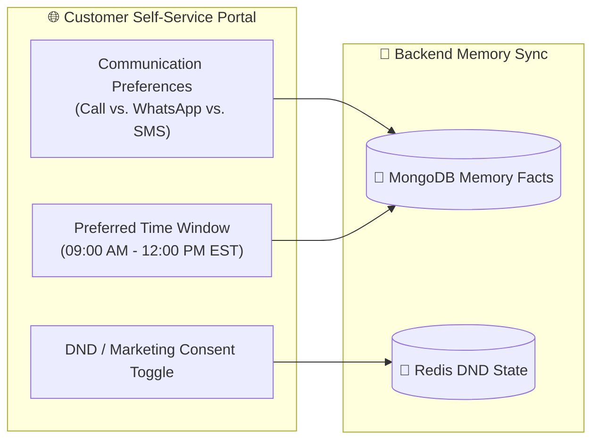

# 👤 User & Agent Operator Lifecycle Diagrams Flow

This document details the visual architecture, call dispatching loops, and data flows for **Tenant Admins**, **Agent Operators**, **Team Members**, and **End Users**.

---

## 1. User & Team Member Role Hierarchy in Workspace

---

## 2. Agent Operator Softphone Inbound & Outbound Calling Flow

---

## 3. Team Invitation & Dynamic RBAC Provisioning Flow

---

## 4. End-User Communication Preferences & Self-Service Flow

