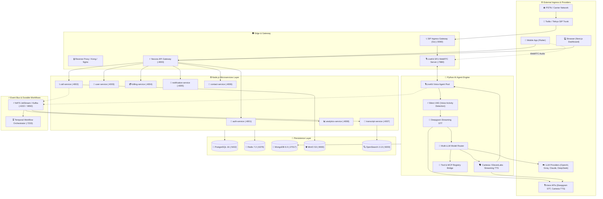
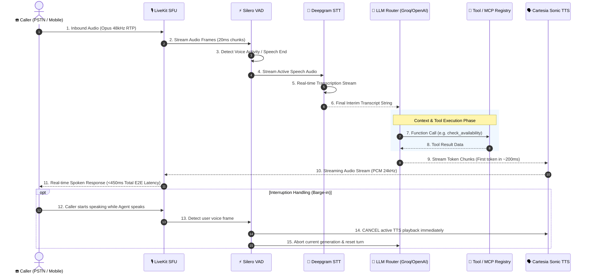

# 🏗️ Nexora System Architecture & Media Topology

---

## 1. High-Level Polyglot Architecture

Nexora is partitioned by **technical execution responsibilities**:
- **Go Engine**: Ultra-low-latency real-time RTP/SIP audio packet streaming and WebRTC media server integration.
- **Python AI Platform**: Multi-agent conversational intelligence, streaming VAD, STT (Deepgram), Multi-LLM routing, and TTS (Cartesia / ElevenLabs).
- **TypeScript / Node.js Microservices**: API routing, authentication, business rules, billing, database access, and event pub/sub.
- **Flutter Client**: Cross-platform mobile (Android, iOS) and desktop (Windows, macOS) communication dialer.
- **Next.js Portals**: Real-time management dashboards, analytics visualizations, and enterprise portals.

---

## 2. Real-Time Voice Audio Pipeline

---

## 3. Network Ports & Internal Service Matrix

| Service | Internal Host / DNS | Exposed Local Port | Protocol | Purpose |
| :--- | :--- | :--- | :--- | :--- |
| **API Gateway** | `nexora-api-gateway` | `4000` | HTTP / REST / WS | Edge routing, JWT validation, rate limiting |
| **Auth Service** | `nexora-auth-service` | `4001` | HTTP / REST | User registration, login, OTP dispatch, session tokens |
| **Call Service** | `nexora-call-service` | `4002` | HTTP / REST | Call lifecycle state machine, dialing triggers |
| **User Service** | `nexora-user-service` | `4003` | HTTP / REST | User profiles, organization teams, permissions |
| **Billing Service** | `nexora-billing-service` | `4004` | HTTP / REST | Invoices, Stripe subscriptions, wallet balances |
| **Notification Service** | `nexora-notification-service` | `4005` | HTTP / REST | SMS, WhatsApp, Email, Push dispatchers |
| **LiveKit Media SFU** | `nexora-livekit` | `7880, 7881` | WebRTC / TCP / UDP | Real-time audio conference bridge & streaming |
| **PostgreSQL** | `nexora-postgres` | `5432` | TCP (SQL) | Primary relational database + `pgvector` |
| **Redis** | `nexora-redis` | `6379` | RESP (In-Memory) | Cache, distributed locks, rate-limit buckets |
| **MongoDB** | `nexora-mongo` | `27017` | BSON / TCP | Conversation memory, semi-structured agent state |
| **NATS JetStream** | `nexora-nats` | `4222, 8222` | TCP / HTTP Monitoring | Event bus and streaming pub/sub |
| **Apache Kafka** | `nexora-kafka` | `9092` | TCP (Binary) | High-throughput telemetry and transcript streaming |
| **OpenSearch** | `nexora-opensearch` | `9200` | HTTP / JSON | Transcript full-text search and RAG embeddings |
| **MinIO (S3)** | `nexora-minio` | `9000, 9001` | HTTP / S3 API | Audio recording WAV/MP3 storage & asset uploads |
| **Temporal Engine** | `nexora-temporal` | `7233, 8088` | gRPC / HTTP Web UI | Durable long-running workflow orchestration |
| **HashiCorp Vault** | `nexora-vault` | `8200` | HTTP / REST | Production secrets management & API keys |
