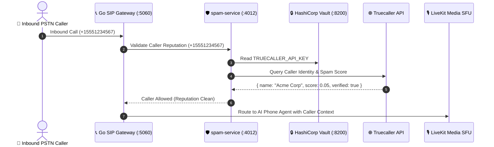

# 📞 Truecaller Intelligence & Caller Identity Integration Specification

This document details the external caller identity verification and reputation scoring architecture integrating with Truecaller Developer and Truecaller for Business APIs.

---

## 1. Integration Scope & Security

Nexora integrates with Truecaller services to provide:
1. **Caller Identity**: Name, profile verification, and business badge lookup during inbound calls.
2. **Phone Number Verification**: Instant user profile verification with user consent.
3. **Reputation Signals**: Verified business caller-ID and spam reputation scoring where enabled.

> [!IMPORTANT]
> Truecaller API credentials must NEVER be stored in client applications (Flutter, Next.js). All requests are proxied securely through the backend `spam-service` using credentials retrieved dynamically from HashiCorp Vault.

---

## 2. Architecture & Call Ingress Flow



---

## 3. Configuration & Vault Keys

```env
TRUECALLER_CLIENT_ID=
TRUECALLER_APP_KEY=
TRUECALLER_API_KEY=
TRUECALLER_API_SECRET=
TRUECALLER_BASE_URL=https://api4.truecaller.com/v1
```
