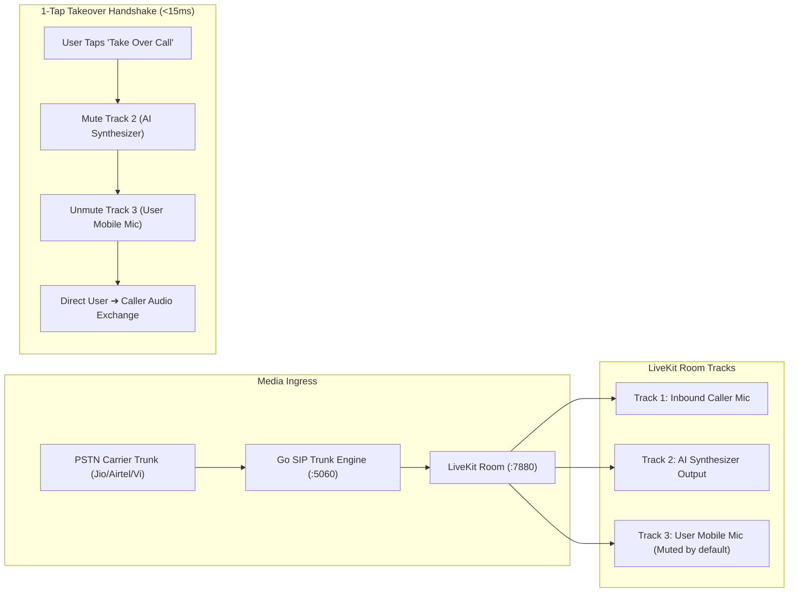

# ⚙️ Technical Requirements Document (TRD) — Nexora AI Platform

---

## 1. Technical Architecture & Protocols

| Component | Technical Implementation & Protocol | Port / Protocol | Target SLA |
| :--- | :--- | :--- | :--- |
| **SIP Telephony Ingress/Egress** | Go SIP Stack (`pion/sip` / `livekit-sip`) | `:5060` UDP/TCP, `:5061` TLS | < 50ms SIP INVITE handling |
| **Media Server (SFU)** | LiveKit WebRTC Server (Opus 48kHz / G.711 / AMR-WB) | `:7880` HTTP/WS, `:7881` RTC | < 80ms acoustic latency |
| **Streaming STT** | Deepgram Nova-2 WebRTC / WebSocket Client | WSS Streaming | < 120ms Time-to-First-Word |
| **Streaming TTS** | Cartesia Sonic / ElevenLabs Turbo v2.5 / Deepgram Aura | HTTP/2 Chunked Audio | < 90ms Time-to-First-Audio |
| **API Gateway** | Node.js Express + TypeScript + Redis Rate Limiter | `:4000` HTTP/REST | < 25ms P99 API response |
| **Event Streaming Bus** | NATS JetStream + Redis Streams | `:4222` NATS, `:6379` Redis | < 5ms event propagation |
| **Mobile Client** | Flutter 3.x (Clean Architecture, Riverpod/Provider) | Mobile WebRTC / Dio | 60fps UI rendering |

---

## 2. Low-Latency Takeover & Audio Bridge Technical Specification

---

## 3. Carrier Failure Mitigation Architecture

To eliminate the 30.4% – 42.6% call forwarding audio drop rates observed on major Indian carriers:
1. **Anycast STUN/TURN Media Relay**: Auto-negotiate ICE candidates across multi-region edge nodes, eliminating asymmetric NAT audio loss.
2. **Dynamic Jitter Buffer Adaptation**: Real-time jitter buffer sizing between 20ms and 80ms based on RTCP packet loss statistics.
3. **Out-of-Band DTMF Transcoding**: Convert RFC 2833 / RFC 4733 telephony events directly into clean DTMF tone packets for reliable IVR traversal.
4. **Zero-Drop Failover Trunks**: Dynamic fallback from primary regional DID to secondary backup DID if SIP 180 Ringing is not received within 3.5 seconds.
