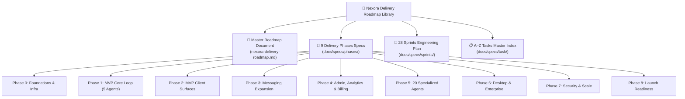

# 🚀 Nexora Delivery Roadmap Specifications Directory

This directory provides the definitive engineering roadmap, phase specifications, sprint engineering plans, and component indexes for the **Nexora AI Telephony & Communication Platform**.

---

## 📑 Roadmap Documents Index

| Specification Document | Focus & Key Contents |
| :--- | :--- |
| [**`nexora-delivery-roadmap.md`**](./nexora-delivery-roadmap.md) | Complete Delivery Roadmap: 9 phases, 28 two-week sprint engineering plans, milestone targets (Phase 2 MVP, Phase 4 SaaS v1, Phase 8 GA Enterprise), key architectural risks, and Master A–Z component index. |

---

## 🧭 Delivery Phases & Sprints Hierarchy

