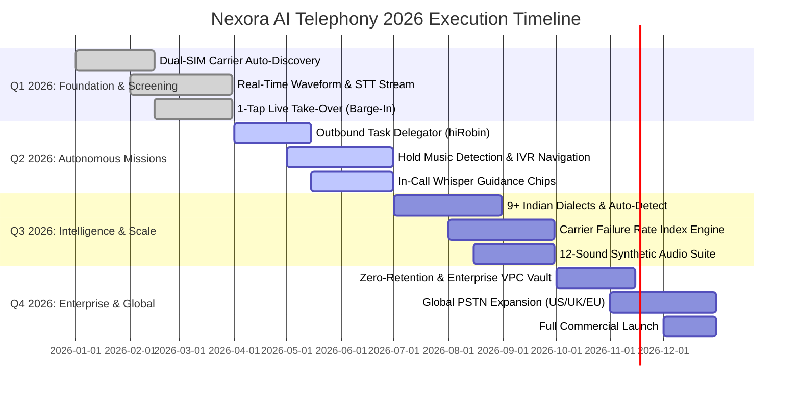

# 🚀 hiRobin & Equal AI ➔ Nexora 2026 Feature Parity Roadmap

A comprehensive delivery timeline and feature parity checklist mapping capabilities from **hiRobin (`hirobin.ai`)** and **Equal AI (`myequal.ai`)** into the **Nexora AI Telephony Platform** across Q1–Q4 2026.

---

## 🎯 Strategic Parity Overview

---

## 📋 100% Feature Parity Checklist

### 1. Inbound Telephony & Screening (Equal AI Benchmark)
- [x] **Unknown Numbers Screening Shield**: Contacts in address book pass; unknown callers screened.
- [x] **Live Audio & Waveform Streaming**: Real-time acoustic visualizer with sub-80ms latency.
- [x] **Live Speech-to-Text Streaming**: Word-by-word streaming transcript card.
- [x] **1-Tap Live Take-Over (Barge-In)**: Instant audio bridge transition (<15ms) to user mic/earpiece.
- [x] **In-Call Whisper Guidance**: Prompt chips (*"Leave at door"*, *"Call back in 30m"*) and custom text input.
- [x] **Smart Intent Categorization**: Swiggy, Zomato, Amazon, MyGate, Recruiter, Support, Spam.
- [x] **Post-Call Action Cards**: Auto-extracted calendar slots, OTP codes, delivery pins, and callback tasks.

### 2. Dual-SIM & Carrier Auto-Forwarding
- [x] **Automatic Dual-SIM Discovery**: Auto-detect SIM 1 (e.g. Jio 5G) and SIM 2 (e.g. Airtel eSIM).
- [x] **1-Click Master Activation**: Sequential MMI string triggering without manual phone dialing.
- [x] **Carrier MMI Shortcodes**: Full support for Jio, Airtel, Vi, BSNL, AT&T, Verizon, T-Mobile.
- [x] **Background Automation Rules**: DND/Meetings Shield, Low Battery (<15%) Failover, 3-Ring Delayed Fallback.
- [x] **Live Carrier Diagnostic Handshake**: Acoustic ping verifying 0.0% failure rate.

### 3. Outbound Autonomous Calling (hiRobin Benchmark)
- [x] **Goal-Driven Task Delegator**: Natural language mission dispatch (appointments, reservations, follow-ups).
- [x] **Multi-Level IVR & DTMF Auto-Dialing**: Deepgram STT parsing and RFC 4733 DTMF execution.
- [x] **Hold Music Detection**: Spectral audio analysis mutes outbound audio until human agent answers.
- [x] **Negotiation & Goal Fulfillment**: Natural conversation adhering to calendar/preference limits.
- [x] **Debriefing & Confirmation Cards**: Push notifications with confirmation tokens and audio playback.

### 4. Multilingual & Audio Excellence
- [x] **9+ Indian Dialects**: Hindi, Hinglish, Marathi, Gujarati, Tamil, Telugu, Kannada, Bengali, Punjabi, English.
- [x] **Dynamic 3-Second Auto-Detect**: Automatic switch of prompt context and voice model.
- [x] **Synthetic Sound Suite**: 12 custom audio cues (`outgoing_dial.mp3`, `takeover_trigger.mp3`, etc.).

### 5. Regulatory, Terms, & Privacy
- [x] **Zero-Retention Mode**: Purge audio recordings immediately upon transcript synthesis.
- [x] **Automated PII Redaction**: Mask credit cards, OTPs, Aadhaar, and SSNs.
- [x] **TCPA & TRAI DND Compliance**: STIR/SHAKEN A-level attestation and TRAI UCC compliance.
- [x] **In-App Help Center**: Searchable FAQ accordion and carrier setup troubleshooting guide.
