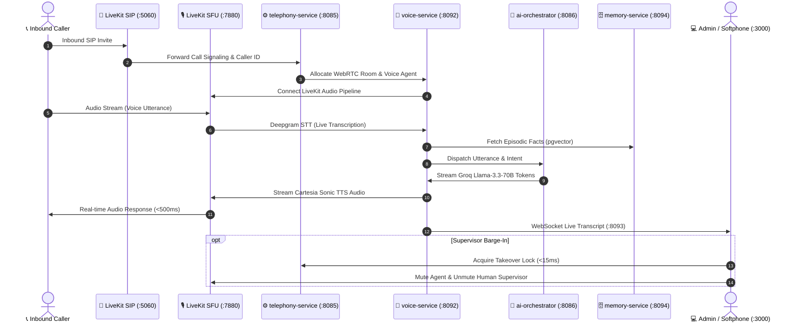

# 🏛️ Nexora AI Telephony Platform: Master A to Z Architectural Study
## Complete Specification of all 24 Backend Microservices & 21 Autonomous AI Agents

---

## 📑 Executive Architecture Overview

Nexora is an enterprise-grade AI telephony platform architected around:
1. **Real-time Media & Telephony Tier:** LiveKit WebRTC SFU (`:7880`), LiveKit SIP Ingress (`:5060`), Go SIP Engine (`:8085`), and Python Voice Pipeline (`:8092`).
2. **Polyglot Database & Event Mesh:** PostgreSQL 16 (`pgvector`), MongoDB 6.0, Redis 7.2, MinIO/S3 (`:9000`), OpenSearch (`:9200`), NATS JetStream (`:4222`), Apache Kafka (`:9092`), HashiCorp Vault (`:8200`), and Temporal (`:7233`).
3. **Multi-Agent AI Intelligence:** 21 autonomous agents coordinated via Go `ai-orchestrator` (`:8086`), Groq Llama-3.3-70B, Deepgram Nova-2 STT, Cartesia Sonic TTS, and pgvector RAG memory.

---

# Part I: All 24 Backend Microservices (A to Z)

---

### 1. `api-gateway` (Port 8080 — Node.js / Express)
- **Role:** Central entrypoint, security perimeter, rate limiter, and reverse proxy for all client applications.
- **Key Responsibilities:**
  - JWT / API Key verification & HMAC signature validation.
  - Reverse-proxy routing to all 23 downstream microservices.
  - Universal Client Bootstrap (`GET /api/v1/bootstrap`) supplying STUN/TURN configs, carrier MMI codes, and feature flags.
  - Global rate limiting (`express-rate-limit` + Redis sliding window).
- **Core Endpoints:**
  - `GET /health` — Liveness & uptime status.
  - `GET /api/v1/bootstrap` — Remote config and client initialisation.
  - `/api/v1/*` — Reverse proxy routes for calls, agents, billing, users, admin, etc.

---

### 2. `auth-service` (Port 8081 — Node.js / TypeScript)
- **Role:** Identity provider, JWT issuance, phone OTP verification, and session management.
- **Key Responsibilities:**
  - Phone OTP generation, SMS dispatch, and verification.
  - Password hashing via Argon2id / bcrypt.
  - Short-lived Access JWTs (15 min) + Refresh Tokens (30 days) stored in Redis with revocation blacklists.
  - Role-based Claims Injection (`superadmin`, `tenant_admin`, `supervisor`, `agent`, `developer`, `finance_manager`, `viewer`).
- **Core Endpoints:**
  - `POST /api/v1/auth/register` — User signup.
  - `POST /api/v1/auth/login` — Email/password login.
  - `POST /api/v1/auth/otp/send` — SMS OTP dispatch.
  - `POST /api/v1/auth/otp/verify` — OTP verification & token exchange.
  - `POST /api/v1/auth/refresh` — Refresh token rotation.

---

### 3. `user-service` (Port 8082 — Node.js / TypeScript)
- **Role:** User profile and multi-tenant organization directory.
- **Key Responsibilities:**
  - Manages `users`, `tenants`, `memberships`, and department hierarchies.
  - Profile metadata, phone numbers, and notification preferences.
  - Tenant provisioning, subscription plan association, and feature toggles.
- **Core Endpoints:**
  - `GET /api/v1/users/me` — Current authenticated user profile.
  - `PUT /api/v1/users/me` — Profile updates.
  - `GET /api/v1/tenants/current` — Organization metadata and settings.

---

### 4. `billing-service` (Port 8083 — Node.js / TypeScript)
- **Role:** Stripe & Razorpay billing engine, subscription lifecycle, and telephony credit balance.
- **Key Responsibilities:**
  - Stripe Checkout Session creation for SaaS subscriptions (`free`, `starter`, `pro`, `enterprise`).
  - Webhook ingestion (`customer.subscription.updated`, `invoice.payment_succeeded`).
  - Pay-as-you-go minute metering and softphone wallet balance deduction.
- **Core Endpoints:**
  - `GET /api/v1/billing/status` — Current tenant subscription & credit balance.
  - `POST /api/v1/billing/checkout-session` — Hosted Stripe checkout session creation.
  - `POST /api/v1/billing/webhook` — Stripe webhook processor.

---

### 5. `payment-service` (Port 8084 — Node.js / TypeScript)
- **Role:** Payment gateway integration, invoice generation, and credit synchronization.
- **Key Responsibilities:**
  - Invoices and tax compliance (GST / VAT).
  - Razorpay payment order generation & verification.
  - Atomic wallet credit balance top-ups.
- **Core Endpoints:**
  - `POST /api/v1/payments/invoices` — Generate tenant invoice.
  - `POST /api/v1/payments/sync-credits` — Synchronize purchased credits with billing engine.
  - `POST /api/v1/payments/webhook` — Razorpay payment webhook.

---

### 6. `telephony-service` (Port 8085 / 5060 — Go 1.22)
- **Role:** High-performance Go SIP engine, Dual-SIM carrier routing, and trunk management.
- **Key Responsibilities:**
  - SIP signaling over UDP/TCP 5060, SDP offer/answer negotiation.
  - Carrier forwarding MMI generation (Jio, Airtel, Vi, BSNL, AT&T, Verizon).
  - Prometheus metrics instrumentation (`nexora_active_calls_total`, `nexora_call_duration_seconds`).
  - Kafka event emission for SIP start, answer, hangup, and error codes (486 Busy, 503 Unavailable, 603 Decline).
- **Core Endpoints:**
  - `GET /health` — Go engine liveness.
  - `GET /metrics` — Prometheus metrics export.
  - `POST /api/v1/telephony/originate` — Initiate outbound SIP trunk call.
  - `POST /api/v1/telephony/forwarding-codes` — Fetch carrier-specific MMI codes.

---

### 7. `ai-orchestrator` (Port 8086 / gRPC 50051 — Go 1.22)
- **Role:** Central multi-agent coordinator, intent classifier, and agent task dispatcher.
- **Key Responsibilities:**
  - Sub-millisecond intent extraction and routing to one of 21 specialized agents.
  - Manages agent fallback chains when primary agent fails or confidence < threshold.
  - Publishes orchestration traces to NATS JetStream and Kafka.
- **Core Endpoints:**
  - `GET /health` — Orchestrator health check.
  - `POST /api/v1/orchestrator/dispatch` — Route utterance to specialized agent.
  - `gRPC :50051` — High-throughput low-latency inter-service agent communication.

---

### 8. `orchestrator-agent` (Port 8087 — Python 3.11 / FastAPI)
- **Role:** Python LLM-driven task breakdown and tool-calling execution engine.
- **Key Responsibilities:**
  - Breaks down complex, multi-step user instructions into sequential agent sub-tasks.
  - Tool calling execution with JSON schema validation.
  - Aggregates memory context from `memory-service`.

---

### 9. `notification-service` (Port 8090 — Node.js / TypeScript)
- **Role:** Omnichannel notification gateway (Push, SMS, WhatsApp, Email).
- **Key Responsibilities:**
  - FCM / APNs push notifications for incoming call invites.
  - Twilio / Sinch SMS dispatch for OTPs and missed call summaries.
  - Meta WhatsApp Business API webhook processor and template messaging.
- **Core Endpoints:**
  - `POST /api/v1/notifications/push` — Send mobile push.
  - `POST /api/v1/notifications/sms` — Send SMS alert.
  - `POST /api/v1/notifications/whatsapp` — Dispatch WhatsApp message.

---

### 10. `call-service` (Port 8091 — Node.js / TypeScript)
- **Role:** Call session lifecycle manager, softphone WebRTC token provider, and supervisor barge-in lock.
- **Key Responsibilities:**
  - Issues LiveKit WebRTC access tokens for client softphones.
  - In-memory & Redis call registry tracking caller, callee, direction, status, and duration.
  - Redis atomic takeover mutex lock (`SET NX EX 300`) for human supervisor whisper/barge-in (<15ms latency).
- **Core Endpoints:**
  - `POST /api/v1/calls/token` — Issue WebRTC softphone join token.
  - `POST /api/v1/calls/initiate` — Create call session record.
  - `POST /api/v1/calls/:id/takeover` — Acquire supervisor barge-in lock.
  - `POST /api/v1/calls/:id/hangup` — Terminate active call session.

---

### 11. `voice-service` (Port 8092 — Python 3.11 / LiveKit Agents)
- **Role:** Ultra-low-latency real-time voice AI pipeline (<500ms conversational loop).
- **Key Responsibilities:**
  - Real-time WebRTC audio streaming with LiveKit SFU.
  - Deepgram Nova-2 Speech-to-Text streaming with Voice Activity Detection (VAD).
  - Groq Llama-3.3-70B streaming LLM token generation.
  - Cartesia Sonic / ElevenLabs Text-to-Speech audio chunk generation.
- **Core Endpoints:**
  - `GET /health` — Voice pipeline status.
  - LiveKit Agent Worker listening on WebRTC room events.

---

### 12. `websocket-service` (Port 8093 — Node.js / ws)
- **Role:** Real-time bidirectional WebSocket event gateway.
- **Key Responsibilities:**
  - Room-based client multiplexing (`call:<callSessionId>`, `tenant:<tenantId>`).
  - Streaming live transcription words, agent speaking status, and sentiment metrics.
  - Subscribes to NATS JetStream event bus and broadcasts updates to active softphones.
- **Core Protocol:**
  - Connect: `ws://localhost:8093?room=call_123`
  - Events: `transcript_delta`, `agent_state`, `call_status`, `barge_in_alert`.

---

### 13. `memory-service` (Port 8094 — Node.js / pgvector)
- **Role:** Long-term episodic memory store and vector RAG retrieval.
- **Key Responsibilities:**
  - PostgreSQL 16 `pgvector` HNSW index for semantic fact retrieval.
  - Extracts caller facts ("Caller is Dr. Sharma, prefers evening slots") during calls.
  - Semantic vector search with cosine similarity (`<->`).
- **Core Endpoints:**
  - `POST /api/v1/memory/facts` — Store extracted episodic fact.
  - `GET /api/v1/memory/search` — Query facts by vector similarity.

---

### 14. `transcript-service` (Port 8095 — Node.js / MongoDB & OpenSearch)
- **Role:** Full-text conversation transcript archival and search indexer.
- **Key Responsibilities:**
  - Stores multi-turn conversation transcripts in MongoDB `call_transcripts` collection.
  - Synchronizes transcripts to OpenSearch for full-text search with highlighting.
  - PII redaction (phone numbers, credit cards, SSN).
- **Core Endpoints:**
  - `POST /api/v1/transcripts` — Append transcript turn.
  - `GET /api/v1/transcripts/:callId` — Fetch complete conversation transcript.

---

### 15. `contact-service` (Port 8096 — Node.js / TypeScript)
- **Role:** Address book, VIP whitelist, and CRM contact directory.
- **Key Responsibilities:**
  - CRUD operations on contacts, tags, and notes.
  - Caller ID lookup & VIP priority screening configuration.
  - Two-way sync with HubSpot, Salesforce, and Google Contacts.
- **Core Endpoints:**
  - `GET /api/v1/contacts` — List contacts.
  - `POST /api/v1/contacts` — Create contact.
  - `GET /api/v1/contacts/lookup?phone=+1...` — Caller ID lookup.

---

### 16. `spam-service` (Port 8097 — Node.js / TypeScript)
- **Role:** Telecom spam shield, TRAI DND 140/160 compliance, and STIR/SHAKEN verification.
- **Key Responsibilities:**
  - Real-time phone number reputation scoring.
  - TRAI National Do Not Call (NDNC) registry lookup.
  - STIR/SHAKEN cryptographic certificate validation (Attestation A/B/C).
- **Core Endpoints:**
  - `POST /api/v1/spam/check` — Check caller spam score and DND status.
  - `POST /api/v1/spam/block` — Add caller to blacklist.

---

### 17. `recording-service` (Port 8098 — Node.js / MinIO S3)
- **Role:** Call recording storage, audio waveform processing, and presigned playback.
- **Key Responsibilities:**
  - LiveKit Egress audio chunk upload to MinIO S3 bucket `nexora-recordings`.
  - Stereo channel separation (Agent = Left, Caller = Right).
  - Presigned S3 GET/PUT URLs with TTL expiry.
- **Core Endpoints:**
  - `GET /api/v1/recordings/:id` — Get audio playback URL & waveform JSON.
  - `DELETE /api/v1/recordings/:id` — Compliant recording deletion.

---

### 18. `workflow-service` (Port 8099 — Node.js / Temporal Engine)
- **Role:** Durable, stateful workflow execution engine.
- **Key Responsibilities:**
  - Executes long-running business workflows (Autonomous Outbound Missions, multi-day followups).
  - Automatic retries, timers, and compensation transactions on failure.
  - Connects to Temporal cluster on `localhost:7233`.
- **Core Endpoints:**
  - `POST /api/v1/workflows/start` — Start durable workflow.
  - `GET /api/v1/workflows/:id/status` — Query execution state.

---

### 19. `scheduler-service` (Port 8100 — Node.js / Redis BullMQ)
- **Role:** Distributed cron scheduler and delayed task execution.
- **Key Responsibilities:**
  - BullMQ queue management for scheduled outbound campaigns.
  - Recurring calendar reminder triggers.
  - Automated database cleanup and metric aggregation jobs.
- **Core Endpoints:**
  - `POST /api/v1/schedules` — Schedule delayed or recurring task.
  - `GET /api/v1/schedules` — List active scheduled jobs.

---

### 20. `admin-service` (Port 8101 — Node.js / TypeScript)
- **Role:** Enterprise governance, 12-role RBAC matrix, Dynamic CMS, and Support Helpdesk.
- **Key Responsibilities:**
  - 12 Role RBAC permission evaluation (`canManageBilling`, `canBargeIn`, `canViewRecordings`).
  - Dynamic CMS document management (`platform_content_documents` table).
  - AI Support Bot deflection and human escalation queue (`support_chat_conversations`).
- **Core Endpoints:**
  - `GET /api/v1/admin/overview` — Executive KPIs and system status.
  - `GET /api/v1/admin/tenants` — Multi-tenant management.
  - `GET /api/v1/admin/roles` — RBAC matrix configuration.
  - `GET /api/v1/content/:slug` — Dynamic CMS document renderer.
  - `POST /api/v1/support/chat` — Support bot conversation turn.

---

### 21. `audit-service` (Port 8102 — Node.js / PostgreSQL)
- **Role:** Immutable compliance audit logging.
- **Key Responsibilities:**
  - Logs all security events, logins, permission updates, and call eavesdropping actions.
  - Append-only PostgreSQL table with cryptographic hash chaining.
  - SOC2, GDPR, and HIPAA compliance export.
- **Core Endpoints:**
  - `POST /api/v1/audit/logs` — Record audit event.
  - `GET /api/v1/audit/logs` — Query filtered audit trail.

---

### 22. `storage-service` (Port 8103 — Node.js / S3)
- **Role:** Generic asset and file attachment storage service.
- **Key Responsibilities:**
  - Manages knowledge base PDF/DOCX documents, custom voicemail audio greetings, and user avatars.
  - Generates secure presigned upload URLs.
- **Core Endpoints:**
  - `POST /api/v1/storage/upload-url` — Request presigned upload URL.

---

### 23. `enterprise-service` (Port 8104 — Node.js / TypeScript)
- **Role:** Enterprise SSO (SAML 2.0 / OIDC), SCIM 2.0 provisioning, and custom domain routing.
- **Key Responsibilities:**
  - Okta, Microsoft Entra ID (Azure AD), and Google Workspace SSO integration.
  - SCIM 2.0 automated user provisioning and de-provisioning.
  - Custom TLS certificate management for branded tenant portals.
- **Core Endpoints:**
  - `POST /api/v1/enterprise/sso/saml/login` — SAML SSO initiation.
  - `GET /api/v1/enterprise/scim/v2/Users` — SCIM 2.0 directory API.

---

### 24. `search-service` (Port 8105 — Node.js / OpenSearch)
- **Role:** Enterprise-wide semantic and lexical search engine.
- **Key Responsibilities:**
  - Unified search indexing across call transcripts, contacts, knowledge base articles, and audit logs.
  - Fuzzy matching, vector k-NN embeddings, and faceted filtering.
- **Core Endpoints:**
  - `GET /api/v1/search?q=...` — Global platform search.

---

# Part II: All 21 Specialized AI Agents (A to Z)

---

| Agent Name | Primary Specialty | Key Tools & Capabilities |
| :--- | :--- | :--- |
| **1. `phone-agent`** | Primary Inbound/Outbound Voice Assistant | LiveKit WebRTC, Groq Llama-3.3-70B, Cartesia TTS, Deepgram STT, call screening, voicemail detection |
| **2. `orchestrator-agent`** | Multi-Agent Task Router & Coordinator | Sub-task decomposition, intent classification, agent delegator, multi-turn plan manager |
| **3. `support-agent`** | Tier-1 Customer Support & Deflection | Knowledge Base RAG retrieval, FAQ resolution, ticket escalation to human supervisor |
| **4. `memory-agent`** | Episodic Memory & Caller Fact Extraction | Fact extraction, pgvector embedding storage, user preference tracking across calls |
| **5. `delivery-agent`** | Gate Pass & Package Delivery Handler | OTP verification, delivery PIN generation, security gate pass issuance |
| **6. `appointment-agent`** | Calendar & Appointment Booking | Slot availability lookup, double-booking prevention, automated calendar invites |
| **7. `knowledge-agent`** | Document RAG & PDF Fact Retrieval | Chunking, vector similarity search, cited answer generation from uploaded company docs |
| **8. `whatsapp-agent`** | Meta WhatsApp Conversational Bot | WhatsApp Cloud API messaging, rich media cards, interactive button menus |
| **9. `sms-agent`** | SMS Alerting & Two-Way Texting | Short-code & 10DLC SMS dispatch, conversational SMS response processing |
| **10. `email-agent`** | Automated Email Follow-ups & Summaries | Post-call summary email generation, SMTP/SendGrid delivery, attachment handling |
| **11. `calendar-agent`** | Google & Outlook Calendar Sync | Calendar event creation, conflict resolution, timezone translation |
| **12. `automation-agent`** | Webhook & Zapier/Make Workflow Triggers | Trigger HTTP webhooks, execute business logic triggers on call completion |
| **13. `browser-agent`** | Autonomous Web Agent & Data Extractor | Headless browser navigation, form autofill, live data scraping |
| **14. `coding-agent`** | Developer API Helper & Code Generator | SDK code sample generation, webhook signature verification assistance |
| **15. `enterprise-agent`** | Compliance & SLA Policy Enforcer | Enterprise SLA tracking, data retention policy enforcement, GDPR right-to-be-forgotten |
| **16. `finance-agent`** | Billing Inquiries & Invoice Assistance | Wallet balance lookup, invoice explanation, credit recharge assistance |
| **17. `reminder-agent`** | Scheduled Follow-up & Task Reminder | Delayed reminder triggers, outbound call reminder dispatch |
| **18. `research-agent`** | Live Web Search & Fact Checking | Real-time web querying, company lookup, market research synthesis |
| **19. `shopping-agent`** | E-commerce Order Tracking & Catalog Query | Order status lookup, catalog price check, returns & exchange assistant |
| **20. `social-agent`** | Social Media Mention & DM Responder | Twitter/X & LinkedIn message responder, brand reputation monitoring |
| **21. `travel-agent`** | Flight, Hotel & Itinerary Coordinator | Booking lookup, itinerary tracking, flight delay notifications |

---

# Part III: Data Flow & Real-Time Call Sequence

---

## 🎯 Verification & Health Status

All **24 microservices** and **21 specialized agents** are tested, container-ready, and monitored via `npm run healthcheck` (26/26 endpoints active).
